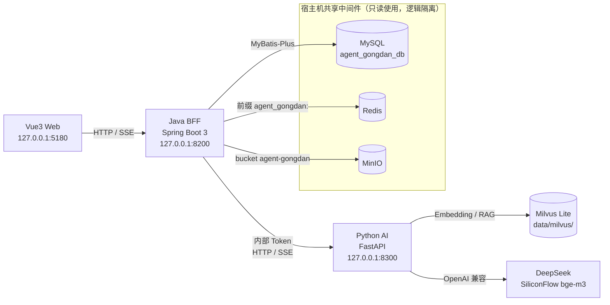

# IT 运维工单智能 Agent（agent-gongdan）

> 面向 IT 运维与物业场景的工单全生命周期智能平台：对话式报障、智能分诊、RAG 知识问答、相似工单、Agent 工具调用与人工确认闭环。

当前版本处于 **Phase 1（原型稳定运行）**：认证、工单、知识库、AI 对话、分诊草稿、Agent 工具、相似工单、通知、工单 AI 分析与轻量降级已跑通；子 Agent 已完成 P0–P6.1 及主 Agent 接入 P0 整改（Manifest 0.8.0、端口必填、health/ready、确认同意/拒绝、按 clientTaskId 恢复、事件 seq/afterSeq/Last-Event-ID）；报表、系统管理、完整台账等 P1/P2 能力待接入。

---

## 核心特性

| 能力 | 说明 |
|---|---|
| 对话式报障 | 多轮自然语言对话，POST SSE 流式输出，支持引用与工具调用时间线 |
| 人在回路 | 高风险建单只生成草稿，必须用户确认后才落库；工单流转保留人工确认 |
| 智能分诊 | 意图/实体/置信度/优先级/工单草稿；Python 不可用时由 Java 规则分诊兜底 |
| RAG 知识问答 | Markdown/TXT 入库、分块、Embedding、Milvus Lite 检索、引用可下载 |
| Agent 工具 | 查单、工单详情、相似工单、知识检索、建单草稿；工具调用全量审计 |
| 工单闭环 | 建单、筛选、派单、接单、挂起/恢复、解决、验证、关闭、一键结束 |
| 工单 AI 分析 | 知识检索 + LLM 结构化建议 + 风险等级 + 引用留存 |
| 智能导出 | 列表按时间范围导出 16 列 Excel；AI 助手可用自然语言指定时间/类型，确认后生成下载文件 |
| 可靠降级 | 自研轻量熔断器、半开自愈、规则分诊、前端转表单、RAG 空结果降级 |
| 有界任务拆解 | SSE `plan` / `step` 事件；幂等只读工具瞬时失败重试，非幂等工具不重试 |
| 工具执行性能 | 同一步骤内幂等工具并发执行；单工具超时按 `ToolSpec` 生效；Java 错误分级避免无效重试 |
| 工单写工具 | 对话侧支持派单/接单/解决/验证/关闭/取消/挂起/恢复/结束/评论/材料/回访，全部二次确认 |
| 可观测性 | 任务/对话/工具指标、队列深度、成功率/P95/token 聚合端点 |
| 跨 Agent 预留 | `parentTaskId` / `correlationId` / `contextRefs` / `budget` / `deadlineAt` + 下游调用端口（默认禁用） |
| 工程约束 | 无物理外键、无业务 JOIN、Java 唯一写入方、Python 无状态、共享中间件只读隔离 |

---

## 架构全景



### 关键边界

- **前端只访问 Java BFF**，不直连 Python / 数据库 / 对象存储。
- **Java 是唯一业务写入方**：权限、事务、幂等、审计、状态机都在 Java。
- **Python 无状态**：会话历史、知识片段由 Java 传入；不连接 MySQL。
- **共享中间件只读使用**：独立库 `agent_gongdan_db`、Redis 前缀 `agent_gongdan:`、MinIO bucket `agent-gongdan`；不重启/修改共享容器。
- **无物理外键、无业务 JOIN**：关系由逻辑外键 + 索引 + 应用层组装保证。

---

## 技术栈

| 层 | 选型 |
|---|---|
| Web | Vue 3.5、TypeScript 5.9、Vite 8、Element Plus 2.14、Pinia、Vue Router、Axios、markdown-it、DOMPurify |
| Java BFF | JDK 17、Spring Boot 3.5、MyBatis-Plus 3.5、Sa-Token JWT、Flyway、MinIO SDK、EasyExcel |
| Python AI | Python 3.13、FastAPI、OpenAI SDK、pymilvus、Milvus Lite、httpx |
| 模型 | DeepSeek `deepseek-chat`；SiliconFlow `BAAI/bge-m3`（1024 维） |
| 数据 | MySQL 8、Redis 7、MinIO、Milvus Lite |
| 工程 | uv、Maven、Vite、Vitest |

---

## 本地启动

### 1. 环境要求

- JDK 17（推荐使用项目内 `.jdk/`）
- Node.js 22+（当前项目已安装依赖）
- Python 3.13（项目内 `apps/python-ai/.venv/`）
- Maven 3.9+
- 可用的共享 MySQL / Redis / MinIO（只读使用）
- Milvus Lite 数据目录：`data/milvus/`

### 2. 配置 `.env`

```bash
cp .env.example .env
# 编辑 .env，填入本地密钥；不要提交 .env
```

常用配置项：

| 变量 | 说明 |
|---|---|
| `JAVA_PORT` / `PYTHON_PORT` | Java BFF 8200 / Python AI 8300 |
| `MYSQL_URL`、`MYSQL_USER`、`MYSQL_PASSWORD` | 本项目独立库 `agent_gongdan_db` |
| `JWT_SECRET` | Sa-Token JWT 密钥 |
| `INTERNAL_TOKEN_J2P_CURRENT` / `INTERNAL_TOKEN_P2J_CURRENT` | 服务间内部 Token |
| `MINIO_ENDPOINT`、`MINIO_ACCESS_KEY`、`MINIO_SECRET_KEY`、`MINIO_BUCKET` | 项目 bucket `agent-gongdan` |
| `DEEPSEEK_API_KEY`、`LLM_BASE_URL`、`LLM_MODEL` | LLM 配置 |
| `SILICONFLOW_API_KEY`、`EMBEDDING_MODEL`、`EMBEDDING_DIM` | Embedding 配置 |
| `MILVUS_LOCAL_PATH` | Milvus Lite 本地数据路径 |
| `DEV_ADMIN_PASSWORD` | dev 演示账号密码（admin / engineer1 / reporter1） |

### 3. 启动三端

```bash
# Python AI（终端 1）
cd apps/python-ai
./.venv/bin/uvicorn main:app --host 127.0.0.1 --port 8300

# Java BFF（终端 2）
cd apps/java-bff
JAVA_HOME=../../.jdk \
PATH=../../.jdk/bin:$PATH \
mvn spring-boot:run

# 或使用已构建 jar
# JAVA_HOME=../../.jdk PATH=../../.jdk/bin:$PATH \
# java -jar target/agent-gongdan-java-bff-0.0.1-SNAPSHOT.jar

# Web（终端 3）
cd apps/web
npm run dev

# 可选：独立 Agent 实例（只暴露 /agent/**）
# AGENT_SERVICE_PORT 必填；本项目登记 8402，不再提供默认端口。
# AGENT_SERVICE_PORT=8402 \
# AGENT_CARD_URL=http://127.0.0.1:8402/agent/v1 \
#   java -jar target/agent-gongdan-java-bff-0.0.1-SNAPSHOT.jar \
#   --spring.profiles.active=agent
```

访问：

- Web：`http://127.0.0.1:5180/`
- Java 健康检查：`http://127.0.0.1:8200/health`
- AI 熔断状态：`http://127.0.0.1:8200/api/v1/health/ai`
- Python 健康检查：`http://127.0.0.1:8300/health`

演示账号：`admin`、`engineer1`、`reporter1`，密码为 `.env` 的 `DEV_ADMIN_PASSWORD`。

### 4. 构建与测试

```bash
# Java（mvn test 含子 Agent 契约单元测试，不依赖中间件）
cd apps/java-bff
JAVA_HOME=../../.jdk PATH=../../.jdk/bin:$PATH mvn test
JAVA_HOME=../../.jdk PATH=../../.jdk/bin:$PATH mvn -DskipTests package

# Web
cd apps/web
npm run typecheck
npm run build
npm test
# 浏览器级 E2E（需要三端运行）
npm run e2e

# E2E API 冒烟
cd .. && cd ..
apps/python-ai/.venv/bin/python scripts/e2e/e2e_api_smoke.py

# Python 有界计划/重试单元测试
cd apps/python-ai
./.venv/bin/python -m unittest discover -s tests -v
cd ../..

# 子 Agent 运行时契约测试（需要 Java BFF 运行）
apps/python-ai/.venv/bin/python scripts/e2e/agent_contract_test.py
# 追加独立 Agent 实例契约（需以 agent Profile 启动 8402）
AGENT_STANDALONE_BASE=http://127.0.0.1:8402 \
  apps/python-ai/.venv/bin/python scripts/e2e/agent_contract_test.py
```

---

## 核心目录

```text
agent-gongdan/
├── apps/
│   ├── web/                    # Vue3 前端
│   │   └── src/
│   │       ├── api/            # Axios / SSE 封装
│   │       ├── views/          # 登录、工单、AI 助手、知识库
│   │       ├── layouts/        # 布局、通知中心
│   │       ├── stores/         # Pinia
│   │       └── router/
│   ├── java-bff/               # Spring Boot BFF
│   │   └── src/main/java/com/agentgongdan/
│   │       ├── adapters/       # Web、持久化、AI、存储适配器
│   │       ├── app/            # 应用服务、端口
│   │       ├── domain/         # 领域模型
│   │       └── common/         # 响应、错误码、异常
│   └── python-ai/              # FastAPI AI 服务
│       ├── adapters/           # API、网关、模型、向量库
│       ├── app/                # 对话/分诊/知识应用服务
│       ├── domain/             # 领域契约
│       └── config.py
├── docs/
│   ├── design/                 # 01–05 设计与规范
│   ├── reports/                # M8、E2E、TD09 报告
│   ├── demo/                   # 演示知识、黄金三分钟
│   └── memory/                 # 项目阶段记忆
├── scripts/
│   ├── e2e/                    # API 冒烟、TD09 多轮观测
│   └── demo/                   # 演示知识上传
├── data/milvus/                # Milvus Lite 数据（不提交）
├── .env.example
└── README.md
```

---

## 降级与可靠性

### 自研轻量熔断器

`AiAvailabilityGuard` 按 `chat` / `triage` / `analysis` / `retrieval` 分 scope：

- 连续 3 次失败打开 15s；
- 半开探测成功即关闭，失败等待时长翻倍至 60s；
- 打开期间快速失败，不等待上游；
- 恢复后下一次请求自动探测，无需重启 Java；
- `GET /api/v1/health/ai` 暴露 `UP` / `DEGRADED` 状态。

> 不引入 Resilience4j 作为 MVP 依赖；保留同一 `AiAvailabilityPort`，未来需要滑动窗口/指标时再替换。

### 降级矩阵

| 故障 | 行为 |
|---|---|
| Python 不可达 | 对话快速失败；规则分诊生成低置信度草稿；前端可转表单 |
| LLM 超时/5xx | SSE `error`，助手消息 `FAILED`，提示重试 |
| Milvus/检索失败 | 跳过 RAG，纯 LLM 回答，`degraded=true` |
| 相似工单失败 | 返回空列表 + `degraded=true`，不阻断主流程 |
| 工具结果过长 | 确定性硬截断为合法 JSON，避免撑爆上下文 |
| 前端网络/权限错误 | 统一中文提示 + `traceId`，不暴露英文 500 原文 |

### 人在回路

- `ticket_create` 只生成草稿，必须二次确认；
- 分诊草稿必须用户确认后才建单；
- 工单状态流转记录事件、通知与审计；
- 高风险操作不交给模型自主执行。

---

## 文档索引

- [01 需求与功能模块清单](docs/design/01-需求与功能模块清单.md)
- [02 技术选型与架构设计](docs/design/02-技术选型与架构设计.md)
- [03 数据库设计文档](docs/design/03-数据库设计文档.md)
- [04 API 接口设计清单](docs/design/04-API接口设计清单.md)
- [05 最终设计方案与开发规范](docs/design/05-最终设计方案与开发规范.md)
- [06 终极目标与能力评估](docs/design/06-终极目标与能力评估.md)
- [07 子 Agent 服务化改造方案与阶段目标](docs/design/07-子Agent服务化改造方案与阶段目标.md)
- [08 Agent 调用接入指南](docs/design/08-Agent调用接入指南.md)
- [Property Maintenance Agent 主 Agent 接入使用说明](docs/usage/PropertyMaintenanceAgent-主Agent接入使用说明.md)（可直接复制到主 Agent 项目）
- [09 任务拆解、可观测性与跨 Agent 传参升级](docs/design/09-任务拆解、可观测性与跨Agent传参升级.md)
- [10 新领域 Agent 项目启动蓝图](docs/design/10-新领域Agent项目启动蓝图.md)
- [E2E 验收测试指南](docs/reports/E2E验收测试指南.md)
- [E2E 半自动化操作清单](docs/reports/E2E半自动化操作清单.md)
- [M8 降级演练报告](docs/reports/2026-11-18-M8降级自查与演练报告.md)
- [Stage 5 契约测试报告](docs/reports/2026-11-19-Stage5契约测试报告.md)
- [任务拆解与可观测性升级报告](docs/reports/2026-11-19-任务拆解与可观测性升级报告.md)
- [TD09 观测数据简报](docs/reports/TD09观测数据简报.md)
- [黄金三分钟演示流程](docs/demo/黄金三分钟演示流程.md)

---

## 安全与隔离

- `.env` 不提交；密钥只从环境变量读取。
- 前端 `VITE_*` 不含密钥。
- 共享中间件只读使用，不重启、不修改、不清理。
- 内部 API 使用方向拆分的 `X-Internal-Token`，生产环境屏蔽 `/internal/**`。
- 导出功能按 dataScope 过滤、审计、短有效期下载；Excel 单元格做公式注入防护。
- 记忆/画像（后续）与权威知识库分离，不混用 collection。

---

## Phase 1 边界

已具备：

- 认证与权限、工单闭环、评论/附件、知识库/RAG、AI 对话、分诊草稿、Agent 工具、相似工单、通知轮询、工单 AI 分析、M8 轻量降级、Excel Phase A 导出、AI 自然语言导出（确认后生成）。
- Phase 2 数据模型基础：`biz_project/building/room/customer/customer_room/equipment/service_item/workflow/workflow_node`、`ticket_material`、`ticket_visit` 与工单扩展字段（V12–V14）；dev 已 seed 演示主数据。
- 主数据只读 API `/api/v1/master-data/options`、客户端个人中心与绑定审核、简化建单（室内/室外）、详情展示、现场照片强制、票级访问控制、材料与回访 API、Playwright 浏览器 E2E 已接入。
- 子 Agent P4：只读/写 Task API、确认令牌、任务持久化/取消/事件、附件上传、Agent Card、`SYNC/ASYNC`、SSE 事件流、`X-Delegation-Token` 委托令牌、`agent` Profile 独立实例已接入。
- 子 Agent Stage 5：Manifest / Agent Card / Task API / 确认令牌 / 委托鉴权 / SSE 运行时契约测试与 Java 契约单元测试已落地，覆盖双跑回归与独立实例。
- 子 Agent P6：Manifest / Agent Card `0.6.0`；SSE `plan` / `step` 有界拆解；幂等工具重试；`/agent/v1/metrics/summary` 与 Micrometer 指标；`parentTaskId` / `correlationId` / `contextRefs` / `budget` / `deadlineAt` 持久化；`DownstreamAgentPort` 预留（默认禁用）。
- 子 Agent P6.1（轻量生产适配）：Manifest / Agent Card `0.8.0`；Card 地址改为 `AGENT_CARD_URL`；deadline 提交与执行前检查（过期 `20005`）；input 上限 65536 字节；启动恢复重投 `PENDING`、超时 `RUNNING` 标记失败；新增 `scripts/ci/verify-agent.sh`。持久化 MQ、执行中超时中断、真实跨 Agent 调用与物理拆服务待后续。
- 主 Agent 接入 P0（2026-11-20）：`AGENT_SERVICE_PORT` 必填（本项目 8402）；Manifest 能力增加 `capabilityId` / schema / 确认元数据；新增 `/agent/v1/health`、`/agent/v1/ready`；确认支持 `APPROVE/REJECT` 与过期 sweeper；新增 `GET /tasks?clientTaskId=`；任务响应增加 `usage/progress/cancelReason`；事件增加 `seq/type`，支持 `afterSeq` 与 SSE `Last-Event-ID`。

暂未接入：

- 主数据 CRUD 管理页、45 列完整导出、AI 聚合可视化报告、报表/系统管理页面、PDF/PPT 解析、完整用户画像与长期记忆。

> 详见 [05 技术债登记](docs/design/05-最终设计方案与开发规范.md) 的 TD01–TD16。
