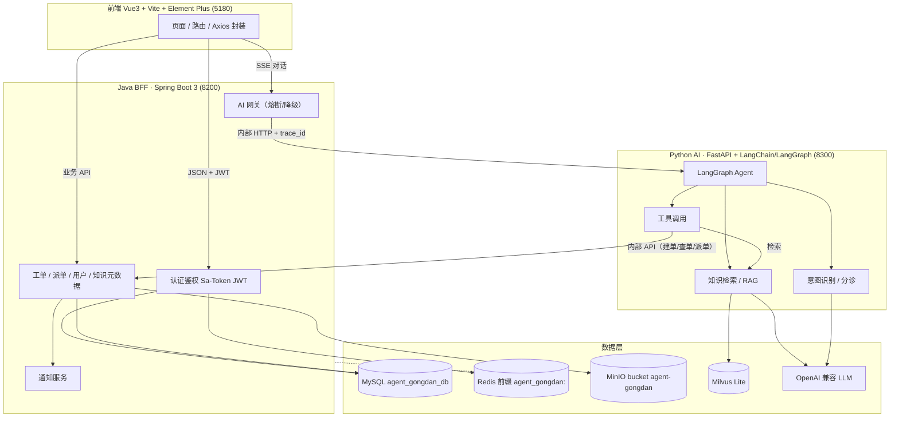
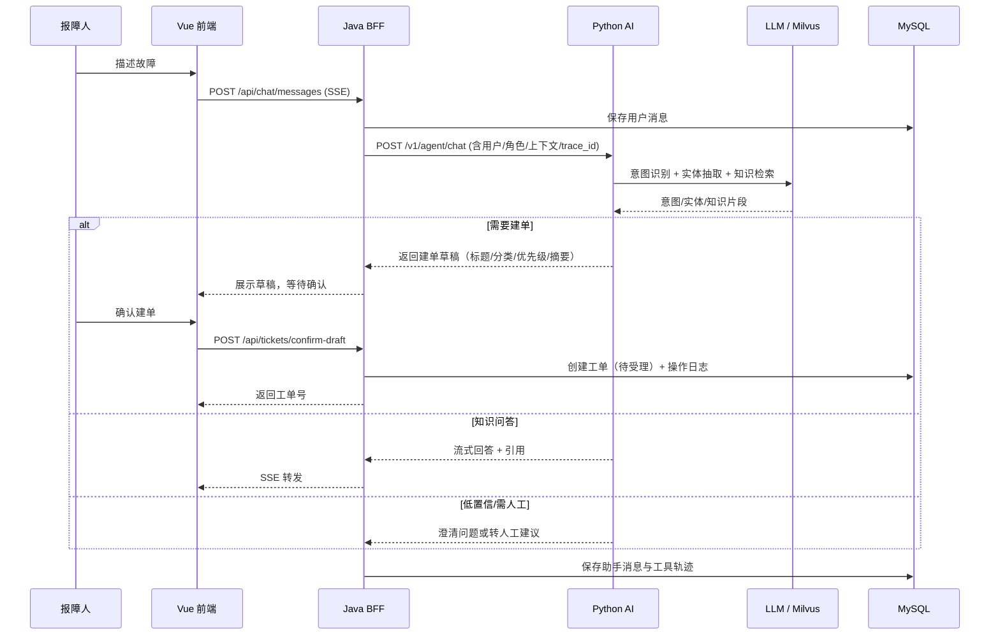

# 01-需求与功能模块清单

> 项目：**IT 运维工单智能 Agent**（agent-gongdan）
> 阶段：第一阶段 · 需求与功能模块梳理
> 版本：v1.0
> 日期：2026-11-17
> 状态：待评审
> 说明：本阶段仅输出需求与设计，**不包含任何业务代码或脚手架初始化代码**。

---

## 1. 文档信息

### 1.1 修订记录

| 版本 | 日期 | 修订人 | 说明 |
|---|---|---|---|
| v1.0 | 2026-11-17 | Claude | 初稿；整合“核心开发路径”视频素材与“物业系统”业务拓展素材 |

### 1.2 关联文档

| 阶段 | 文档 | 状态 |
|---|---|---|
| 第一阶段 | `01-需求与功能模块清单.md` | 本文档 |
| 第二阶段 | `02-技术选型与架构设计.md` | 待产出 |
| 第三阶段 | `03-数据库设计文档.md` | 待产出 |
| 第四阶段 | `04-API接口设计清单.md` | 待产出 |
| 第五阶段 | `05-最终设计方案与开发规范.md` | 待产出 |

### 1.3 术语表

| 术语 | 说明 |
|---|---|
| 工单 | 一次报障/服务请求的完整生命周期记录 |
| 报障人 | 发起工单的用户，可为业户、租户或内部员工 |
| 代客报单 | 客服/调度员代业户发起工单 |
| 内部报单 | 物业/运维内部人员发起的工单 |
| 抢单池 | 待处理工单公开池，符合条件工程师可主动认领 |
| RAG | 检索增强生成（Retrieval-Augmented Generation） |
| 意图识别 | 判断用户输入属于报障、查询、操作、知识问答或闲聊 |
| 人在回路 | 高风险/自动操作需用户确认后才执行 |
| 六边形架构 | 领域层、应用层、适配层分离，依赖倒置的架构思想 |
| 降级 | AI 或依赖不可用时，回退到不依赖 AI 的基础业务流程 |

---

## 2. 项目背景与目标

### 2.1 项目背景

IT 运维与物业服务工作长期存在以下痛点：

1. **报障入口分散**：电话、微信、口头、表单并存，信息不完整，重复沟通成本高。
2. **分诊依赖人工**：故障类型、紧急度、归属部门靠人工判断，响应慢且标准不一。
3. **知识沉淀不足**：处理经验散落在个人和聊天记录中，同类问题重复排查。
4. **工单流转不透明**：派单、转派、抢单、跨部门协作缺乏统一记录与时限约束。
5. **数据上下文割裂**：业户、房号、设备、历史工单信息未与工单联动，AI 难以给出有针对性的建议。

本项目以“**对话式报障 + 智能分诊 + RAG 知识问答 + 工单全生命周期管理**”为主线，同时预留物业业务场景（业户、资源图、设备台账、巡检、复杂派单、通知）作为拓展模块与 AI 数据上下文。

### 2.2 建设目标

| 编号 | 目标 | 说明 |
|---|---|---|
| G1 | 统一工单入口 | 支持表单建单、对话建单、代客报单、内部报单 |
| G2 | 智能分诊 | 自动识别故障类型、实体、紧急度，给出分类与优先级建议 |
| G3 | 知识复用 | 文档入库、向量检索、带引用的 RAG 回答、相似工单推荐 |
| G4 | 闭环流转 | 派单/抢单/转派/处理/验证/评价/关闭全流程可追溯 |
| G5 | 跨语言异构 | Vue3 前端 + Java BFF + Python AI 服务解耦协作 |
| G6 | 故障可降级 | AI 服务异常时，基础建单与处理能力不受影响 |
| G7 | 严格隔离 | 使用独立库/前缀/bucket/端口，不影响共享中间件与其他项目 |

### 2.3 成功指标（目标值待评审）

| 指标 | 目标值 | 度量方式 |
|---|---|---|
| 意图识别准确率 | ≥ 85% | 人工抽检 + 用户纠正率 |
| 知识问答命中率 | ≥ 70% | 有引用回答 / 知识类提问 |
| 对话建单占比 | ≥ 30% | 对话建单量 / 总建单量 |
| 首次响应时间 | ≤ 5 分钟 | 建单到首次有人受理 |
| AI 故障时建单成功率 | 100% | 降级演练 |
| 核心业务接口 P95 | ≤ 500 ms | 网关/应用埋点 |
| RAG 首 token 延迟 | ≤ 2 s | 应用埋点 |
| RAG 完整回答延迟 | ≤ 8 s | 应用埋点 |
| 数据隔离违规 | 0 | 审计与巡检 |

### 2.4 设计原则

1. **六边形架构**：领域层不依赖框架；应用层通过 ports 定义接口；适配层实现外部依赖；`main.py` 作为组装根。
2. **业务数据归属 Java**：Python 不直连 MySQL，所有业务写入经 Java 内部 API；Python 只负责 AI 编排与向量检索。
3. **人在回路**：自动建单、派单、转派、关闭等关键动作需明确确认，避免 AI 误操作。
4. **降级优先**：任何 AI 依赖故障都不得阻断基础工单能力。
5. **隔离与可观测**：独立逻辑库、Redis 前缀、MinIO bucket、端口段；trace_id 贯穿全链路。
6. **渐进式拓展**：核心链路 P0 先闭环，物业业务以 P1/P2 模块与数据上下文方式接入。

---

## 3. 范围与边界

### 3.1 本期范围（MVP = P0）

1. 登录鉴权、用户与角色。
2. 工单表单建单、列表、详情、状态流转、评论、附件、完结更新。
3. AI 会话、SSE 流式对话、历史对话存储、AgentChat 接口。
4. 意图识别、实体抽取、优先级建议、人在回路自动建单。
5. 知识文档上传、解析分块、Embedding、Milvus Lite 检索、RAG 回答与引用。
6. LangGraph Agent 与工具调用（建单、查单、我的工单、检索知识）。
7. 降级与容错（AI 熔断、Milvus 故障、LLM 失败）。
8. 前端页面：登录、Layout、Axios 封装、工单列表/提交/详情、知识库管理、AI 助手对话。
9. 平台基础：统一响应、错误码、trace_id、健康检查、日志脱敏、OpenAPI、CORS/限流。
10. Java ↔ Python 双后端联调与契约测试。

### 3.2 拓展范围（P1/P2）

1. **工单场景拓展**：代客报单、内部报单、报单类型字典、SLA、满意度。
2. **派单模式拓展**：抢单池、转负责人、转物业部、派单规则与看板。
3. **业户与资源**：客户/业户信息、房号/租户/空置状态、资源图可视化。
4. **设备与巡检**：设备分类、设备台账、设备-工单关联、巡检计划与结果联动。
5. **通知拓展**：站内通知、系统弹窗、未读计数、语音播报、邮件/IM。
6. **统计报表**：工单趋势、分类分布、SLA、满意度、AI 效果指标。
7. **数据上下文**：业户/房号/设备/历史工单统一组装并注入 Agent。
8. **系统管理**：字典、权限、审计、AI 参数配置。

### 3.3 明确不做（本期边界）

| 不做项 | 原因 |
|---|---|
| 完整物业 ERP（收费、合同、财务、门禁等） | 超出本期范围，仅取业户/设备/巡检作为工单上下文 |
| 多租户 SaaS 隔离 | 本期单组织、单物业场景 |
| 原生移动端 App | 前端以 Web 为主，P2 可做响应式 |
| 真实语音网关对接 | 语音播报仅预留接口，P2 实现 |
| 自研向量数据库/Embedding 模型 | 使用 Milvus + 现成 Embedding 模型 |
| 修改共享中间件配置 | 违反全局最高优先级规则 |
| 部署 Milvus Standalone | 本期内存与磁盘紧张，采用 Milvus Lite |
| 自动无人值守关单 | 关键动作保留人工确认 |

### 3.4 环境决策与资源约束（已确认）

| 项目 | 决策 | 约束 |
|---|---|---|
| Java | 项目内安装 **JDK 17**（`agent-gongdan/.jdk/`），配置项目级 `JAVA_HOME` | 禁止 apt 修改系统默认 Java；不影响其他项目 |
| Python | 使用 **uv** 安装 **Python 3.13**，项目内 `.venv` | 禁止修改系统 Python |
| 向量库 | **Milvus Lite**（嵌入式，随 Python 进程运行） | 内存占用低；通过 ports 抽象，未来可切换 Standalone |
| MySQL | 独立库 `agent_gongdan_db`，最小权限账号 | 不写 `geo_ai_db` 及其他既有库；不用 root 跑业务 |
| Redis | 统一前缀 `agent_gongdan:`（DB 0） | 禁止无前缀 key；禁止 FLUSH 类操作 |
| MinIO | 独立 bucket `agent-gongdan` | 禁止操作既有 bucket（当前仅 `geo-ai-platform`） |
| 端口 | Java BFF `8200`、Python AI `8300`、Web `5180` | 已登记；启动前 `ss -ltn` 复核 |
| 进程 | 独立 pid 文件，精确 PID 停止 | 禁止 `pkill`/`killall`/`fuser -k` |
| LLM | OpenAI 兼容接口 | base_url、模型、密钥来源待第二阶段确认 |

### 3.5 与其他项目的隔离承诺

1. 所有读写、安装、运行仅发生在 `~/Workspace/agent-gongdan/` 内。
2. 不修改 `infra`、`vibe-platform`、`geo-ai-platform` 等任何同级项目。
3. 不重启、不停止、不重建共享容器，不修改全局配置。
4. 不清理 59231 等他人遗留进程或端口。
5. 已由用户级 `cc-guard.py` 提供机械拦截，本项目的设计不得依赖“绕过守卫”的路径。

---

## 4. 角色与权限矩阵

### 4.1 角色定义

| 角色 | 说明 | 主要诉求 |
|---|---|---|
| 报障人（业户/员工） | 发起工单、补充信息、验证结果、评价 | 快速报障、进度可见、问题解决 |
| 运维工程师 | 接单、处理、完结、补充知识 | 工单清晰、上下文完整、少重复沟通 |
| 调度员/物业客服 | 代客报单、分诊、派单、转派、催办 | 全局视图、快速分配、超时可控 |
| 知识库管理员 | 维护知识文档与知识条目 | 入库便捷、命中率可观测 |
| 系统管理员 | 用户/角色/字典/审计/AI 配置 | 安全、可控、可追溯 |
| 巡检员（拓展） | 执行巡检任务、由巡检发起工单 | 任务清晰、异常可一键转工单 |
| AI Agent | 系统主体，执行意图识别、检索与工具调用 | 边界清晰、动作可审计、可降级 |

### 4.2 权限矩阵（关键动作）

> ✓ = 允许；△ = 有条件允许（仅本人/本部门/被授权）；— = 不允许。

| 动作 / 角色 | 报障人 | 运维工程师 | 调度员 | 知识库管理员 | 系统管理员 | 巡检员 |
|---|---|---|---|---|---|---|
| 登录与查看本人信息 | ✓ | ✓ | ✓ | ✓ | ✓ | ✓ |
| 表单/对话建单 | ✓ | ✓ | ✓ | — | — | ✓ |
| 代客报单 | — | — | ✓ | — | — | — |
| 内部报单 | — | ✓ | ✓ | — | — | ✓ |
| 查看本人工单 | ✓ | ✓ | ✓ | — | ✓ | ✓ |
| 查看待办/全部工单 | — | ✓ | ✓ | — | ✓ | △ |
| 接单/处理/完结 | — | ✓ | △ | — | △ | △ |
| 派单/转派/抢单池管理 | — | — | ✓ | — | ✓ | — |
| 评论/补充信息 | ✓ | ✓ | ✓ | — | ✓ | ✓ |
| 验证结果/评价 | ✓ | — | △ | — | — | — |
| 知识库增删查 | — | △（提交候选） | — | ✓ | ✓ | — |
| 知识问答 | ✓ | ✓ | ✓ | ✓ | ✓ | ✓ |
| 业户/资源维护 | — | — | △ | — | ✓ | — |
| 设备台账维护 | — | △ | — | — | ✓ | △ |
| 巡检任务执行 | — | — | — | — | — | ✓ |
| 统计报表 | — | △ | ✓ | △ | ✓ | — |
| 用户/角色管理 | — | — | — | — | ✓ | — |
| 审计日志 | — | — | — | — | ✓ | — |

---

## 5. 功能清单

### 5.0 优先级定义

| 优先级 | 定义 | 交付要求 |
|---|---|---|
| **P0** | MVP 核心链路，缺一不可 | 本期必须完成并通过验收 |
| **P1** | 增强能力，显著提升业务完整性 | 核心链路稳定后交付 |
| **P2** | 规划储备，视资源与业务反馈决定 | 仅保留接口与设计位 |

**来源标记**：`核心` = 视频分集目录中的核心开发路径；`拓展` = 物业培训 PPT 中的业务拓展；`平台` = 支撑性需求。

### 5.1 M0 平台基础（FR-PLAT）

| 编号 | 功能 | 说明 | 优先级 | 来源 |
|---|---|---|---|---|
| FR-PLAT-01 | 统一响应体与错误码 | Java/Python 统一 `code/message/data/traceId` 结构 | P0 | 平台 |
| FR-PLAT-02 | trace_id 全链路 | Vue→Java→Python→LLM→工具调用全程透传 | P0 | 平台 |
| FR-PLAT-03 | 健康检查与就绪探针 | `/health`、`/ready`，供联调与熔断判断 | P0 | 平台 |
| FR-PLAT-04 | 结构化日志与脱敏 | JSON 日志；手机号、密钥、令牌脱敏 | P0 | 平台 |
| FR-PLAT-05 | OpenAPI 文档 | Java 与 Python 各自暴露 Swagger/OpenAPI | P0 | 平台 |
| FR-PLAT-06 | CORS 白名单与限流 | 仅允许 `5180` 等受信来源；基础 QPS 限制 | P0 | 平台 |
| FR-PLAT-07 | 配置与环境变量 | `.env.example` + 本地 `.env`，禁止提交密钥 | P0 | 平台 |
| FR-PLAT-08 | 双后端联调与契约测试 | Java↔Python 接口契约、联调用例、故障注入 | P0 | 核心 |
| FR-PLAT-09 | 数据初始化与种子数据 | 字典、角色、演示账号、示例知识 | P0 | 平台 |
| FR-PLAT-10 | 时区与编码规范 | 统一 `Asia/Shanghai`、UTF-8、时间格式 ISO-8601 | P1 | 平台 |

### 5.2 M1 认证与用户（FR-AUTH）

| 编号 | 功能 | 说明 | 优先级 | 来源 |
|---|---|---|---|---|
| FR-AUTH-01 | 账号密码登录 | BCrypt 校验，返回 JWT | P0 | 核心 |
| FR-AUTH-02 | Sa-Token JWT 签发与校验 | 无状态鉴权；容错降级策略第四阶段细化 | P0 | 核心 |
| FR-AUTH-03 | 登出与令牌失效 | 登出后本地清除；可选 Redis 黑名单 | P0 | 核心 |
| FR-AUTH-04 | 当前用户与角色权限 | `/me`、菜单/按钮/接口级权限 | P0 | 核心 |
| FR-AUTH-05 | 用户管理 | 新增、编辑、禁用、角色分配 | P1 | 核心 |
| FR-AUTH-06 | 登录失败锁定与密码策略 | 连续失败锁定、最小长度/复杂度 | P1 | 平台 |
| FR-AUTH-07 | 服务间认证 | Java↔Python 内部令牌/签名，防外部直调 | P0 | 平台 |
| FR-AUTH-08 | 数据权限 | 本人/部门/全部数据范围控制 | P1 | 平台 |
| FR-AUTH-09 | 多端登录限制 | 单端/多端策略（P2） | P2 | 平台 |

### 5.3 M2 工单管理（FR-TICKET）

| 编号 | 功能 | 说明 | 优先级 | 来源 |
|---|---|---|---|---|
| FR-TICKET-01 | 表单创建工单 | 标题、描述、分类、优先级、位置、附件 | P0 | 核心 |
| FR-TICKET-02 | 对话创建工单 | Agent 生成草稿，用户确认后落单 | P0 | 核心 |
| FR-TICKET-03 | 工单列表 | 我的/待办/全部；状态、分类、时间筛选、分页 | P0 | 核心 |
| FR-TICKET-04 | 工单详情与时间线 | 基本信息、流转记录、评论、附件、工具调用轨迹 | P0 | 核心 |
| FR-TICKET-05 | 状态流转 | 待受理→待接单→处理中→待验证→已解决→已关闭 | P0 | 核心 |
| FR-TICKET-06 | 完结工单更新 | 处理结果、耗时、解决方案、关闭原因回填 | P0 | 核心 |
| FR-TICKET-07 | 评论与内部备注 | 公开回复 vs 仅内部可见 | P0 | 核心 |
| FR-TICKET-08 | 附件上传/下载 | 限制类型与大小；存 MinIO 独立 bucket | P0 | 核心 |
| FR-TICKET-09 | 优先级/分类/标签 | 报障类型、业务线、影响范围 | P0 | 核心 |
| FR-TICKET-10 | 操作日志 | 谁在何时改了什么，前后值可追溯 | P0 | 核心 |
| FR-TICKET-11 | 取消与重开 | 填原因；重开保留历史并回到待受理 | P0 | 核心 |
| FR-TICKET-12 | 代客报单 | 客服代业户建单，记录代报人 | P1 | 拓展 |
| FR-TICKET-13 | 内部报单 | 工程维修、保洁、安保等内部来源 | P1 | 拓展 |
| FR-TICKET-14 | 报单类型字典 | 综维、清洁、绿化、秩序、投诉、工程维修等 | P1 | 拓展 |
| FR-TICKET-15 | 工单关联业户/房号/设备 | 作为分诊、检索与通知的上下文 | P1 | 拓展 |
| FR-TICKET-16 | SLA 计时与超时标记 | 按优先级/类型配置时限 | P1 | 拓展 |
| FR-TICKET-17 | 满意度评价 | 解决后评分与评价内容 | P1 | 拓展 |
| FR-TICKET-18 | 关联/合并重复工单 | 避免重复处理 | P2 | 拓展 |
| FR-TICKET-19 | 工单模板/快捷填报 | 常见故障一键套用 | P2 | 拓展 |
| FR-TICKET-20 | 批量导入/导出 | 运维与报表场景 | P2 | 拓展 |

### 5.4 M3 派单与流转（FR-DISP）

| 编号 | 功能 | 说明 | 优先级 | 来源 |
|---|---|---|---|---|
| FR-DISP-01 | 直接派单 | 调度员指定处理人 | P0 | 核心 |
| FR-DISP-02 | 认领/释放 | 工程师认领待处理工单，可释放回池 | P0 | 核心 |
| FR-DISP-03 | 抢单池 | 工单进入公开池，符合条件者认领（乐观锁防重复） | P1 | 拓展 |
| FR-DISP-04 | 转负责人 | 更换处理人，需填原因并留痕 | P1 | 拓展 |
| FR-DISP-05 | 转物业部 | 跨部门流转，记录部门与交接说明 | P1 | 拓展 |
| FR-DISP-06 | 派单规则 | 技能、区域、负载、值班表匹配 | P2 | 拓展 |
| FR-DISP-07 | 派单/转派通知 | 站内通知 + 弹窗 | P1 | 拓展 |
| FR-DISP-08 | 派单看板 | 待派、池中、超时、人员负载视图 | P1 | 拓展 |

### 5.5 M4 AI 会话与 Agent 对话（FR-CHAT）

| 编号 | 功能 | 说明 | 优先级 | 来源 |
|---|---|---|---|---|
| FR-CHAT-01 | 会话创建/关闭/列表 | 每用户多会话，自动标题 | P0 | 核心 |
| FR-CHAT-02 | 多轮消息与上下文管理 | 滑动窗口 + 摘要压缩，避免超限 | P0 | 核心 |
| FR-CHAT-03 | SSE 流式输出 | 首 token 快速返回，支持中断 | P0 | 核心 |
| FR-CHAT-04 | 历史对话存储与查询 | 消息、角色、引用、工具轨迹持久化 | P0 | 核心 |
| FR-CHAT-05 | 会话关联工单 | 对话中创建/查询的工单可跳转 | P0 | 核心 |
| FR-CHAT-06 | 回答引用与来源展示 | 知识文档、章节、相似工单 | P0 | 核心 |
| FR-CHAT-07 | AgentChat 接口封装 | Python 对外统一 `/v1/agent/chat` 接口 | P0 | 核心 |
| FR-CHAT-08 | 人工接管/转人工 | 低置信、投诉、敏感场景转人工 | P1 | 拓展 |
| FR-CHAT-09 | 会话归档与检索 | 按用户、时间、工单检索历史对话 | P1 | 核心 |
| FR-CHAT-10 | 附件/图片理解 | 用户上传截图辅助分诊 | P2 | 拓展 |
| FR-CHAT-11 | 多会话并行运行 | 会话间上下文隔离 | P2 | 核心 |

### 5.6 M5 意图识别与智能分诊（FR-TRIAGE）

| 编号 | 功能 | 说明 | 优先级 | 来源 |
|---|---|---|---|---|
| FR-TRIAGE-01 | 故障类型分析/意图分类 | 报障、查询、操作、知识问答、闲聊、转人工 | P0 | 核心 |
| FR-TRIAGE-02 | 实体抽取 | 系统/模块、错误码、位置、设备、时间、影响范围 | P0 | 核心 |
| FR-TRIAGE-03 | 紧急度与优先级建议 | 依据影响范围、关键词、业务规则 | P0 | 核心 |
| FR-TRIAGE-04 | 标题摘要与分类建议 | 生成工单标题、描述摘要、分类候选 | P0 | 核心 |
| FR-TRIAGE-05 | 低置信澄清与转人工 | 置信度低于阈值时追问或转人工 | P0 | 核心 |
| FR-TRIAGE-06 | 人在回路确认建单 | 展示草稿，用户确认后才创建 | P0 | 核心 |
| FR-TRIAGE-07 | 相似信息/相似工单查询 | 结合向量检索与结构化过滤 | P0 | 核心 |
| FR-TRIAGE-08 | 规则兜底分类 | AI 不可用时关键词/字典规则分类 | P0 | 平台 |
| FR-TRIAGE-09 | 误判纠正与反馈 | 用户/工程师纠正后记录，用于评估与优化 | P1 | 拓展 |
| FR-TRIAGE-10 | 批量分诊/重分诊 | 历史工单重新分类 | P2 | 拓展 |

### 5.7 M6 知识库与 RAG（FR-KB）

| 编号 | 功能 | 说明 | 优先级 | 来源 |
|---|---|---|---|---|
| FR-KB-01 | 知识文档上传 | md/txt/pdf/docx；填写分类、可见范围 | P0 | 核心 |
| FR-KB-02 | 文档解析/清洗/分块 | 结构化解析、去噪、按语义/长度分块 | P0 | 核心 |
| FR-KB-03 | Embedding 模型接入与向量化 | 统一封装，支持模型配置与批处理 | P0 | 核心 |
| FR-KB-04 | Milvus 连接与查询封装 | Milvus Lite 适配器；接口预留 Standalone 切换 | P0 | 核心 |
| FR-KB-05 | 知识条目增删查改 | 列表、检索、编辑、启停、分类、删除 | P0 | 核心 |
| FR-KB-06 | 向量检索 top-k 与阈值 | 相似度阈值、结果去重、元数据过滤 | P0 | 核心 |
| FR-KB-07 | RAG 答案生成与引用 | 上下文拼装、引用来源、拒答策略 | P0 | 核心 |
| FR-KB-08 | 无命中兜底 | 提示未找到、建议建单或转人工 | P0 | 核心 |
| FR-KB-09 | 历史工单知识化与检索 | 完结工单可选入库；相似工单推荐 | P1 | 核心 |
| FR-KB-10 | 混合检索/重排 | 向量 + 关键词 + 重排模型 | P1 | 拓展 |
| FR-KB-11 | 知识可见范围与权限 | 按角色/部门/业务线过滤 | P1 | 拓展 |
| FR-KB-12 | 文档版本与重新索引 | 更新文档后增量/全量重建 | P2 | 拓展 |
| FR-KB-13 | 知识缺口统计 | 未命中问题聚合，指导补充知识 | P2 | 拓展 |
| FR-KB-14 | 知识审核/发布流程 | 草稿→审核→发布 | P2 | 拓展 |

### 5.8 M7 Agent 工具调用与编排（FR-AGENT）

| 编号 | 功能 | 说明 | 优先级 | 来源 |
|---|---|---|---|---|
| FR-AGENT-01 | LangGraph Agent 实例与状态图 | 意图→检索→决策→工具→回复的状态编排 | P0 | 核心 |
| FR-AGENT-02 | 工具注册与编排 | 工具描述、参数 Schema、可发现性 | P0 | 核心 |
| FR-AGENT-03 | create_ticket 工具 | 经 Java 内部 API 建单，幂等键防重复 | P0 | 核心 |
| FR-AGENT-04 | query_ticket/status 工具 | 查询工单状态与摘要（权限过滤） | P0 | 核心 |
| FR-AGENT-05 | list_my_tickets 工具 | 查询当前用户相关工单 | P0 | 核心 |
| FR-AGENT-06 | search_knowledge 工具 | 供 Agent 主动检索知识 | P0 | 核心 |
| FR-AGENT-07 | assign_ticket/escalate 工具 | 派单与转人工（P1，需高权限确认） | P1 | 拓展 |
| FR-AGENT-08 | 高危操作二次确认 | 建单、派单、关闭前展示确认 | P0 | 核心 |
| FR-AGENT-09 | 工具调用审计/超时/重试/幂等 | 入参、结果、耗时、错误可追溯 | P0 | 核心 |
| FR-AGENT-10 | 工具级权限控制 | 按角色/数据范围裁剪可用工具 | P1 | 平台 |
| FR-AGENT-11 | 多步规划与任务分解 | 复合请求拆解（查单+催办等） | P1 | 拓展 |
| FR-AGENT-12 | 工具结果结构化回填 | 前端展示工单卡片、引用卡片 | P1 | 核心 |

### 5.9 M8 降级与容错（FR-RES）

| 编号 | 功能 | 说明 | 优先级 | 来源 |
|---|---|---|---|---|
| FR-RES-01 | AI 健康检查与熔断 | Java 侧探活、超时、熔断、半开恢复 | P0 | 核心 |
| FR-RES-02 | AI 不可用→表单建单+规则分类 | 对话入口提示降级，基础能力可用 | P0 | 核心 |
| FR-RES-03 | Milvus 不可用→跳过检索/关键词兜底 | 不阻断回答与建单，标注“未检索知识” | P0 | 核心 |
| FR-RES-04 | LLM 超时/失败重试与提示 | 有限重试，失败后友好提示 | P0 | 核心 |
| FR-RES-05 | 会话与工单数据一致性 | 工具调用失败可回滚/补偿，不产生脏数据 | P0 | 核心 |
| FR-RES-06 | 降级事件记录与告警 | 记录 trace_id、原因、持续时长 | P1 | 平台 |
| FR-RES-07 | 限流/排队/超时预算 | 防止级联雪崩 | P1 | 平台 |
| FR-RES-08 | 模型切换/多 Provider 容灾 | 主备模型切换 | P2 | 拓展 |

### 5.10 M9 通知与提醒（FR-NOTIFY）

| 编号 | 功能 | 说明 | 优先级 | 来源 |
|---|---|---|---|---|
| FR-NOTIFY-01 | 站内通知/系统弹窗 | 新工单、派单、状态变更 | P1 | 拓展 |
| FR-NOTIFY-02 | 未读计数与通知中心 | 列表、已读/全部已读 | P1 | 拓展 |
| FR-NOTIFY-03 | 工单状态变更通知 | 报障人、处理人、调度员按规则接收 | P1 | 拓展 |
| FR-NOTIFY-04 | SLA 超时提醒 | 到期前/超时后提醒 | P1 | 拓展 |
| FR-NOTIFY-05 | 语音播报 | 新工单/紧急工单语音提示（TTS 或浏览器播报） | P2 | 拓展 |
| FR-NOTIFY-06 | 邮件/IM 集成 | 邮件、企业微信/钉钉等 | P2 | 拓展 |
| FR-NOTIFY-07 | 通知偏好设置 | 按用户/角色配置渠道与开关 | P2 | 拓展 |

### 5.11 M10 统计报表（FR-RPT）

| 编号 | 功能 | 说明 | 优先级 | 来源 |
|---|---|---|---|---|
| FR-RPT-01 | 工单量/趋势/状态分布 | 日/周/月维度 | P1 | 拓展 |
| FR-RPT-02 | 分类/区域/人员分布 | 报障类型、楼栋/部门、处理人 | P1 | 拓展 |
| FR-RPT-03 | 处理时长/SLA 达成率 | 平均/中位/P95、超时率 | P1 | 拓展 |
| FR-RPT-04 | 满意度统计 | 评分分布与低分原因 | P1 | 拓展 |
| FR-RPT-05 | AI 效果指标 | 意图准确率、知识命中率、转人工率、token 成本 | P2 | 拓展 |
| FR-RPT-06 | 业户/设备维度分析 | 高频报障业户、设备故障率 | P2 | 拓展 |
| FR-RPT-07 | 报表导出 | Excel/CSV | P2 | 拓展 |

### 5.12 M11 系统管理与审计（FR-ADMIN）

| 编号 | 功能 | 说明 | 优先级 | 来源 |
|---|---|---|---|---|
| FR-ADMIN-01 | 字典/分类/优先级配置 | 报障类型、状态、紧急度等 | P1 | 拓展 |
| FR-ADMIN-02 | 角色与权限配置 | 菜单、按钮、接口、数据范围 | P1 | 平台 |
| FR-ADMIN-03 | 审计日志查询 | 登录、工单、知识、AI 工具调用审计 | P1 | 平台 |
| FR-ADMIN-04 | AI 参数配置 | 模型、温度、阈值、开关热更新 | P2 | 拓展 |
| FR-ADMIN-05 | 系统公告 | 维护窗口、通知 | P2 | 拓展 |
| FR-ADMIN-06 | 字典导入导出 | 初始化与迁移 | P2 | 平台 |

### 5.13 M12 业户与资源（FR-CUST，拓展）

| 编号 | 功能 | 说明 | 优先级 | 来源 |
|---|---|---|---|---|
| FR-CUST-01 | 客户/业户信息维护 | 姓名、联系方式、类型（业主/租户）、状态 | P1 | 拓展 |
| FR-CUST-02 | 房号/租户/空置状态管理 | 楼栋-单元-房号层级；租户与空置标记 | P1 | 拓展 |
| FR-CUST-03 | 资源图可视化 | 房号、租户、空置状态图形化展示 | P2 | 拓展 |
| FR-CUST-04 | 业户与工单关联 | 建单时选择业户/房号，详情展示 | P1 | 拓展 |
| FR-CUST-05 | 业户历史服务记录 | 历史工单、投诉、评价汇总 | P2 | 拓展 |
| FR-CUST-06 | 业户画像（AI 上下文） | 供分诊与答复使用的有限画像 | P2 | 拓展 |
| FR-CUST-07 | 批量导入/同步 | 从既有台账导入 | P2 | 拓展 |
| FR-CUST-08 | 业户隐私脱敏 | 列表/日志/AI 上下文脱敏 | P1 | 拓展 |

### 5.14 M13 设备台账与巡检（FR-EQUIP，拓展）

| 编号 | 功能 | 说明 | 优先级 | 来源 |
|---|---|---|---|---|
| FR-EQUIP-01 | 工程设备分类 | 电梯、空调、水泵、消防、门禁等 | P1 | 拓展 |
| FR-EQUIP-02 | 设备台账 CRUD | 编号、位置、品牌型号、维保信息、状态 | P1 | 拓展 |
| FR-EQUIP-03 | 设备与工单关联 | 报障时选择设备，详情联动 | P1 | 拓展 |
| FR-EQUIP-04 | 巡检计划与任务 | 周期、路线、检查项、执行人 | P2 | 拓展 |
| FR-EQUIP-05 | 巡检结果与工单联动 | 异常一键转工单，保留巡检记录 | P2 | 拓展 |
| FR-EQUIP-06 | 设备维修/巡检历史 | 供 AI 与工程师参考 | P2 | 拓展 |
| FR-EQUIP-07 | 设备二维码/位置 | 扫码报障、定位 | P2 | 拓展 |
| FR-EQUIP-08 | 设备状态与预警 | 维保到期、故障频次预警 | P2 | 拓展 |

### 5.15 M14 业务数据上下文（FR-CTX，拓展/跨域）

| 编号 | 功能 | 说明 | 优先级 | 来源 |
|---|---|---|---|---|
| FR-CTX-01 | 统一业务上下文组装 | 业户、房号、设备、历史工单、知识片段 | P1 | 拓展 |
| FR-CTX-02 | 上下文注入 Agent | 按需注入 prompt 或作为工具查询 | P1 | 拓展 |
| FR-CTX-03 | 上下文权限过滤 | 仅注入当前用户有权访问的数据 | P1 | 拓展 |
| FR-CTX-04 | 上下文缓存与失效 | 短期缓存，数据变更后失效 | P2 | 拓展 |
| FR-CTX-05 | 上下文审计 | 记录 AI 使用了哪些业务数据 | P2 | 拓展 |

### 5.16 M15 前端页面与交互（FR-WEB）

| 编号 | 功能 | 说明 | 优先级 | 来源 |
|---|---|---|---|---|
| FR-WEB-01 | 登录页与路由守卫 | 登录、令牌过期处理、无权限跳转 | P0 | 核心 |
| FR-WEB-02 | Layout 布局与导航 | 侧边栏、顶栏、用户菜单、面包屑 | P0 | 核心 |
| FR-WEB-03 | Axios 封装 | 统一 token、错误提示、trace_id、超时/重试 | P0 | 核心 |
| FR-WEB-04 | 工单列表/提交/详情页 | 筛选、分页、表单校验、时间线、附件 | P0 | 核心 |
| FR-WEB-05 | 知识库管理页 | 上传、列表、编辑、启停、检索测试 | P0 | 核心 |
| FR-WEB-06 | AI 助手对话页 | 流式消息、引用卡片、工单卡片、确认建单 | P0 | 核心 |
| FR-WEB-07 | 派单看板/抢单池页 | 派单、转派、抢单、负载视图 | P1 | 拓展 |
| FR-WEB-08 | 通知中心/弹窗 | 未读、列表、弹窗、语音开关 | P1 | 拓展 |
| FR-WEB-09 | 统计报表页 | 图表与筛选 | P1 | 拓展 |
| FR-WEB-10 | 系统管理页 | 用户、角色、字典、审计 | P1 | 拓展 |
| FR-WEB-11 | 业户/资源图页 | 业户列表、房号状态、资源图 | P2 | 拓展 |
| FR-WEB-12 | 设备台账/巡检页 | 设备列表、巡检任务 | P2 | 拓展 |
| FR-WEB-13 | 响应式/移动端适配 | 手机浏览器可用 | P2 | 拓展 |

### 5.17 功能统计

| 模块 | 功能项 | P0 | P1 | P2 |
|---|---:|---:|---:|---:|
| M0 平台基础 | 10 | 9 | 1 | 0 |
| M1 认证与用户 | 9 | 5 | 3 | 1 |
| M2 工单管理 | 20 | 11 | 6 | 3 |
| M3 派单与流转 | 8 | 2 | 5 | 1 |
| M4 AI 会话 | 11 | 7 | 2 | 2 |
| M5 意图识别与分诊 | 10 | 8 | 1 | 1 |
| M6 知识库与 RAG | 14 | 8 | 3 | 3 |
| M7 Agent 工具调用 | 12 | 8 | 4 | 0 |
| M8 降级与容错 | 8 | 5 | 2 | 1 |
| M9 通知与提醒 | 7 | 0 | 4 | 3 |
| M10 统计报表 | 7 | 0 | 4 | 3 |
| M11 系统管理与审计 | 6 | 0 | 3 | 3 |
| M12 业户与资源 | 8 | 0 | 4 | 4 |
| M13 设备台账与巡检 | 8 | 0 | 3 | 5 |
| M14 业务数据上下文 | 5 | 0 | 3 | 2 |
| M15 前端页面与交互 | 13 | 6 | 4 | 3 |
| **合计** | **156** | **69** | **52** | **35** |

> 说明：P0 为 MVP 核心闭环，建议按第 12 节里程碑分批交付，而非一次性上线全部功能。

---

## 6. 功能模块划分

### 6.1 模块职责与领域对象

| 模块 | 职责 | 核心领域对象 | 六边形归属 |
|---|---|---|---|
| M0 平台基础 | 横切能力：响应、错误、追踪、日志、配置 | `ErrorCode`、`TraceContext` | adapters/api、app/ports |
| M1 认证与用户 | 身份认证、令牌、角色与数据权限 | `User`、`Role`、`Permission` | domain、app、adapters |
| M2 工单管理 | 工单生命周期、评论、附件、操作日志 | `Ticket`、`TicketEvent`、`Comment`、`Attachment` | domain、app、adapters |
| M3 派单与流转 | 派单、认领、抢单、转派、看板 | `DispatchTask`、`Assignment` | domain、app、adapters |
| M4 AI 会话 | 会话与消息、流式输出、历史存储 | `Session`、`Message` | domain、app、adapters |
| M5 意图识别与分诊 | 意图、实体、优先级、人在回路建单 | `Intent`、`TriageResult`、`TicketDraft` | domain、app |
| M6 知识库与 RAG | 文档解析、分块、向量化、检索、回答 | `KnowledgeDoc`、`Chunk`、`RetrievalHit` | domain、app、adapters |
| M7 Agent 工具调用 | LangGraph 编排、工具注册、权限与审计 | `AgentRun`、`ToolSpec`、`ToolCall` | domain、app、adapters |
| M8 降级与容错 | 熔断、降级、补偿、限流 | `DegradationEvent`、`CircuitState` | app、adapters |
| M9 通知与提醒 | 站内信、弹窗、语音、偏好 | `Notification`、`NotifyPreference` | domain、app、adapters |
| M10 统计报表 | 指标聚合与展示 | `MetricSnapshot` | app、adapters |
| M11 系统管理与审计 | 字典、权限、审计、AI 参数 | `AuditLog`、`DictItem`、`AiConfig` | domain、app、adapters |
| M12 业户与资源 | 业户、房号、租户、空置、资源图 | `Customer`、`Room`、`Tenancy` | domain、app、adapters |
| M13 设备台账与巡检 | 设备分类、台账、巡检任务与结果 | `Equipment`、`InspectionPlan`、`InspectionTask` | domain、app、adapters |
| M14 业务数据上下文 | 跨域上下文组装、过滤、注入、审计 | `BusinessContext` | app、adapters |
| M15 前端页面与交互 | 页面、路由、请求封装、组件 | 无（独立 Vue 应用） | UI 适配层 |

### 6.2 六边形架构分层映射（设计约束）

> 详细目录结构在第二阶段展开，本节只固定职责边界。

**Python AI 服务（按用户给定的目录基线扩展）**

| 层 | 目录/文件 | 职责 |
|---|---|---|
| 领域层 | `domain/session.py`、`context.py`、`tool.py`、`roles.py` 及后续 `intent.py`、`knowledge.py`、`customer.py`、`equipment.py` | 纯领域模型与规则，不依赖 FastAPI/LangChain/Milvus |
| 应用层 | `app/ports.py`、`app/service.py` | 定义 `LLMClient`、`EmbeddingClient`、`VectorStore`、`TicketGateway`、`KnowledgeGateway`、`ContextProvider`、`SessionStore` 等端口；实现用例编排 |
| 适配层 | `adapters/models`、`adapters/stores`、`adapters/api`、`adapters/tools` | OpenAI 兼容客户端、Milvus Lite 存储、Java 内部 API 客户端、FastAPI 路由、LangGraph 工具 |
| 组装根 | `main.py` | 依赖注入与端口→适配器绑定；切换 Milvus Lite/Standalone 只改此处配置 |

**Java BFF（同样遵循六边形思想）**

| 层 | 职责 |
|---|---|
| 领域层 | Ticket、Dispatch、User、KnowledgeMeta、Customer、Equipment 等领域模型与状态机 |
| 应用层 | `ports`：仓储、AI 网关、通知、上下文查询；`service`：工单、派单、知识元数据、用户等用例 |
| 适配层 | Web Controller、MyBatis-Plus 仓储、Python AI 客户端、通知适配器、MinIO 适配器 |
| 组装根 | Spring 配置类统一装配 |

**关键依赖规则**

1. `domain` 不依赖任何框架、数据库、HTTP 客户端。
2. `app` 只依赖 `domain` 与 `ports` 抽象，不依赖具体适配器。
3. `adapters` 实现 `ports`，可被替换（Milvus Lite → Standalone、OpenAI 兼容 → 其他模型）。
4. Python 不得直接访问 MySQL；业务写入必须经 Java 内部 API。
5. 前端只与 Java BFF 通信，不直连 Python AI 服务。

---

## 7. 模块关系

### 7.1 总体关系图



### 7.2 跨语言调用关系

| 调用方 | 被调用方 | 内容 | 约束 |
|---|---|---|---|
| Vue | Java BFF | 所有业务与对话入口 | JWT 鉴权；不直连 Python |
| Java BFF | Python AI | 对话、分诊、知识入库、相似检索 | 内部令牌 + trace_id；超时/熔断/降级 |
| Python AI | Java BFF | 工具调用：建单、查单、我的工单、派单 | 内部 API + 用户上下文透传；幂等键 |
| Python AI | Milvus Lite | 向量写入/查询 | 通过 `VectorStore` 端口 |
| Python AI | LLM | 意图、生成、摘要 | OpenAI 兼容；超时/重试 |
| Java BFF | MinIO | 知识原文、附件 | 独立 bucket；预签名 URL |

### 7.3 依赖方向约束

```
Vue ──► Java BFF ──► Python AI
             ▲             │
             └─────────────┘  （仅内部工具调用，不回写数据库）
```

- Java 是**业务数据唯一写入方**（System of Record）。
- Python 是**无状态 AI 服务**（Milvus Lite 数据除外），会话/工单数据均存 Java 侧。
- 任何跨语言调用都必须携带 `trace_id` 与调用方标识，便于排障与审计。

---

## 8. 核心业务流程

### 8.1 流程 A：对话报障 → 智能分诊 → 确认建单



**步骤说明**

1. 用户在 AI 助手页输入问题，前端通过 SSE 发起流式请求。
2. Java 校验 JWT、落库用户消息，组装用户上下文（角色、所属、业户/房号/设备等，按权限过滤）。
3. Python LangGraph 执行：意图分类 → 实体抽取 → 知识检索（可选）→ 决策。
4. 需要建单时，**只返回草稿**；用户确认后由前端调用 Java 确认接口落单（人在回路）。
5. 建单成功后返回工单号；会话与工单双向关联。
6. 低置信场景必须澄清或转人工，禁止静默自动建单。

### 8.2 流程 B：知识问答（RAG）

1. 用户提问 → Java → Python。
2. 意图判定为知识问答；对问题做 Embedding。
3. Milvus 检索 top-k，按相似度阈值与权限过滤。
4. 命中：拼装上下文与引用，LLM 流式生成答案，前端展示引用来源。
5. 未命中：明确告知“未找到相关知识”，建议建单或转人工，并记录知识缺口。
6. Java 持久化消息、引用与反馈。

### 8.3 流程 C：人工/代客建单 → 处理 → 验证 → 评价

1. 报障人或客服（代客报单）填写工单；支持关联业户、房号、设备。
2. 调度员直接派单或放入抢单池。
3. 工程师接单，处理过程中可评论、上传附件、请求协助。
4. 工程师提交解决，填写处理结果与解决方案，工单进入“待验证”。
5. 报障人验证：通过 → 已解决；不通过 → 回到处理中。
6. 评价（P1）后关闭；全过程写入操作日志并触发通知。
7. 完结工单可选择进入知识候选（P1）。

### 8.4 流程 D：派单模式与流转

| 模式 | 步骤 | 关键规则 |
|---|---|---|
| 直接派单 | 调度员选择处理人 → 待接单 → 工程师接单 | 处理人必须在线/有权限 |
| 抢单池 | 调度员放入池 → 符合条件的工程师可见 → 认领 | 乐观锁防重复认领；超时回收 |
| 转负责人 | 当前处理人/调度员转派 → 新处理人接单 | 必填转派原因；保留历史处理人 |
| 转物业部 | 调度员选择目标部门 → 部门负责人接单 | 跨部门交接说明；通知双方 |

**通用规则**：所有转派保留完整时间线；被转派方可拒收并回退；超时未接单自动提醒调度员。

### 8.5 流程 E：知识入库

1. 知识库管理员上传文档，填写分类、可见范围。
2. Java 保存文件到 MinIO（bucket `agent-gongdan`）与元数据（UPLOADED）。
3. Java 调用 Python 知识入库接口（异步任务，携带文档 ID 与预签名地址）。
4. Python 解析 → 清洗 → 分块 → Embedding → 写入 Milvus（带 doc_id、chunk_id、分类、可见范围）。
5. 回写状态：ACTIVE / FAILED（含原因）；支持重试。
6. 检索时按角色与可见范围过滤，引用可回溯到原文与章节。

### 8.6 流程 F：相似信息/相似工单查询

1. 在分诊或对话中触发“相似问题查询”。
2. 对当前描述做 Embedding，检索知识片段与历史工单向量（P1 起）。
3. 结合结构化条件（分类、设备、房号、时间）过滤与排序。
4. 返回相似工单列表、解决方案摘要与知识引用。
5. 工程师可一键引用历史方案；用户仅可见有权限的内容。

### 8.7 流程 G：AI 降级

1. Java 对 Python 服务做健康检查与熔断统计。
2. Python 不可达/超时 → 熔断打开：对话入口提示“AI 暂不可用”，建单与工单查询不受影响。
3. 意图识别失败 → 规则引擎（关键词/字典）给出分类与优先级建议，转人工分诊。
4. Milvus 不可用 → 跳过向量检索，仅使用 LLM 常识或直接转人工，并标注“未检索知识库”。
5. LLM 超时/失败 → 有限重试；仍失败则返回降级提示，保留用户消息。
6. 所有降级事件记录 trace_id、原因、持续时长，P1 起接入告警。

### 8.8 流程 H：通知与提醒

1. 触发事件：建单、派单、转派、状态变更、评论、SLA 到期/超时。
2. Java 通知服务按角色与偏好生成站内通知。
3. 前端通知中心展示未读；关键事件弹窗。
4. P2：紧急工单语音播报（浏览器 `speechSynthesis` 或外部 TTS）、邮件/IM 推送。
5. 通知失败不阻断主流程，进入重试队列并记录。

---

## 9. 状态机与生命周期

### 9.1 工单状态机

| 当前状态 | 事件 | 目标状态 | 触发者 | 说明 |
|---|---|---|---|---|
| 待受理 | 直接派单 | 待接单 | 调度员 | 指定处理人并通知 |
| 待受理 | 放入抢单池 | 待接单（池） | 调度员 | P1；符合条件者可见 |
| 待受理 | 认领 | 处理中 | 工程师 | 直接认领 |
| 待接单 | 接单 | 处理中 | 被指派工程师 | 记录接单时间 |
| 待接单 | 拒收/转派 | 待接单 | 工程师/调度员 | 必填原因 |
| 处理中 | 提交解决 | 待验证 | 工程师 | 填写处理结果与方案 |
| 处理中 | 挂起 | 挂起 | 工程师 | 等待外部资源/备件 |
| 挂起 | 恢复 | 处理中 | 工程师 | 记录挂起时长 |
| 待验证 | 验证通过 | 已解决 | 报障人/调度员 | 可进入评价 |
| 待验证 | 验证不通过 | 处理中 | 报障人/调度员 | 必填不通过原因 |
| 已解决 | 关闭 | 已关闭 | 系统/调度员 | 评价后自动或手动关闭 |
| 已关闭 | 重开 | 待受理 | 报障人/调度员 | 保留全部历史 |
| 任意未终结 | 取消 | 已取消 | 报障人/调度员/管理员 | 必填取消原因 |
| 待受理/待接单 | 转物业部 | 待接单 | 调度员 | P1；跨部门交接 |

**约束**

- 非法流转一律拒绝并记录审计。
- 每次流转写入 `TicketEvent`（操作人、时间、前后状态、原因、trace_id）。
- 通知与 SLA 计时由状态事件驱动，不重复触发。

### 9.2 AI 会话生命周期

| 状态 | 说明 | 迁移 |
|---|---|---|
| ACTIVE | 正常对话中 | 用户关闭 → CLOSED；转人工 → HANDED_OFF |
| HANDED_OFF | 已转人工，AI 停止主导 | 人工结束 → CLOSED |
| CLOSED | 会话结束，只读 | 超期归档 → ARCHIVED |
| ARCHIVED | 归档，按权限检索 | — |
| DEGRADED | AI 不可用，仅保留消息记录 | 恢复后可继续 |

### 9.3 知识文档生命周期

`UPLOADED → PARSING → INDEXING → ACTIVE`；异常 → `FAILED`（可重试）；管理员可 `DISABLED`，重新启用需重建索引。

---

## 10. 非功能需求

| 类别 | 要求 | 验收方式 |
|---|---|---|
| 性能 | 核心业务接口 P95 ≤ 500 ms；RAG 首 token ≤ 2 s；完整回答 ≤ 8 s | 压测与埋点 |
| 可用性 | 工单基础能力可用性 ≥ 99.5%；AI 故障不阻断建单 | 故障注入演练 |
| 降级 | AI/Milvus/LLM 任一故障均有明确降级路径 | 演练清单逐项验证 |
| 安全 | JWT + RBAC + 数据权限；BCrypt；内部服务令牌；输入校验；文件类型/大小限制 | 安全测试与代码评审 |
| 隐私 | 手机号、地址、业户信息在日志与 AI 上下文中脱敏 | 抽查日志与 prompt |
| 提示词安全 | 防提示词注入、越权工具调用；工具参数二次校验 | 对抗用例 |
| 可观测 | trace_id 全链路；结构化日志；关键指标（QPS、延迟、错误率、token） | 日志与监控看板 |
| 审计 | 登录、工单流转、知识变更、AI 工具调用可追溯 | 审计查询 |
| 兼容 | Java 17、Python 3.13、MySQL 8、Node 22、主流 Chrome/Edge | 联调验证 |
| 资源 | 不修改共享中间件；本项目内存/端口/磁盘可观测 | 启动前后资源对比 |
| 数据一致性 | 工具调用失败可补偿；幂等键防重复建单 | 针对用例测试 |
| 可维护性 | 六边形分层；端口可替换；配置外置 | 架构评审 |

---

## 11. 约束与假设

### 11.1 资源与隔离约束

1. MySQL 仅使用 `agent_gongdan_db`，业务账号非 root，仅授权本库。
2. Redis 所有 key 必须带 `agent_gongdan:` 前缀。
3. MinIO 仅使用 `agent-gongdan` bucket。
4. 端口固定为 8200 / 8300 / 5180，启动前复核。
5. 禁止任何容器生命周期操作与全局配置修改。
6. 一旦发现资源冲突，立即停止并报告，不做清理。

### 11.2 技术假设

| 假设 | 影响 | 待确认阶段 |
|---|---|---|
| LLM 提供 OpenAI 兼容接口，支持流式与工具调用 | 决定 Agent 与 RAG 实现 | 第二阶段 |
| Embedding 模型可通过同一或独立接口调用 | 决定向量维度与成本 | 第二阶段 |
| Milvus Lite 满足本期数据规模（万级 chunk 以内） | 超出需切换 Standalone | 第二阶段 |
| JWT 采用无状态校验，Redis 仅作可选增强 | 决定登出与吊销策略 | 第四阶段 |
| 附件与知识原文存 MinIO，不进入数据库 | 决定上传流程 | 第三阶段 |
| 单组织、单物业场景，不做多租户 | 数据模型不含租户隔离 | 第三阶段 |
| 语音播报可用浏览器 TTS 或外部服务 | 影响 P2 实现方式 | 第二阶段 |

### 11.3 关键风险（详细方案见第五阶段）

| 风险 | 影响 | 初步应对 |
|---|---|---|
| AI 误判意图导致错误建单/分派 | 业务错误 | 人在回路确认、置信度阈值、可撤销 |
| LLM 服务不稳定或成本超预期 | 体验与成本 | 熔断降级、缓存、限流、模型可切换 |
| Milvus Lite 能力/容量不足 | RAG 受限 | 端口抽象，可切 Standalone |
| 提示词注入或工具越权 | 安全 | 工具白名单、参数校验、权限过滤、审计 |
| 共享资源被其他项目挤占 | 性能波动 | 只读共享、独立前缀/库、资源监控 |
| 物业拓展需求膨胀 | 范围失控 | P1/P2 分级，先核心闭环 |

---

## 12. 验收标准与里程碑

### 12.1 阶段门（设计阶段）

| 阶段 | 交付物 | 通过标准 |
|---|---|---|
| 第一阶段 | 本文档 | 功能清单、模块划分、流程、状态机评审通过 |
| 第二阶段 | 技术选型与架构设计 | 六边形分层、端口定义、目录结构、选型确认 |
| 第三阶段 | 数据库设计 | 表结构、约束、索引、命名规范评审通过 |
| 第四阶段 | API 设计 | 接口契约、错误码、鉴权、跨语言通信评审通过 |
| 第五阶段 | 最终方案与开发规范 | 一致性检查、风险与降级方案定稿 |

### 12.2 开发里程碑（供第二阶段细化）

| 里程碑 | 范围 | 验收要点 |
|---|---|---|
| M1 基础骨架 | 认证、工单基础闭环、平台基础 | 登录、建单、流转、完结、日志可用 |
| M2 AI 对话与分诊 | 会话、意图、实体、草稿建单 | 对话建单全链路、低置信转人工 |
| M3 知识库与 RAG | 上传、解析、向量化、检索、引用 | 知识命中、引用可追溯、无命中兜底 |
| M4 Agent 工具与降级 | LangGraph、工具调用、熔断降级 | 工具审计、AI 停机演练通过 |
| M5 前端与拓展 | 前端完善、派单/通知/报表/业户设备 | P1 模块按优先级交付 |

### 12.3 MVP 验收清单（P0）

- [ ] 用户可登录，按角色看到对应菜单与数据。
- [ ] 可通过表单或对话创建工单；对话建单必须经用户确认。
- [ ] 工单可派单、接单、处理、提交解决、验证、关闭，时间线完整。
- [ ] 完结工单可更新处理结果与解决方案。
- [ ] 知识文档可上传、解析、向量化并被 RAG 检索命中，回答带引用。
- [ ] Agent 可调用建单、查单、我的工单、检索知识工具，调用可审计。
- [ ] 停止 Python 服务后，Java 建单/查询仍可用，前端明确提示降级。
- [ ] 所有数据仅落在 `agent_gongdan_db`；Redis key 均带前缀；MinIO 仅用独立 bucket。
- [ ] trace_id 可从一次前端请求贯穿到 Python 与工具调用日志。
- [ ] 未对 vibe-platform 产生资源或数据影响（启动前后对比）。

---

## 13. 待确认事项

| 编号 | 事项 | 影响阶段 | 说明 |
|---|---|---|---|
| Q1 | OpenAI 兼容接口的 base_url、模型名、密钥来源 | 第二阶段 | 是否使用现有 DeepSeek 兼容端点 |
| Q2 | Embedding 模型与向量维度 | 第二阶段/第三阶段 | 与 Milvus collection 设计相关 |
| Q3 | JWT 令牌存储：纯无状态 vs Redis 黑名单 | 第四阶段 | 影响登出、封禁、容错降级 |
| Q4 | Java↔Python 服务间认证方式 | 第四阶段 | 内部令牌、签名或网络隔离 |
| Q5 | Milvus Lite 数据目录位置与迁移策略 | 第二阶段 | 项目内持久化路径 |
| Q6 | 附件与知识文档大小/类型限制 | 第三阶段 | 影响 MinIO 与上传接口 |
| Q7 | 语音播报实现方式（浏览器 TTS / 外部服务） | 第二阶段 | P2 范围 |
| Q8 | 业户与设备数据来源（手工录入/批量导入/外部同步） | 第三阶段 | 拓展模块前提 |
| Q9 | SLA 时限规则（按优先级/类型） | 第三阶段 | 影响工单表与提醒 |
| Q10 | 拓展模块优先级排序 | 第二阶段 | P1 内部先后顺序 |

---

## 附录 A：输入素材 → 功能映射

### A.1 素材一：核心开发路径（视频分集目录）

| 素材条目 | 对应模块 | 对应功能编号 |
|---|---|---|
| 前端：登录与权限 | M1 / M15 | FR-WEB-01、FR-AUTH-01~04 |
| 前端：Layout 布局 | M15 | FR-WEB-02 |
| 前端：Axios 封装 | M15 | FR-WEB-03 |
| 前端：工单列表/提交/详情 | M2 / M15 | FR-WEB-04、FR-TICKET-01~11 |
| 前端：知识库添加 | M6 / M15 | FR-WEB-05、FR-KB-01、FR-KB-05 |
| 前端：AI 助手对话 | M4 / M15 | FR-WEB-06、FR-CHAT-01~07 |
| Java：登录（Sa-Token） | M1 | FR-AUTH-02 |
| Java：异常处理 | M0 | FR-PLAT-01、FR-PLAT-04 |
| Java：工单列表/提交 | M2 | FR-TICKET-01~05 |
| Java：完结工单更新 | M2 | FR-TICKET-06 |
| Java：知识库增删查 | M6 | FR-KB-05 |
| Java：历史对话存储 | M4 | FR-CHAT-04 |
| Java：引入 AI 服务做双后端联调 | M0 / M7 | FR-PLAT-08、FR-PLAT-02 |
| Python：故障类型分析 | M5 | FR-TRIAGE-01~04 |
| Python：知识库模块 | M6 | FR-KB-01~08 |
| Python：Milvus 连接与查询封装 | M6 | FR-KB-04、FR-KB-06 |
| Python：Embedding 模型引入 | M6 | FR-KB-03 |
| Python：LangGraph Agent 实例 | M7 | FR-AGENT-01、FR-AGENT-02 |
| Python：AgentChat 接口封装 | M4 | FR-CHAT-07 |
| Python：相似信息查询 | M5 / M6 | FR-TRIAGE-07、FR-KB-09 |
| 双后端联动：Java 基础业务 + Python AI | M0 / M7 / M8 | FR-PLAT-08、FR-AGENT-03~09、FR-RES-01~05 |

### A.2 素材二：物业业务拓展（培训 PPT）

| 素材条目 | 对应模块 | 对应功能编号 | 定位 |
|---|---|---|---|
| 客户信息维护 | M12 | FR-CUST-01 | 拓展 P1 |
| 资源图可视化（房号/租户/空置） | M12 | FR-CUST-02、FR-CUST-03 | 拓展 P1/P2 |
| 工程设备分类 | M13 | FR-EQUIP-01 | 拓展 P1 |
| 设备台账数据 | M13 | FR-EQUIP-02 | 拓展 P1 |
| 巡检关联 | M13 | FR-EQUIP-04~06 | 拓展 P2 |
| 代客报单（综维/清洁/绿化/秩序/投诉） | M2 | FR-TICKET-12、FR-TICKET-14 | 拓展 P1 |
| 内部报单（工程维修/保洁/安保） | M2 | FR-TICKET-13、FR-TICKET-14 | 拓展 P1 |
| 直接派单 | M3 | FR-DISP-01 | 核心 P0 |
| 抢单池 | M3 | FR-DISP-03 | 拓展 P1 |
| 转负责人 | M3 | FR-DISP-04 | 拓展 P1 |
| 转物业部 | M3 | FR-DISP-05 | 拓展 P1 |
| 通知：系统弹窗 | M9 | FR-NOTIFY-01 | 拓展 P1 |
| 通知：语音播报 | M9 | FR-NOTIFY-05 | 拓展 P2 |
| 业户/设备作为 AI 数据上下文 | M14 | FR-CTX-01~03 | 拓展 P1 |

---

## 附录 B：优先级与交付建议

1. **先闭环、后智能**：M1/M2/M0 的基础建单与流转必须先于 AI 能力可用，确保任何情况下业务不断。
2. **AI 能力分批接入**：会话与意图（M4/M5）→ 工具调用（M7）→ 知识库与 RAG（M6）→ 相似检索与上下文（M14）。
3. **拓展模块不阻塞核心**：M12/M13 先以“工单关联字段 + 只读上下文”方式接入，完整页面与巡检后置。
4. **降级贯穿始终**：M8 的熔断与演练与 AI 功能同步交付，不后置。
5. **每个里程碑必须更新本清单状态**，防止范围漂移。

---

> **文档结束**。本阶段不包含任何代码与脚手架；下一阶段将输出《02-技术选型与架构设计.md》。
