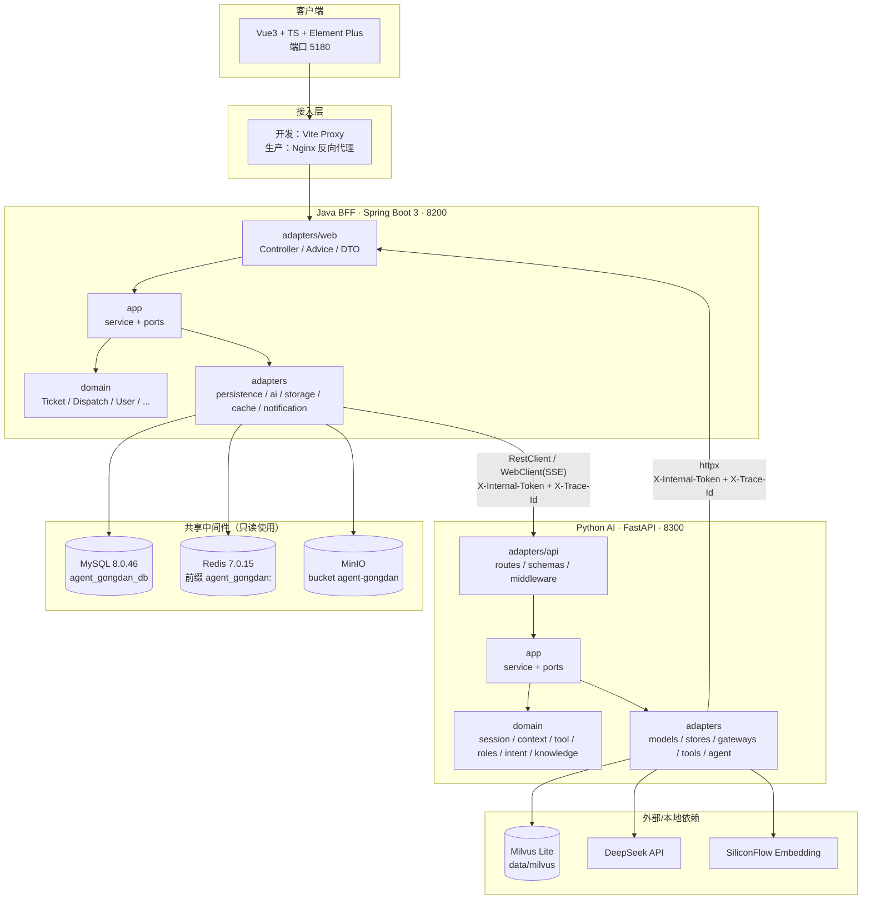
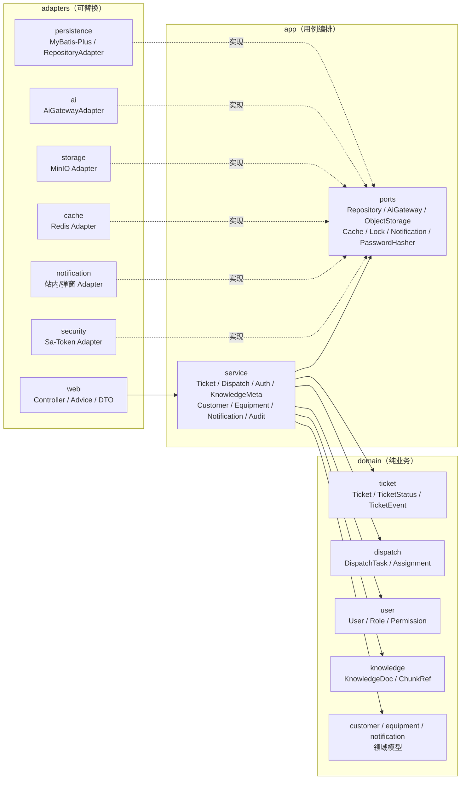
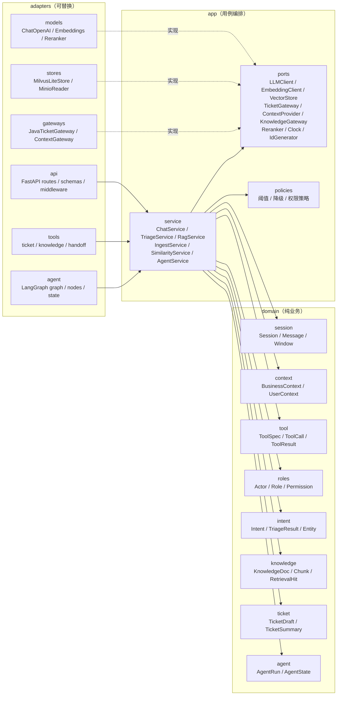
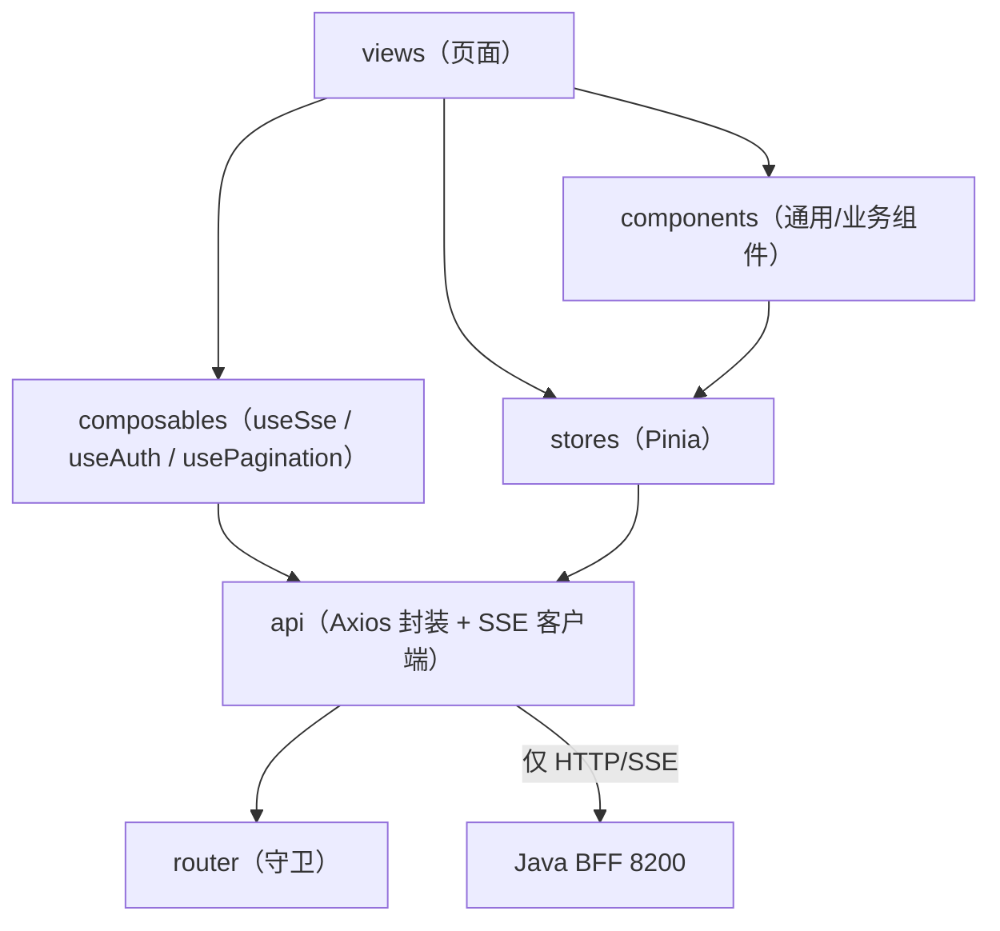
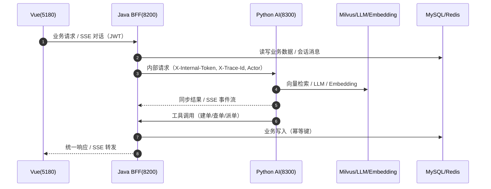
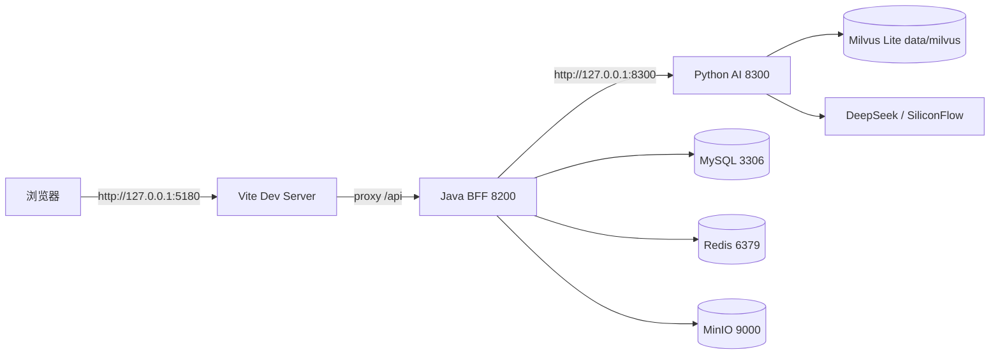
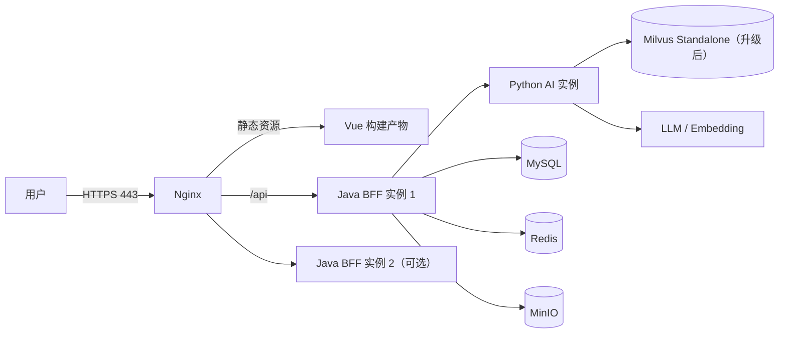

# 02-技术选型与架构设计

> 项目：**IT 运维工单智能 Agent**（agent-gongdan）
> 阶段：第二阶段 · 技术选型与整体架构
> 版本：v1.2
> 日期：2026-11-18
> 状态：已确认（Phase 1 实现回填：M8 轻量自愈熔断、降级演练口径、文档-代码对账）
> 说明：本文档只包含设计、契约、目录与配置说明，**不包含任何业务代码或脚手架配置代码**。

---

## 1. 文档信息与决策记录

### 1.1 修订记录

| 版本 | 日期 | 修订人 | 说明 |
|---|---|---|---|
| v1.0 | 2026-11-17 | Claude | 依据第一阶段需求与用户拍板的 6 项选型，输出完整架构设计 |
| v1.1 | 2026-11-17 | Claude | 回填 04 v1.1：SSE 事件全集（`triage`/`ping`/`ticket_card`）、内部建单字段（`source_ref_*`/`triage_id`）、collection 命名、内部 API 路径统一 |
| v1.2 | 2026-11-18 | Claude | Phase 1 实现回填：M8 采用轻量自愈熔断器 `AiAvailabilityGuard`、规则分诊兜底、前端转表单入口；补充 §4.6 上下文管理策略与 TD09–TD14 |

### 1.2 关联文档

| 阶段 | 文档 | 状态 |
|---|---|---|
| 第一阶段 | `01-需求与功能模块清单.md` | 已认可 |
| 第二阶段 | `02-技术选型与架构设计.md` | 本文档 |
| 第三阶段 | `03-数据库设计文档.md`（v1.1） | 已确认 |
| 第四阶段 | `04-API接口设计清单.md`（v1.1） | 已回填 |
| 第五阶段 | `05-最终设计方案与开发规范.md`（v1.2） | 已确认 |

### 1.3 已拍板决策记录

| 编号 | 事项 | 决策 | 来源 |
|---|---|---|---|
| D01 | 项目定位 | 可部署、支持高并发的企业级 IT 运维工单智能 Agent | 第一阶段 |
| D02 | 前端栈 | Vue3 + Vite + Element Plus + Axios + TypeScript | 第一阶段 / 第二阶段 |
| D03 | Java 栈 | Java 17 + Spring Boot 3 + MyBatis-Plus + Sa-Token JWT | 第一阶段 |
| D04 | Python 栈 | Python 3.13 + FastAPI + LangChain 1.x + LangGraph + Milvus Lite | 第一阶段 / 第二阶段 |
| D05 | 架构思想 | 六边形架构，Domain / App(ports) / Adapters / 组装根 | 第一阶段 |
| D06 | LLM | DeepSeek OpenAI 兼容接口，`https://api.deepseek.com/v1`，`deepseek-chat` | 用户拍板 |
| D07 | Embedding | SiliconFlow OpenAI 兼容接口，`BAAI/bge-m3`，1024 维，`SILICONFLOW_API_KEY` | 用户拍板 |
| D08 | 服务间认证 | 按方向拆分的静态内部 Token（J2P / P2J），Header `X-Internal-Token` + `X-Internal-Token-Kid`，从 `.env` 读取；current+next 双 Token 轮换 | 用户拍板 / 04 v1.1 细化 |
| D09 | Milvus | Milvus Lite，数据目录 `<repo>/data/milvus/` | 用户拍板 |
| D10 | 语音播报 | P2 使用浏览器原生 `speechSynthesis` | 用户拍板 |
| D11 | JWT 策略 | 延后至第四阶段；倾向纯无状态，Redis 仅作可选黑名单 | 用户拍板 |
| D12 | 附件限制 | 延后至第三阶段；预设单文件 10MB，允许 pdf/docx/md/png/jpg | 用户拍板 |
| D13 | 业户/设备数据 | 本期准备 10–20 条高质量 Seed Data 用于演示与 AI 上下文 | 用户拍板 |
| D14 | SLA | 紧急 4 小时、普通 24 小时，第三阶段建表体现 | 用户拍板 |
| D15 | 拓展排序 | 直接派单 + 抢单池 → 通知 → 报表/业户设备可视化 | 用户拍板 |
| D16 | Java HTTP/SSE/容错 | RestClient + WebClient/Flux + Resilience4j，不引入 Spring Cloud；**MVP 使用轻量自愈熔断器，暂不替换 Resilience4j**（见 §7.4） | 用户拍板 |
| D17 | LangChain 代际 | 1.x 主线 | 用户拍板 |
| D18 | 数据库迁移 | Flyway | 用户拍板 |
| D19 | Mermaid | 仅用于设计文档，不进入前端运行时 | 用户拍板 |
| D20 | 数据库外键 | **全量禁止物理外键**，仅用逻辑外键字段 + 索引 | 用户拍板 |

---

## 2. 设计目标与约束

### 2.1 设计目标

| 编号 | 目标 | 架构落点 |
|---|---|---|
| A1 | 企业级、可部署 | 分环境配置、健康检查、迁移脚本、优雅停机、可观测性 |
| A2 | 支持高并发演进 | 无状态服务、连接池、异步 I/O、SSE 流式、限流熔断、可水平扩展 |
| A3 | 跨语言异构解耦 | Java 与 Python 通过契约化内部 API 通信，各自独立部署 |
| A4 | 六边形架构 | 领域不依赖框架；应用层依赖端口；适配器可替换 |
| A5 | AI 故障可降级 | 熔断、规则兜底、表单建单、Milvus/LLM 分级降级 |
| A6 | 安全与可审计 | JWT、内部 Token、RBAC、数据权限、PII 脱敏、全链路审计 |
| A7 | 严格资源隔离 | 独立库/前缀/bucket/端口，共享中间件只读 |
| A8 | MVP 妥协保留升级潜力 | 所有妥协登记升级触发条件与替换点 |

### 2.2 不可妥协的底线

1. 不触碰 `~/Workspace/` 下其他项目；共享中间件只允许连接使用。
2. 不修改共享容器、全局配置、端口、认证或数据卷。
3. 所有业务数据只写入 `agent_gongdan_db`；Redis key 必须带 `agent_gongdan:` 前缀；MinIO 只用 `agent-gongdan` bucket。
4. **数据库全量禁止物理外键**：不使用 `FOREIGN KEY`，不依赖级联删除/更新。
5. Python 不直连 MySQL；前端不直连 Python；所有业务写入经 Java。
6. 关键操作保留人在回路；AI 故障不得阻断基础工单能力。

### 2.3 数据库外键策略（本项目强制约定）

| 项目 | 规定 |
|---|---|
| 物理外键 | **禁止创建**，包括 `FOREIGN KEY ... REFERENCES` 与级联动作 |
| 关系表达 | 使用逻辑外键字段（如 `ticket_id`、`user_id`）并在需要时建普通索引 |
| 一致性保障 | 应用层事务、写入前存在性校验、幂等键、唯一索引、定期对账任务 |
| 删除策略 | 业务数据默认软删除（`deleted_at` / `is_deleted`）；禁止数据库级联删除 |
| 跨服务关系 | Java 是唯一写入方；Python 通过内部 API 读写，不持有数据库连接 |
| 迁移影响 | 表结构变更不触发外键锁；便于分库分表与数据迁移 |
| 风险与补偿 | 可能产生孤儿数据 → 对账任务与告警；关键关联查询在应用层做 join/批量补全 |

> 第三阶段的建表 SQL 必须逐项检查：**不得出现任何 `FOREIGN KEY` 关键字**。

---

## 3. 技术选型清单

> 版本来源：2026-11-17 实时查询 PyPI / npm / Maven Central 与共享中间件实际版本。
> 本文档记录的是**决策基线**；实施时以锁文件解析结果为准，并回填到本表。

### 3.1 前端（Node.js 22.22.1 已安装）

| 组件 | 版本 | 用途 | 状态 |
|---|---|---|---|
| Vue | 3.5.45 | 核心框架 | 已确认 |
| Vite | 8.3.8 | 构建与开发服务器 | 已确认 |
| @vitejs/plugin-vue | 6.0.11 | Vite Vue 插件 | 已确认 |
| TypeScript | 5.9.3 | 类型系统（TS 7 与 vue-tsc 3.3.14 不兼容，Phase 1 实测回退） | 已确认 |
| vue-tsc | 3.3.14 | 模板与类型检查 | 已确认 |
| Element Plus | 2.14.8 | UI 组件 | 已确认 |
| @element-plus/icons-vue | 2.3.2 | 图标 | 已确认 |
| Axios | 1.21.1 | HTTP 封装 | 已确认 |
| Vue Router | 5.5.1 | 路由与守卫 | 已确认 |
| Pinia | 4.1.0 | 状态管理 | 已确认 |
| Sass | 1.108.2 | 样式预处理 | 已确认 |
| markdown-it | 15.0.3 | AI 回答 Markdown 渲染 | 已确认 |
| DOMPurify | 3.4.18 | XSS 过滤 | 已确认 |
| @microsoft/fetch-event-source | 2.0.1 | POST SSE 流式对话 | 已确认 |
| ECharts | 6.1.0 | P1 报表 | 已确认 |
| Vitest | 5.1.0 | 单测 | 已确认 |
| @vue/test-utils | 2.6.0 | 组件测试 | 已确认 |
| ESLint | 10.15.0 | 静态检查 | 已确认 |
| Prettier | 3.10.1 | 格式化 | 已确认 |
| Mermaid | 12.3.0 | 仅设计文档，无前端运行时依赖 | 已确认 |

**兼容性验证点**：Vite 8 / Node 22；Vue 3.5 + Vue Router 5 + Pinia 4；**TypeScript 5.9.3 + vue-tsc 3.3.14 已验证**。TypeScript 7.0.2 因 `./lib/tsc` 导出缺失与 vue-tsc 不兼容，暂不使用；安装时如出现 peer 依赖冲突，优先降级 Router/Pinia 到与 Vue 3.5 官方声明兼容的版本，并在本表回填。

### 3.2 Java（JDK 17 项目内安装；Maven 3.9.12 已安装）

| 组件 | 版本 | 用途 | 状态 |
|---|---|---|---|
| Eclipse Temurin JDK | 17.0.x（安装时锁定最新补丁） | 运行时 | 已确认（项目内 `.jdk/`） |
| Maven | 3.9.12 | 构建 | 已安装 |
| Spring Boot | 3.5.16 | 基础框架 | 已确认 |
| Spring Web MVC | 随 Boot | 主 Web 栈 | 已确认 |
| Spring WebFlux（仅 WebClient） | 随 Boot | SSE 流式转发 | 已确认 |
| MyBatis-Plus | 3.5.18.1 | ORM | 已确认 |
| MySQL Connector/J | 26.10.0（不兼容则回退 9.3.0） | JDBC 驱动 | 待实测 |
| Sa-Token（boot3 + jwt） | 1.46.0 | 无状态鉴权 | 已确认 |
| Resilience4j（spring-boot3） | 2.4.0 | 熔断/重试/超时/舱壁 | 暂不引入；MVP 使用 `AiAvailabilityGuard`，保留同一 Port 替换口（见 §7.4） |
| springdoc-openapi | 2.10.0 | OpenAPI/Swagger | 已确认 |
| Flyway + flyway-mysql | 13.12.2 | 数据库迁移 | 已确认 |
| MinIO Java SDK | 9.0.4 | 对象存储 | 已确认 |
| Lombok | 1.18.48 | 样板代码 | 已确认 |
| MapStruct | 1.6.3 | DTO 映射 | 已确认 |
| Micrometer + Actuator | 随 Boot | 指标与健康检查 | 已确认 |
| Spring Data Redis（Lettuce） | 随 Boot | 缓存/限流/可选黑名单 | 已确认 |
| JUnit 5 / Mockito / AssertJ | 随 Boot | 测试 | 已确认 |

**兼容性验证点**：`mysql-connector-j 26.10.0` 与 MySQL 8.0.46 的握手、时区、SSL、`allowPublicKeyRetrieval` 参数；不通过则回退 9.3.0。Spring Boot 3.5.16 与 Java 17 的兼容性由官方保证。

### 3.3 Python（uv 0.13.8；Python 3.13 项目内安装）

| 组件 | 版本 | 用途 | 状态 |
|---|---|---|---|
| Python | 3.13.x（uv 锁定最新补丁） | 运行时 | 已确认 |
| uv | 0.13.8 | 解释器与依赖管理 | 已确认（待安装） |
| FastAPI | 0.163.1 | Web 框架 | 已确认 |
| Uvicorn | 0.54.0 | ASGI 服务器 | 已确认 |
| Pydantic | 2.14.3 | 数据模型 | 已确认 |
| pydantic-settings | 2.16.3 | 配置加载 | 已确认 |
| LangChain | 1.5.0 | LLM 编排 | 已确认 |
| LangGraph | 1.2.22 | Agent 状态图 | 已确认 |
| langchain-openai | 1.8.0 | OpenAI 兼容客户端 | 已确认 |
| pymilvus | 3.0.3 | Milvus 客户端 | 已确认 |
| milvus-lite | 3.2.2 | 本地向量库（版本由 pymilvus 依赖解析后锁定） | 待锁定 |
| httpx | 0.28.1 | 调用 Java 内部 API | 已确认 |
| tenacity | 9.2.1 | 重试 | 已确认 |
| structlog | 26.1.0 | 结构化日志 | 已确认 |
| python-multipart | 0.0.34 | 文件上传 | 已确认 |
| orjson | 3.13.0 | 高性能序列化（可选） | 已确认 |
| prometheus-client | 0.26.0 | P1 指标 | 已确认 |
| pytest / pytest-asyncio / respx | 9.2.0 / 1.5.0 / 0.23.1 | 测试 | 已确认 |
| black | 26.10.1 | 格式化（遵循 AGENTS.md） | 已确认 |

**兼容性验证点**：pymilvus 3.0.3 与 milvus-lite 3.2.2 的版本约束以 `uv.lock` 解析为准；LangChain 1.x 与 langchain-openai 1.x 的 API 一致性；Python 3.13 下所有 wheel 可用性。

### 3.4 中间件与外部服务

| 组件 | 实际版本 | 使用方式 | 备注 |
|---|---|---|---|
| MySQL | 8.0.46 | 共享实例，库 `agent_gongdan_db` | 最小权限账号；禁止物理外键 |
| Redis | 7.0.15 | 共享实例，前缀 `agent_gongdan:` | `maxmemory=0`、`noeviction`，应用必须自限缓存 |
| MinIO | RELEASE.2025-09-07 | 共享实例，bucket `agent-gongdan` | 不改认证；使用用户提供的凭据 |
| Milvus Lite | 3.2.2 | 嵌入式，`<repo>/data/milvus/milvus.db` | 单进程限制，见第 8 节 |
| LLM | DeepSeek `deepseek-chat` | `https://api.deepseek.com/v1` | `DEEPSEEK_API_KEY` |
| Embedding | SiliconFlow `BAAI/bge-m3` | OpenAI 兼容 | 1024 维，`SILICONFLOW_API_KEY` |
| 语音播报 | 浏览器 `speechSynthesis` | P2 | 无外部服务 |

### 3.5 版本锁定策略

| 工程 | 锁定文件 | 规则 |
|---|---|---|
| Vue | `package-lock.json` / `pnpm-lock.yaml` | `save-exact=true`，禁止 `^`/`~` 漂移 |
| Java | `pom.xml` `<properties>` | 所有版本集中声明；禁止使用未固定版本的动态范围 |
| Python | `uv.lock` + `.python-version` | 锁定解释器与全部传递依赖 |
| 运行时 | 版本写入 `README.md` 与本文档 | 升级需走变更评审并更新文档 |

### 3.6 Python 依赖分层约束

| 层 | 允许依赖 | 禁止依赖 |
|---|---|---|
| `domain/` | 标准库、`dataclasses`、`typing`、领域内模块 | FastAPI、Pydantic、LangChain、pymilvus、httpx |
| `app/` | `domain/`、`app/ports.py`、标准库 | 具体 SDK、FastAPI 路由、数据库驱动 |
| `adapters/` | FastAPI、Pydantic、LangChain/LangGraph、pymilvus、httpx、MinIO SDK | 直接跨适配器互相调用 |
| `main.py` | 全部层 | 业务规则（只做装配） |

Java 端对应规则：`domain` 不依赖 Spring/MyBatis；`app` 依赖 domain 与 ports；`adapters` 实现 ports；`config` 只做装配。

---

## 4. 六边形架构落地

### 4.1 总体架构图



### 4.2 Java 端六边形分层



**Java 端口清单（应用层定义，适配层实现）**

| 端口 | 职责 | 典型适配器 |
|---|---|---|
| `TicketRepositoryPort` | 工单聚合持久化与查询 | MyBatis-Plus |
| `TicketEventRepositoryPort` | 时间线与操作日志 | MyBatis-Plus |
| `DispatchRepositoryPort` | 派单/抢单池 | MyBatis-Plus |
| `UserRepositoryPort` | 用户与角色 | MyBatis-Plus |
| `KnowledgeMetaRepositoryPort` | 知识元数据 | MyBatis-Plus |
| `CustomerRepositoryPort` / `EquipmentRepositoryPort` | 业户与设备 | MyBatis-Plus |
| `AiGatewayPort` | 调用 Python AI（同步/SSE/入库/检索） | RestClient + WebClient |
| `ObjectStoragePort` | 附件与知识原文 | MinIO |
| `CachePort` / `LockPort` | 缓存、幂等键、分布式锁 | Redis |
| `NotificationPort` | 站内通知与弹窗事件 | 站内实现，P2 邮件/IM |
| `PasswordHasherPort` | 密码哈希 | BCrypt |
| `AuditPort` | 审计写入 | MySQL |
| `ClockPort` / `IdGeneratorPort` | 可测试时间与 ID | 系统实现 |

### 4.3 Python 端六边形分层



**Python 端口清单（`app/ports.py` 内定义，不包含实现）**

| 端口 | 职责 | 适配器 | 升级/替换点 |
|---|---|---|---|
| `LLMClient` | 同步/流式对话、结构化输出 | `adapters/models/llm_openai_compatible` | 换模型/厂商 |
| `EmbeddingClient` | 批量/单条向量化 | `adapters/models/embedding_openai_compatible` | 换 Embedding 平台 |
| `VectorStore` | collection 管理、upsert、检索、删除 | `adapters/stores/milvus_lite_store` | **Milvus Lite → Standalone** |
| `Reranker` | P1 检索重排 | `adapters/models/reranker` | 可空实现 |
| `TicketGateway` | 建单/查单/我的工单/派单 | `adapters/gateways/java_ticket_gateway` | 换通信方式 |
| `ContextProvider` | 业户/房号/设备/历史工单上下文 | `adapters/gateways/java_context_gateway` | 增加上下文源 |
| `KnowledgeGateway` | 获取文档原文/预签名地址 | `adapters/gateways/java_knowledge_gateway` | 换存储 |
| `DocumentReader` | 读取 MinIO 文档 | `adapters/stores/minio_document_reader` | 换对象存储 |
| `Clock` / `IdGenerator` | 可测试时间与 ID | 系统实现 | — |

**Python 无状态原则**

- Python 不保存会话主数据；会话与消息由 Java 持久化。
- 每次请求由 Java 传入：`actor`、`session_id`、最近 N 条消息、会话摘要、业务上下文引用。
- LangGraph 的检查点（checkpoint）默认仅存在于单次请求内存；未来如需跨请求恢复，新增 `CheckpointStore` 端口（Redis/DB），不改变业务层。

### 4.4 前端分层



**前端约束**

1. 只允许访问 Java BFF（8200）；禁止硬编码 Python 地址。
2. 所有请求经 `api/http.ts` 统一封装：Token、`X-Request-Id`、错误码、超时、降级提示。
3. `VITE_*` 变量会进入前端产物，禁止放任何密钥。
4. 页面不直接处理业务错误码，由 `api` 层映射为统一提示与 `traceId` 展示。

### 4.5 依赖规则与架构守护

| 规则 | Java | Python | 前端 |
|---|---|---|---|
| 领域层零框架依赖 | ✓ | ✓ | — |
| 应用层只依赖端口 | ✓ | ✓ | — |
| 适配器实现端口 | ✓ | ✓ | — |
| 组装根集中装配 | Spring Config | `main.py` | `main.ts` |
| 禁止越层调用 | Controller 不含业务；Repository 不返回 Entity 到 Web | 路由不写业务；Agent 不直接调 SDK | 页面不直连 Python |
| 守护手段 | ArchUnit（P1） | import-linter（P1） | ESLint 边界规则（P1） |

### 4.6 上下文管理策略（Phase 1）

当前采用“**单会话滑动窗口 + 当前问题 RAG + 单轮工具结果**”，不做跨会话长期记忆：

| 项 | Phase 1 策略 | 说明 |
|---|---|---|
| 会话历史 | Java 取最近 `CHAT_HISTORY_MAX_MESSAGES=20` 条已完成消息；Python 再限制 `messages[-24:]` | 只取 `USER/ASSISTANT`，工具消息不跨轮重放 |
| 单条消息 | 超过 4000 字符截断后再送模型 | 原文仍完整保存在 `chat_message` |
| RAG | `RAG_TOP_K=5`、阈值 0.35、总字符 6000 | 由 Java 召回并补全分块内容 |
| 工具结果 | **确定性硬截断**，只保留模型决策所需字段与条数 | 不做 LLM 语义压缩；审计表另有 4096 字节截断 |
| 长会话摘要 | `chat_session.summary` 字段已预留，**当前未启用** | 登记为 TD10，Phase 1.5 实现 |
| 跨会话记忆 / 用户画像 | 不做 | 登记为 TD11–TD13 |
| 记忆与知识库 | **禁止混用** | 记忆必须独立存储、按 `tenant_id + user_id` 过滤；权威知识不按时间衰减 |

**原则**：先做确定性压缩与可观测性，再考虑语义压缩；记忆不得写入权威知识库 collection，避免语义污染与越权检索。

---

## 5. 项目目录结构

### 5.1 仓库根目录

```text
agent-gongdan/
├── CLAUDE.md                         # 项目规则（第 0 条隔离 + 第 2 条可升级原则）
├── README.md                         # 启动说明、端口、环境要求
├── .env.example                      # 后端共享配置模板（不含真实密钥）
├── .gitignore                        # .env / .jdk / .venv / data/milvus / logs / run
├── .editorconfig
├── docs/
│   ├── design/
│   │   ├── 01-需求与功能模块清单.md
│   │   ├── 02-技术选型与架构设计.md
│   │   ├── 03-数据库设计文档.md          # 待产出
│   │   ├── 04-API接口设计清单.md         # 待产出
│   │   └── 05-最终设计方案与开发规范.md   # 待产出
│   └── memory/
│       ├── 00_project_brief.md          # 项目简介与阶段记忆
│       └── YYYY-MM-DD-阶段总结.md        # 后续阶段补充
├── apps/
│   ├── web/                          # Vue3 + TS 子工程
│   ├── java-bff/                     # Spring Boot 3 子工程
│   └── python-ai/                    # FastAPI 子工程
├── data/
│   └── milvus/                       # Milvus Lite 数据（gitignored）
│       └── .gitkeep
├── logs/                             # 进程日志（gitignored）
├── run/                              # pid 文件（gitignored）
├── scripts/                          # 环境与启停脚本（后续实现）
│   ├── setup-jdk17.sh
│   ├── setup-python313.sh
│   ├── dev-start.sh
│   ├── dev-stop.sh
│   ├── health-check.sh
│   └── db-migrate.sh
├── .jdk/                             # 项目内 JDK 17（gitignored）
└── apps/python-ai/.venv/             # Python 3.13 虚拟环境（gitignored）
```

**环境放置约定**

- JDK 17 放在仓库根 `.jdk/`，由启动脚本设置 `JAVA_HOME`，不修改系统默认。
- Python 3.13 虚拟环境放在 `apps/python-ai/.venv/`，由 uv 创建。
- Milvus Lite 数据固定在 `<repo>/data/milvus/`；配置中的相对路径一律相对**仓库根**解析，不依赖进程 cwd。
- 日志与 pid 文件分别放 `logs/`、`run/`，便于精确停止。

### 5.2 Vue3 子工程目录树

```text
apps/web/
├── .env.example                      # 仅 VITE_* 公开变量
├── .gitignore
├── index.html
├── package.json
├── package-lock.json
├── tsconfig.json
├── tsconfig.app.json
├── tsconfig.node.json
├── vite.config.ts                    # 开发代理 /api → 127.0.0.1:8200
├── eslint.config.ts
├── .prettierrc
├── public/
│   └── favicon.ico
├── src/
│   ├── main.ts                       # 挂载 App、Pinia、Router、Element Plus
│   ├── App.vue
│   ├── api/
│   │   ├── http.ts                   # Axios 实例：Token、trace、错误映射
│   │   ├── sse.ts                    # POST SSE 客户端封装
│   │   ├── auth.ts
│   │   ├── tickets.ts
│   │   ├── chat.ts
│   │   ├── knowledge.ts
│   │   ├── dispatch.ts
│   │   ├── notifications.ts
│   │   ├── reports.ts
│   │   ├── customers.ts
│   │   ├── equipment.ts
│   │   └── admin.ts
│   ├── assets/
│   │   ├── images/
│   │   └── icons/
│   ├── components/
│   │   ├── common/
│   │   │   ├── PageHeader.vue
│   │   │   ├── EmptyState.vue
│   │   │   ├── ConfirmDialog.vue
│   │   │   └── TraceIdTag.vue
│   │   ├── ticket/
│   │   │   ├── TicketTable.vue
│   │   │   ├── TicketForm.vue
│   │   │   ├── TicketTimeline.vue
│   │   │   └── TicketStatusTag.vue
│   │   ├── chat/
│   │   │   ├── MessageList.vue
│   │   │   ├── MessageItem.vue
│   │   │   ├── CitationCard.vue
│   │   │   ├── TicketDraftCard.vue
│   │   │   └── ChatInput.vue
│   │   └── knowledge/
│   │       ├── KnowledgeTable.vue
│   │       └── UploadPanel.vue
│   ├── composables/
│   │   ├── useAuth.ts
│   │   ├── useSse.ts
│   │   ├── usePagination.ts
│   │   ├── usePermission.ts
│   │   └── useNotification.ts
│   ├── layouts/
│   │   ├── DefaultLayout.vue
│   │   └── BlankLayout.vue
│   ├── router/
│   │   ├── index.ts
│   │   ├── routes.ts
│   │   └── guards.ts
│   ├── stores/
│   │   ├── auth.ts
│   │   ├── ticket.ts
│   │   ├── chat.ts
│   │   ├── notification.ts
│   │   └── app.ts
│   ├── styles/
│   │   ├── index.scss
│   │   ├── variables.scss
│   │   └── element-overrides.scss
│   ├── types/
│   │   ├── api.d.ts
│   │   ├── auth.ts
│   │   ├── ticket.ts
│   │   ├── chat.ts
│   │   ├── knowledge.ts
│   │   ├── dispatch.ts
│   │   ├── customer.ts
│   │   └── equipment.ts
│   ├── utils/
│   │   ├── format.ts
│   │   ├── storage.ts
│   │   ├── validate.ts
│   │   └── download.ts
│   └── views/
│       ├── login/LoginView.vue
│       ├── dashboard/DashboardView.vue
│       ├── tickets/
│       │   ├── TicketListView.vue
│       │   ├── TicketCreateView.vue
│       │   └── TicketDetailView.vue
│       ├── chat/ChatView.vue
│       ├── knowledge/
│       │   ├── KnowledgeListView.vue
│       │   └── KnowledgeUploadView.vue
│       ├── dispatch/
│       │   ├── DispatchBoardView.vue
│       │   └── ClaimPoolView.vue
│       ├── notifications/NotificationCenterView.vue
│       ├── reports/ReportView.vue
│       ├── admin/
│       │   ├── UserView.vue
│       │   ├── RoleView.vue
│       │   ├── DictView.vue
│       │   └── AuditView.vue
│       ├── customer/
│       │   ├── CustomerListView.vue
│       │   └── ResourceMapView.vue
│       ├── equipment/
│       │   ├── EquipmentListView.vue
│       │   └── InspectionView.vue
│       └── error/
│           ├── NotFoundView.vue
│           └── ForbiddenView.vue
└── tests/
    ├── unit/
    └── e2e/                          # P2
```

### 5.3 Spring Boot 子工程目录树

```text
apps/java-bff/
├── pom.xml
├── .gitignore
├── src/
│   ├── main/
│   │   ├── java/com/agentgongdan/
│   │   │   ├── AgentGongdanApplication.java
│   │   │   ├── domain/
│   │   │   │   ├── ticket/
│   │   │   │   │   ├── Ticket.java
│   │   │   │   │   ├── TicketStatus.java
│   │   │   │   │   ├── TicketEvent.java
│   │   │   │   │   ├── TicketComment.java
│   │   │   │   │   ├── TicketAttachment.java
│   │   │   │   │   └── TicketDraft.java
│   │   │   │   ├── dispatch/
│   │   │   │   │   ├── DispatchTask.java
│   │   │   │   │   ├── Assignment.java
│   │   │   │   │   └── ClaimPoolEntry.java
│   │   │   │   ├── user/
│   │   │   │   │   ├── User.java
│   │   │   │   │   ├── Role.java
│   │   │   │   │   └── Permission.java
│   │   │   │   ├── knowledge/
│   │   │   │   │   ├── KnowledgeDoc.java
│   │   │   │   │   ├── KnowledgeStatus.java
│   │   │   │   │   └── ChunkRef.java
│   │   │   │   ├── customer/
│   │   │   │   │   ├── Customer.java
│   │   │   │   │   ├── Room.java
│   │   │   │   │   └── Tenancy.java
│   │   │   │   ├── equipment/
│   │   │   │   │   ├── Equipment.java
│   │   │   │   │   ├── EquipmentCategory.java
│   │   │   │   │   └── InspectionTask.java
│   │   │   │   ├── notification/
│   │   │   │   │   └── Notification.java
│   │   │   │   └── shared/
│   │   │   │       ├── DomainError.java
│   │   │   │       ├── PageResult.java
│   │   │   │       └── Ids.java
│   │   │   ├── app/
│   │   │   │   ├── ports/
│   │   │   │   │   ├── repository/
│   │   │   │   │   │   ├── TicketRepositoryPort.java
│   │   │   │   │   │   ├── TicketEventRepositoryPort.java
│   │   │   │   │   │   ├── DispatchRepositoryPort.java
│   │   │   │   │   │   ├── UserRepositoryPort.java
│   │   │   │   │   │   ├── KnowledgeMetaRepositoryPort.java
│   │   │   │   │   │   ├── CustomerRepositoryPort.java
│   │   │   │   │   │   └── EquipmentRepositoryPort.java
│   │   │   │   │   ├── ai/
│   │   │   │   │   │   ├── AiGatewayPort.java
│   │   │   │   │   │   ├── AiChatCommand.java
│   │   │   │   │   │   ├── AiChatEvent.java
│   │   │   │   │   │   ├── TriageCommand.java
│   │   │   │   │   │   └── TriageResult.java
│   │   │   │   │   ├── storage/ObjectStoragePort.java
│   │   │   │   │   ├── cache/CachePort.java
│   │   │   │   │   ├── cache/LockPort.java
│   │   │   │   │   ├── notification/NotificationPort.java
│   │   │   │   │   ├── security/PasswordHasherPort.java
│   │   │   │   │   ├── audit/AuditPort.java
│   │   │   │   │   └── system/ClockPort.java, IdGeneratorPort.java
│   │   │   │   ├── service/
│   │   │   │   │   ├── auth/AuthService.java
│   │   │   │   │   ├── ticket/TicketService.java
│   │   │   │   │   ├── ticket/TicketQueryService.java
│   │   │   │   │   ├── dispatch/DispatchService.java
│   │   │   │   │   ├── knowledge/KnowledgeMetaService.java
│   │   │   │   │   ├── customer/CustomerService.java
│   │   │   │   │   ├── equipment/EquipmentService.java
│   │   │   │   │   ├── notification/NotificationService.java
│   │   │   │   │   └── audit/AuditService.java
│   │   │   │   ├── dto/
│   │   │   │   │   ├── command/
│   │   │   │   │   └── result/
│   │   │   │   └── policy/
│   │   │   │       ├── RuleBasedTriagePolicy.java
│   │   │   │       └── DataScopePolicy.java
│   │   │   ├── adapters/
│   │   │   │   ├── web/
│   │   │   │   │   ├── controller/
│   │   │   │   │   │   ├── AuthController.java
│   │   │   │   │   │   ├── TicketController.java
│   │   │   │   │   │   ├── ChatController.java
│   │   │   │   │   │   ├── KnowledgeController.java
│   │   │   │   │   │   ├── DispatchController.java
│   │   │   │   │   │   ├── NotificationController.java
│   │   │   │   │   │   ├── ReportController.java
│   │   │   │   │   │   ├── AdminController.java
│   │   │   │   │   │   ├── CustomerController.java
│   │   │   │   │   │   ├── EquipmentController.java
│   │   │   │   │   │   └── InternalController.java
│   │   │   │   │   ├── advice/GlobalExceptionHandler.java
│   │   │   │   │   ├── dto/request/ + response/
│   │   │   │   │   └── mapper/ (MapStruct)
│   │   │   │   ├── persistence/
│   │   │   │   │   ├── entity/
│   │   │   │   │   ├── mapper/ (MyBatis-Plus Mapper)
│   │   │   │   │   ├── repository/ (*RepositoryAdapter)
│   │   │   │   │   └── converter/
│   │   │   │   ├── ai/
│   │   │   │   │   ├── AiGatewayAdapter.java
│   │   │   │   │   ├── AiSseClient.java
│   │   │   │   │   └── dto/
│   │   │   │   ├── storage/MinioObjectStorageAdapter.java
│   │   │   │   ├── cache/RedisCacheAdapter.java, RedisLockAdapter.java
│   │   │   │   ├── notification/InAppNotificationAdapter.java
│   │   │   │   └── security/SaTokenPasswordHasherAdapter.java
│   │   │   ├── config/
│   │   │   │   ├── AppConfig.java
│   │   │   │   ├── AiClientConfig.java
│   │   │   │   ├── ResilienceConfig.java
│   │   │   │   ├── MybatisPlusConfig.java
│   │   │   │   ├── WebConfig.java
│   │   │   │   ├── JacksonConfig.java
│   │   │   │   ├── OpenApiConfig.java
│   │   │   │   └── TraceFilter.java
│   │   │   └── common/
│   │   │       ├── error/ErrorCode.java, ApiException.java
│   │   │       ├── trace/TraceContext.java
│   │   │       └── util/
│   │   └── resources/
│   │       ├── application.yml
│   │       ├── application-dev.yml
│   │       ├── application-prod.yml
│   │       ├── db/migration/            # Flyway SQL，第三阶段产出
│   │       │   └── V1__init.sql
│   │       └── logback-spring.xml
│   └── test/
│       └── java/com/agentgongdan/
│           ├── unit/
│           ├── integration/
│           └── contract/                # WireMock 契约测试
```

### 5.4 FastAPI 子工程目录树（重点）

```text
apps/python-ai/
├── pyproject.toml                    # 依赖与工具配置（uv 管理）
├── uv.lock
├── .python-version                   # 3.13
├── README.md
├── main.py                           # 组装根：读配置、建适配器、注入端口、挂载路由
├── config.py                         # pydantic-settings；解析 PROJECT_ROOT 与 .env
├── domain/
│   ├── __init__.py
│   ├── session.py                    # Session / Message / ConversationWindow
│   ├── context.py                    # BusinessContext / UserContext / CustomerContext / EquipmentContext
│   ├── tool.py                       # ToolSpec / ToolCall / ToolResult / ToolRiskLevel
│   ├── roles.py                      # Actor / Role / Permission
│   ├── intent.py                     # Intent / Entity / TriageResult / Priority
│   ├── knowledge.py                  # KnowledgeDoc / Chunk / RetrievalHit / Citation
│   ├── ticket.py                     # TicketDraft / TicketSummary / TicketStatusView
│   ├── agent.py                      # AgentRun / AgentState / AgentDecision
│   └── errors.py                     # 领域错误类型（不含框架依赖）
├── app/
│   ├── __init__.py
│   ├── ports.py                      # 全部端口抽象（LLM/Embedding/VectorStore/Gateway/...）
│   ├── service.py                    # ChatService / TriageService / RagService
│   │                                 # IngestService / SimilarityService / AgentService
│   ├── policies.py                   # 置信度阈值、降级策略、工具白名单、权限裁剪
│   └── prompts/
│       ├── system.md                 # 系统提示词
│       ├── triage.md                 # 分诊提示词
│       └── rag_answer.md             # RAG 回答提示词
├── adapters/
│   ├── __init__.py
│   ├── api/
│   │   ├── __init__.py
│   │   ├── routes_chat.py            # POST /v1/agent/chat（SSE）
│   │   ├── routes_triage.py          # POST /v1/ai/triage
│   │   ├── routes_knowledge.py       # POST /v1/knowledge/ingest、/search、GET /jobs/{id}
│   │   ├── routes_similar.py         # POST /v1/ai/similar/tickets
│   │   ├── routes_health.py          # GET /health、/ready
│   │   ├── schemas.py                # Pydantic 请求/响应模型
│   │   ├── middleware.py             # trace_id、内部 Token 校验、统一错误
│   │   └── dependencies.py           # 路由级依赖注入
│   ├── models/
│   │   ├── __init__.py
│   │   ├── llm_openai_compatible.py  # ChatOpenAI（DeepSeek）
│   │   ├── embedding_openai_compatible.py  # SiliconFlow bge-m3
│   │   └── reranker.py               # P1，可空实现
│   ├── stores/
│   │   ├── __init__.py
│   │   ├── milvus_lite_store.py      # VectorStore 适配器，数据目录 data/milvus
│   │   └── minio_document_reader.py  # 读取预签名文档
│   ├── gateways/
│   │   ├── __init__.py
│   │   ├── java_ticket_gateway.py    # httpx → Java /internal/v1/tickets
│   │   ├── java_context_gateway.py   # httpx → Java /internal/v1/context
│   │   └── java_knowledge_gateway.py # httpx → Java /internal/v1/knowledge
│   ├── tools/
│   │   ├── __init__.py
│   │   ├── registry.py               # 工具注册与白名单
│   │   ├── ticket_tools.py           # create/query/list/assign
│   │   ├── knowledge_tools.py        # search_knowledge
│   │   └── handoff_tools.py          # escalate_to_human
│   └── agent/
│       ├── __init__.py
│       ├── state.py                  # LangGraph 状态定义
│       ├── nodes.py                  # intent / retrieve / decide / tool / respond 节点
│       └── graph.py                  # 状态图装配
└── tests/
    ├── unit/
    ├── integration/
    └── contract/                     # respx 模拟 Java 内部 API
```

**Python 目录设计说明**

1. `domain/` 只放领域模型与规则，禁止导入 FastAPI、LangChain、pymilvus、httpx、数据库驱动。
2. `app/ports.py` 是唯一的外部依赖抽象入口；`service.py` 只编排端口。
3. `adapters/api` 是 Web 边界：参数校验、鉴权中间件、SSE 输出、错误映射。
4. `adapters/agent` 只负责 LangGraph 装配；业务判断在 `app/service.py` 与 `app/policies.py`。
5. `main.py` 是唯一组装根：读取 `config.py`，实例化适配器，绑定端口，挂载路由。
6. 切换 Milvus Lite → Standalone：只替换 `adapters/stores/milvus_lite_store.py` 的装配与配置，不改 `domain/app`。

---

## 6. 端口与配置映射

### 6.1 端口矩阵

| 服务 | 端口 | 绑定地址（开发） | 说明 |
|---|---:|---|---|
| Web 前端（Vite） | 5180 | `127.0.0.1` | 开发用；生产由 Nginx 提供服务 |
| Java BFF | 8200 | `127.0.0.1` | 唯一对外业务入口；Actuator 同端口但限制访问 |
| Python AI | 8300 | `127.0.0.1` | 仅 Java 可访问；生产置于内网 |
| MySQL | 3306 | `0.0.0.0`（共享） | 只连接使用 |
| Redis | 6379 | `0.0.0.0`（共享） | 只连接使用，前缀隔离 |
| MinIO API / Console | 9000 / 9001 | `0.0.0.0`（共享） | 只连接使用 |
| Milvus Lite | 无端口 | 嵌入式 | 数据文件 `<repo>/data/milvus/milvus.db` |
| DeepSeek / SiliconFlow | 443 | 外部 HTTPS | 出站访问 |

> 启动前必须执行 `ss -ltn` 复核；发现冲突立即停止，不做清理。

### 6.2 根 `.env.example`（后端共享配置模板）

> 仅作为配置清单与模板，不包含真实密钥。真实 `.env` 由用户本地创建，必须被 `.gitignore` 忽略。

```dotenv
# ============================================================
# 全局
# ============================================================
APP_ENV=dev
PROJECT_ROOT=.
TZ=Asia/Shanghai
LOG_LEVEL=INFO
LOG_FORMAT=json

# ============================================================
# 端口
# ============================================================
WEB_PORT=5180
JAVA_PORT=8200
PYTHON_PORT=8300

# ============================================================
# MySQL（共享实例，独立库 + 最小权限账号）
# ============================================================
MYSQL_HOST=127.0.0.1
MYSQL_PORT=3306
MYSQL_DATABASE=agent_gongdan_db
MYSQL_USER=agent_gongdan_app
MYSQL_PASSWORD=change_me
MYSQL_URL=jdbc:mysql://127.0.0.1:3306/agent_gongdan_db?useUnicode=true&characterEncoding=utf8&serverTimezone=Asia/Shanghai&useSSL=false&allowPublicKeyRetrieval=true
MYSQL_POOL_MIN=5
MYSQL_POOL_MAX=20
MYSQL_CONNECT_TIMEOUT_MS=3000
MYSQL_SOCKET_TIMEOUT_MS=30000

# ============================================================
# Redis（共享实例，强制前缀）
# ============================================================
REDIS_HOST=127.0.0.1
REDIS_PORT=6379
REDIS_PASSWORD=
REDIS_DB=0
REDIS_KEY_PREFIX=agent_gongdan:
REDIS_TIMEOUT_MS=1000
REDIS_CACHE_TTL_SECONDS=300

# ============================================================
# MinIO（共享实例，独立 bucket）
# ============================================================
MINIO_ENDPOINT=http://127.0.0.1:9000
MINIO_ACCESS_KEY=change_me
MINIO_SECRET_KEY=change_me
MINIO_BUCKET=agent-gongdan
MINIO_PRESIGN_EXPIRE_SECONDS=600

# ============================================================
# Milvus Lite（项目内数据目录）
# ============================================================
# 注意：pymilvus 会读取 MILVUS_URI 环境变量，Lite 本地路径使用 MILVUS_LOCAL_PATH
MILVUS_LOCAL_PATH=./data/milvus/milvus.db
MILVUS_COLLECTION_KNOWLEDGE=agent_gongdan_kb_bge_m3_1024_v1
MILVUS_COLLECTION_TICKETS=agent_gongdan_ticket_bge_m3_1024_v1
MILVUS_METRIC_TYPE=COSINE
MILVUS_INDEX_TYPE=FLAT
MILVUS_TOP_K=5
MILVUS_SCORE_THRESHOLD=0.35
EMBEDDING_DIM=1024

# ============================================================
# LLM（DeepSeek OpenAI 兼容）
# ============================================================
LLM_PROVIDER=deepseek
LLM_BASE_URL=https://api.deepseek.com/v1
LLM_MODEL=deepseek-chat
DEEPSEEK_API_KEY=change_me
LLM_TEMPERATURE=0.2
LLM_MAX_TOKENS=2048
LLM_TIMEOUT_SECONDS=30
LLM_MAX_RETRIES=2

# ============================================================
# Embedding（SiliconFlow OpenAI 兼容）
# ============================================================
EMBEDDING_BASE_URL=https://api.siliconflow.cn/v1
EMBEDDING_MODEL=BAAI/bge-m3
SILICONFLOW_API_KEY=change_me
EMBEDDING_TIMEOUT_SECONDS=15
EMBEDDING_BATCH_SIZE=16

# ============================================================
# 服务间通信
# ============================================================
INTERNAL_TOKEN_J2P_CURRENT=change_me
INTERNAL_TOKEN_J2P_NEXT=change_me
INTERNAL_TOKEN_P2J_CURRENT=change_me
INTERNAL_TOKEN_P2J_NEXT=change_me
JAVA_INTERNAL_BASE_URL=http://127.0.0.1:8200
PYTHON_BASE_URL=http://127.0.0.1:8300
JAVA_TO_PY_CONNECT_TIMEOUT_MS=1000
JAVA_TO_PY_READ_TIMEOUT_MS=30000
JAVA_TO_PY_SSE_IDLE_TIMEOUT_MS=60000
PY_TO_JAVA_CONNECT_TIMEOUT_MS=1000
PY_TO_JAVA_READ_TIMEOUT_MS=5000
RETRY_MAX_ATTEMPTS=2
RETRY_BACKOFF_MS=300

# ============================================================
# 鉴权与安全
# ============================================================
JWT_SECRET=change_me
JWT_EXPIRE_SECONDS=7200
JWT_REFRESH_EXPIRE_SECONDS=604800
AUTH_WHITELIST=/api/auth/login,/health,/ready
CORS_ALLOWED_ORIGINS=http://127.0.0.1:5180,http://localhost:5180

# ============================================================
# 限流 / 熔断
# ============================================================
RATE_LIMIT_QPS=50
RATE_LIMIT_BURST=100
CB_FAILURE_RATE_THRESHOLD=50
CB_SLOW_CALL_DURATION_MS=3000
CB_WAIT_DURATION_SECONDS=30
CB_PERMITTED_HALF_OPEN=3
SSE_MAX_PER_USER=2
SSE_MAX_GLOBAL=200

# ============================================================
# 文件与附件
# ============================================================
UPLOAD_MAX_SIZE_MB=10
UPLOAD_ALLOWED_TYPES=pdf,docx,md,png,jpg
ATTACHMENT_PRESIGN_EXPIRE_SECONDS=600

# ============================================================
# AI 行为参数
# ============================================================
TRIAGE_CONFIDENCE_THRESHOLD=0.75
RAG_TOP_K=5
RAG_SCORE_THRESHOLD=0.35
RAG_MAX_CONTEXT_CHARS=6000
CHAT_HISTORY_MAX_MESSAGES=20
TOOL_RESULT_MAX_CHARS=4000
CHAT_SUMMARY_MAX_CHARS=1500
AGENT_MAX_STEPS=3
TOOL_TIMEOUT_SECONDS=5
TOOL_MAX_RETRIES=1
INGEST_MAX_CONCURRENT_JOBS=2
```

### 6.3 前端 `apps/web/.env.example`

```dotenv
VITE_API_BASE_URL=http://127.0.0.1:8200
VITE_APP_TITLE=IT 运维工单智能 Agent
VITE_SSE_ENABLED=true
VITE_UPLOAD_MAX_SIZE_MB=10
```

> `VITE_*` 会写入前端产物，**禁止放置任何密钥**。

### 6.4 配置加载与优先级

| 应用 | 加载方式 | 优先级（高 → 低） | 校验 |
|---|---|---|---|
| Java | `spring.config.import=optional:file:${PROJECT_ROOT}/.env[.properties]` + `application-{env}.yml` | 操作系统环境变量 > `.env` > yml 默认值 | 启动时校验必填项，缺失即失败 |
| Python | pydantic-settings，`env_file=${PROJECT_ROOT}/.env` | 环境变量 > `.env` > 代码默认值 | 必填密钥缺失即拒绝启动 |
| Vue | Vite 读取 `apps/web/.env` | 构建/启动环境变量 > `.env` | 仅校验公开变量 |

**密钥管理规则**

1. `.env` 不提交、不打印、不写入日志；`.env.example` 只放 `change_me` 占位。
2. 启动日志只允许输出“已加载/缺失”的变量名，不输出值。
3. `DEEPSEEK_API_KEY`、`SILICONFLOW_API_KEY`、`INTERNAL_TOKEN_J2P_*`、`INTERNAL_TOKEN_P2J_*`、`JWT_SECRET`、数据库与 MinIO 密码均视为敏感值。
4. MinIO 使用共享实例的现有凭据或经用户批准的独立凭据；**不得修改共享实例的认证配置**。
5. 配置变更需同步更新 `.env.example` 与本文件第 6 节。

### 6.5 多环境差异

| 配置项 | dev | prod |
|---|---|---|
| 前端服务 | Vite 5180，代理 `/api` → 8200 | Nginx 静态资源 + 反向代理 |
| Python 绑定 | `127.0.0.1:8300` | 内网地址，仅 Java 可达 |
| 日志格式 | 可读文本或 JSON | JSON，集中采集 |
| CORS | `127.0.0.1:5180` | 正式域名白名单 |
| Swagger | 开启 | 关闭或仅内网 |
| Flyway | 启动时迁移（或手动） | 发布流程中执行，禁止应用自动迁移 |
| 密钥来源 | 本地 `.env` | 环境变量/密钥管理，禁止落盘 |
| Milvus | Lite 文件 | 升级触发时切换 Standalone |

---

## 7. 双后端通信契约

### 7.1 调用拓扑与调用矩阵



| 场景 | 发起方 | 目标 | 协议 | 超时 | 重试 |
|---|---|---|---|---|---|
| 登录/工单/知识元数据 CRUD | Vue | Java | HTTP JSON | 10 s | 前端不自动重试写操作 |
| 对话 | Vue → Java → Python | Python | POST SSE | 连接 1 s / 空闲 60 s | 首字节后不重试 |
| 分诊 | Java | Python | HTTP JSON | 10 s | 连接/5xx 最多 1 次 |
| 知识入库 | Java | Python | HTTP JSON（202） | 5 s | 最多 1 次 |
| 知识检索 | Java | Python | HTTP JSON | 5 s | 最多 2 次 |
| 相似工单 | Java | Python | HTTP JSON | 8 s | 最多 1 次 |
| 建单/查单/派单 | Python | Java | HTTP JSON（内部） | 5 s | 见 7.4 |
| 转人工 | Python | Java | HTTP JSON（内部） | 3 s | 幂等，最多 2 次 |
| 健康检查 | Java | Python | HTTP | 1 s | 不重试 |

### 7.2 Java → Python 接口契约

所有内部请求必须携带：

| Header | 必填 | 说明 |
|---|---|---|
| `X-Internal-Token` | 是 | **Java→Python 方向专用 Token**（`INTERNAL_TOKEN_J2P_*`），常量时间比较 |
| `X-Internal-Token-Kid` | 否 | `current` / `next`，轮换期使用 |
| `X-Trace-Id` | 是 | 全链路追踪 ID，Java 边缘生成或透传 |
| `X-Request-Id` | 是 | 单次请求 ID |
| `X-Actor-Id` | 是 | 当前用户 ID（字符串） |
| `X-Actor-Roles` | 是 | 角色列表，逗号分隔 |
| `X-Actor-Dept` | 否 | 部门/数据范围 |
| `Content-Type` | 是 | `application/json`；SSE 请求为 JSON body |
| `Accept` | SSE 必填 | `text/event-stream` |

| 方法 | 路径 | 用途 | 请求要点 | 响应 |
|---|---|---|---|---|
| POST | `/v1/agent/chat` | 对话与工具编排 | `session_id`、`assistant_message_id`、`messages`、`context_chunks`、`model` | SSE 事件流 |
| POST | `/v1/ai/triage` | 同步分诊 | 文本、附件摘要、上下文引用 | `intent`、`entities`、`priority`、`confidence`、`draft` |
| POST | `/v1/knowledge/ingest` | 异步入库 | `doc_id`、`title`、`category`、`visibility`、`presigned_url` | `202 + job_no` |
| POST | `/v1/knowledge/search` | 知识检索 | `query`、`top_k`、`filters`、`actor` | `hits[]`（含 `doc_id`、`chunk_id`、`score`） |
| POST | `/v1/vector/index` | 工单/预分块内容向量化 | `object_type`、`object_id`、`object_version`、`content` | `202 + job_no` |
| GET | `/v1/vector/jobs/{jobNo}` | 向量任务状态 | 路径参数 | `status`、`progress`、`error` |
| POST | `/v1/ai/similar/tickets` | 相似工单 | `query`、`filters`、`actor` | `tickets[]` |
| GET | `/health` | 存活探针 | — | `status` |
| GET | `/ready` | 就绪探针 | — | 依赖状态摘要（不探测外部 LLM） |

**SSE 事件协议**

| event | data 关键字段 | 说明 |
|---|---|---|
| `meta` | `traceId`、`sessionId`、`assistantMessageId`、`model`、`degraded` | 连接建立后首帧 |
| `delta` | `content` | 增量文本 |
| `citation` | `docId`、`chunkId`、`title`、`score`、`rank` | 引用来源 |
| `triage` | `triageId`、`intent`、`confidence`、`action`、`lowConfidence` | 分诊结果 |
| `tool_call` | `toolCallId`、`name`、`status`、`argumentsSummary`、`requiresConfirm`、`resultTicketId` | 工具调用进度/确认 |
| `ticket_card` | `state`（`DRAFT`/`CREATED`）、`ticketId`、`ticketNo`、`statusCode`、`title`、`draft`、`requiresConfirm` | 草稿与已建单统一事件 |
| `done` | `finishReason`、`usage`、`messageId`、`latencyMs` | 正常结束 |
| `error` | `code`、`message`、`retryable`、`degraded` | 错误结束 |
| `ping` | `ts` | 心跳，15–20s |

**SSE 规则**

1. 首帧必须是 `meta`；结束必须是 `done` 或 `error`。
2. Java 逐帧转发，不缓冲整段响应；客户端断开时 Java 主动取消上游订阅。
3. 首字节后不自动重连；**不支持 `Last-Event-ID` 续传**，断线由用户重新发起（相同 `clientMessageId` 幂等）。
4. `ping` 间隔 15–20s，且必须小于 60s 空闲超时；空闲超过 `JAVA_TO_PY_SSE_IDLE_TIMEOUT_MS` 视为失败，发送 `error` 并关闭。
5. Python 上游帧使用 `snake_case`；Java 适配层转换为 `camelCase` 后下发 Vue。
6. `ticket_card` 为唯一建单事件（`state=DRAFT|CREATED`）；不再使用 `ticket_draft`。

### 7.3 Python → Java 内部接口契约

仅允许 Java 暴露给内网的 `/internal/v1/**`，Nginx 必须屏蔽该前缀。

| 方法 | 路径 | 用途 | 幂等 | 说明 |
|---|---|---|---|---|
| POST | `/internal/v1/tickets` | 创建工单 | 是（`Idempotency-Key`） | 返回 `ticketId`、`ticketNo`、`status`；请求含 `source_ref_type`、`source_ref_id`、`triage_id` |
| GET | `/internal/v1/tickets/{id}` | 查询工单 | 是 | 按 Actor 数据权限过滤 |
| GET | `/internal/v1/tickets` | 我的/待办工单 | 是 | `owner=me`、状态、分页 |
| POST | `/internal/v1/tickets/{id}/assign` | 派单（P1） | 否 | 高权限校验；需确认 |
| POST | `/internal/v1/chat/sessions/{id}/handoff` | 转人工 | 是 | 按 `session_id + turn_id` 幂等 |
| GET | `/internal/v1/context` | 业务上下文 | 是 | 业户/房号/设备/历史工单摘要 |
| GET | `/internal/v1/knowledge/documents/{id}/content` | 文档内容/预签名 | 是 | Python 入库读取原文 |

**内部请求 Header（Python 发起）**

| Header | 必填 | 说明 |
|---|---|---|
| `X-Internal-Token` | 是 | **Python→Java 方向专用 Token**（`INTERNAL_TOKEN_P2J_*`），与 J2P 分离 |
| `X-Internal-Token-Kid` | 否 | `current` / `next`，轮换期使用 |
| `X-Trace-Id` | 是 | 沿用当前请求 trace |
| `X-Request-Id` | 是 | 新建 |
| `X-Actor-Id` / `X-Actor-Roles` / `X-Actor-Dept` | 是 | 从 Java 传入的 Actor 原样回传（含 dataScope） |
| `Idempotency-Key` | 建单必填 | 建议使用 `session_id:turn_id:tool_call_id` 的哈希 |
| `Content-Type` | 是 | `application/json` |

**建单请求补充字段**

| 字段 | 说明 |
|---|---|
| `source_ref_type` | `CHAT_SESSION` / `CHAT_MESSAGE` / `TOOL_CALL` / `INSPECTION` / `PHONE` / `MANUAL` |
| `source_ref_id` | 来源对象 ID，与 `source_ref_type` 成对 |
| `triage_id` | 分诊记录 ID；Java 落库 `triage_record` 后回填 |
| `chat_session_id` | 来自会话时填写；Java 写 `chat_session_ticket`，不依赖 `chat_session.ticket_id` |

> 会话与工单关联一律写 `chat_session_ticket`；`chat_session.ticket_id` 仅表示“最近主工单”，不作为全量追溯依据。

**安全规则**

1. `/internal/v1/**` 只接受正确方向的 `X-Internal-Token`（P2J）；令牌比较使用常量时间算法。
2. 开发环境 Python 与 Java 均绑定 `127.0.0.1`；生产环境仅私网/安全组互通。
3. **Nginx、Ingress、负载均衡等所有 ingress 一致屏蔽 `/internal/**`**。
4. Python 不得构造任意 Actor；只能回传 Java 在本次请求中提供的 Actor 与 dataScope。
5. Java 内部接口仍执行数据权限校验，不因“内部调用”而跳过。
6. 内部 Token 采用 `current + next` 双 Token 轮换；详见 04 §3.4。

### 7.4 超时、重试与熔断

**超时预算（从外到内）**

| 层级 | 预算 | 说明 |
|---|---|---|
| 前端业务请求 | 10 s | Axios 超时；写操作不自动重试 |
| 前端 SSE | 空闲 60 s | 收到 `done`/`error` 或用户取消即关闭 |
| Java → Python 对话 | 连接 1 s，单次读 30 s，空闲 60 s | 与 SSE 空闲一致 |
| Java → Python 分诊 | 10 s | 同步 |
| Java → Python 检索 | 5 s | 同步 |
| Python → Java 工具 | 连接 1 s，读 5 s | 单工具 |
| 单次 Agent 运行 | 最多 6 步，总预算 45 s | 由 `AGENT_MAX_STEPS` 与超时共同约束 |

**重试策略**

| 场景 | 是否重试 | 次数 | 退避 | 条件 |
|---|---|---|---|---|
| Java → Python 连接失败 | 是 | 1 | 300 ms × 2^n + 抖动 | 仅 ConnectException/超时 |
| Java → Python 502/503/504 | 是 | 1 | 同上 | 幂等接口 |
| Java → Python SSE | 否 | 0 | — | 首字节后禁止重试 |
| Python → Java GET | 是 | 2 | 300 ms × 2^n + 抖动 | 连接错误/5xx |
| Python → Java 建单（带幂等键） | 是 | 2 | 同上 | 相同幂等键 |
| Python → Java 派单/转人工 | 派单否；转人工是 | 0 / 2 | — | 转人工按 `session_id+turn_id` 幂等 |
| LLM 调用 | 是 | 2 | 500 ms × 2^n | 429/5xx/超时；4xx 不重试 |
| Embedding 调用 | 是 | 2 | 300 ms × 2^n | 同上 |

**熔断（Java 侧 Resilience4j）**

| 参数 | 值 | 说明 |
|---|---|---|
| 失败率阈值 | 50% | 滑动窗口统计 |
| 慢调用阈值 | 3 s | 超过记为慢调用 |
| 打开等待 | 30 s | 半开试探 |
| 半开放行 | 3 次 | 成功则关闭 |
| 作用范围 | `AiGatewayPort` 的每类调用 | 对话/分诊/检索分别统计 |

**MVP 轻量实现（2026-11-18，Phase 1）**

开发阶段不引入完整 Resilience4j，避免过早增加依赖与配置复杂度；但保留同一升级接口：

| 项 | MVP 做法 | 升级路径 |
|---|---|---|
| 熔断器 | Java 侧 `AiAvailabilityGuard`，按 `chat` / `triage` / `analysis` / `retrieval` 分别统计 | 暂不替换；未来需要滑动窗口/指标时再以 Resilience4j 实现同一 `AiAvailabilityPort` |
| 打开条件 | 连续 3 次失败（默认，可配） | 改为滑动窗口失败率 50% / 慢调用 3s |
| 打开时长 | 15s，半开失败后翻倍，上限 60s | `CB_WAIT_DURATION_SECONDS` 等参数 |
| 自愈 | 到点放行 1 次探测；成功关闭，失败重新打开 | 半开放行 3 次 |
| 重试 | MVP 不做自动重试，避免重复写与延迟放大 | P1 对幂等 GET/分诊/搜索增加 1–2 次退避重试 |
| 可观测 | `GET /api/v1/health/ai` 暴露各 scope 状态 | Micrometer + 告警 |

**降级兜底**：Python 分诊不可用时，Java 使用关键词规则生成低置信度草稿（`model=rule-fallback`），用户仍可确认建单；前端在对话失败时提供“改用表单报修”入口。**规则草稿不替代 LLM 分诊，仅在故障时保底。**

**Python 侧容错**：`httpx` 超时 + `tenacity` 重试；不实现复杂熔断，Java 不可用时返回明确错误并记录 trace；LLM/Embedding 失败按第 7.6 节降级。

### 7.5 trace_id 与日志透传

| 环节 | 行为 |
|---|---|
| 生成 | Java 边缘过滤器：读取合法 `X-Trace-Id`，否则生成 UUIDv7（32 位十六进制）；校验格式防日志注入 |
| 响应 | Java 在响应头返回 `X-Trace-Id`；SSE 的 `meta` 事件携带 `traceId` |
| Java → Python | 放入 `X-Trace-Id`；Java 日志 MDC 写入 `traceId` |
| Python 内部 | 中间件写入 `contextvars`；structlog 每条日志自动带 `traceId`、`spanId`、`requestId` |
| Python → Java | 工具调用原样透传 `X-Trace-Id`；Java 内部过滤器复用，不重新生成 |
| 前端 | Axios 发送 `X-Request-Id`；错误提示展示 `traceId`，便于用户报障 |
| 审计 | 工单事件、工具调用、知识变更均记录 `trace_id` |

**统一日志字段**

| 字段 | 说明 |
|---|---|
| `ts` | ISO-8601 时间 |
| `level` | 日志级别 |
| `service` | `java-bff` / `python-ai` / `web` |
| `traceId` / `spanId` / `requestId` | 关联标识 |
| `actorId` / `roles` | 操作者（脱敏） |
| `route` / `method` / `status` / `latencyMs` | 请求信息 |
| `errorCode` / `degraded` | 错误与降级标记 |

**脱敏**：手机号、地址、密钥、Token、Cookie 一律脱敏；禁止打印完整 prompt 与用户隐私原文（可打印哈希与长度）。

### 7.6 错误与降级协议

**内部错误响应**

| 字段 | 类型 | 说明 |
|---|---|---|
| `code` | string | 稳定错误码，如 `AI_LLM_TIMEOUT` |
| `message` | string | 面向调用方的简要说明 |
| `traceId` | string | 追踪 ID |
| `retryable` | boolean | 是否可重试 |
| `degraded` | boolean | 是否处于降级 |
| `details` | object | 可选，不包含敏感信息 |

**公开错误响应（Java → 前端）**

| 字段 | 说明 |
|---|---|
| `code` | 数字业务码（0 表示成功） |
| `message` | 用户可读提示 |
| `data` | 成功数据；失败为 null |
| `traceId` | 追踪 ID |

**错误码段**

| 段 | 领域 | 示例 |
|---|---|---|
| 0 | 成功 | `0` |
| 10xxx | 认证/鉴权 | `AUTH_UNAUTHORIZED`、`AUTH_FORBIDDEN`、`AUTH_TOKEN_EXPIRED` |
| 20xxx | 工单/派单 | `TICKET_NOT_FOUND`、`TICKET_STATE_CONFLICT`、`TICKET_ASSIGN_CONFLICT` |
| 30xxx | AI/Agent | `AI_UNAVAILABLE`、`AI_LLM_TIMEOUT`、`AI_TOOL_FAILED`、`AI_AGENT_STEP_LIMIT` |
| 40xxx | 知识库 | `KB_INGEST_FAILED`、`KB_NO_HIT`、`KB_VECTOR_STORE_ERROR` |
| 50xxx | 系统/依赖 | `SYS_INTERNAL_ERROR`、`SYS_RATE_LIMITED`、`SYS_STORAGE_ERROR` |
| 60xxx | 参数校验 | `VALIDATION_ERROR`、`VALIDATION_FILE_TYPE`、`VALIDATION_FILE_SIZE` |

**降级矩阵**

| 故障 | Java 行为 | Python 行为 | 用户感知 |
|---|---|---|---|
| Python 整体不可达 | 熔断打开；对话返回 `AI_UNAVAILABLE`；表单建单可用；规则分诊 | — | 提示 AI 暂不可用，可继续建单 |
| LLM 超时/5xx | 透传降级结果 | 重试后返回 `AI_LLM_TIMEOUT`、`degraded=true` | 提示稍后重试；消息已保存 |
| Embedding 不可用 | — | 跳过向量检索，标记知识不可用 | 回答不带引用，提示未检索知识 |
| Milvus 不可用 | — | 检索失败降级为无 RAG；仍可 LLM 回答或转人工 | 提示知识检索暂不可用 |
| 工具调用失败 | 返回明确错误，事务回滚/补偿 | 记录失败，回复用户“操作未完成” | 不产生半成品工单 |
| 高负载限流 | 返回 `SYS_RATE_LIMITED` | 队列满时拒绝入库任务 | 提示稍后重试 |

### 7.7 序列化、版本与契约测试

| 项目 | 约定 |
|---|---|
| 公开 API 命名 | `camelCase` |
| 内部 Java↔Python 命名 | `snake_case`（由 Java DTO 映射层转换） |
| ID | 统一字符串，避免前端 Long 精度丢失 |
| 时间 | 存储 UTC；传输 ISO-8601（带偏移），前端按 `Asia/Shanghai` 展示 |
| 枚举 | 大写下划线，如 `PENDING_ASSIGN` |
| 分页 | 请求 `page`/`pageSize`；响应 `items`/`total`/`page`/`pageSize` |
| 空值 | 缺省字段省略；明确语义的 null 才返回 |
| 版本 | 路径 `/v1`；只做向后兼容的增量变更；破坏性变更升 `/v2` |
| 契约测试 | Java 用 WireMock 模拟 Python；Python 用 respx 模拟 Java；双方固定样例与错误码 |

---

## 8. 并发与性能架构

### 8.1 设计目标（待压测验证）

| 指标 | 目标 |
|---|---|
| 业务读接口 QPS | ≥ 500 |
| 业务写接口 QPS | ≥ 100 |
| 并发 SSE 连接 | ≥ 200（全局），单用户 ≤ 2 |
| 并发 AI 请求 | 20–50（受 LLM 配额与成本约束） |
| 并发知识入库任务 | 2（可配置） |
| 工单列表 P95 | ≤ 300 ms |
| 工单详情 P95 | ≤ 400 ms |
| 分诊 P95 | ≤ 3 s |
| 检索 P95 | ≤ 500 ms（Milvus Lite 本地） |
| SSE 首 token P95 | ≤ 2 s |

### 8.2 无状态与水平扩展

1. **Java 无状态**：JWT 鉴权，不在本地保存会话；可部署多实例，前置 Nginx 负载均衡。
2. **Python 无状态**：会话与消息由 Java 持久化；每次请求携带历史与摘要。Milvus Lite 除外。
3. **前端无状态**：仅保存 Token 与用户偏好；刷新可恢复。
4. **横向扩展前置条件**：Python 多实例必须先切换 Milvus Standalone（见 8.6）。

### 8.3 连接池与资源限制

| 资源 | 配置 | 说明 |
|---|---|---|
| HikariCP | min 5 / max 20 | 单实例；避免长事务 |
| Lettuce | 默认共享连接 + 池化 | Redis 操作短平快 |
| WebClient | 连接池上限 100，keep-alive 20 | SSE 与同步调用分离 |
| httpx | max_connections 100，keepalive 20 | Python → Java |
| JVM | `-Xms256m -Xmx512m`（MVP） | 按宿主内存与压测调整 |
| Python 进程 | 单 worker，内存约 300–500 MB | Milvus Lite 限制 |
| Milvus Lite | 数据目录 `data/milvus` | 见 8.6 |

### 8.4 SSE 并发模型

1. Java 使用 **Spring MVC + `SseEmitter`（或 `ResponseBodyEmitter`）**，通过 `WebClient` 订阅 Python 的 `text/event-stream`，逐事件转发。
2. 不使用阻塞式 `RestClient` 处理 SSE；`WebClient` 运行在 Reactor Netty 事件循环，避免占用 Servlet 线程。
3. 每个 SSE 连接设置空闲超时、最大生命周期与取消回调；客户端断开时取消上游订阅并释放资源。
4. 并发限制：Redis 计数器或本地信号量 + 全局上限 `SSE_MAX_GLOBAL`；超限返回 `SYS_RATE_LIMITED`。
5. 不做服务端消息缓冲；断线不续传（MVP 妥协，见第 12 节）。

### 8.5 限流、熔断与舱壁

| 机制 | 位置 | 策略 |
|---|---|---|
| 接口限流 | Java Web 层 | Redis 令牌桶：用户/IP 双维度；Redis 不可用时本地令牌桶兜底（fail-open 有上限） |
| AI 限流 | Java `AiGatewayAdapter` | 信号量限制并发；队列等待超时即拒绝 |
| 熔断 | Java `AiAvailabilityGuard`（MVP）/ Resilience4j（P1） | 按对话/分诊/分析/检索分别统计 |
| 重试预算 | Java/Python | 限制重试总次数，避免放大故障 |
| 舱壁 | Java 线程/连接池 | 对话、检索、入库使用独立并发配额，互不挤占 |
| 入库队列 | Python `IngestService` | 有界队列；满时返回 429/`SYS_RATE_LIMITED` |

### 8.6 Milvus Lite 的并发限制与升级路径

| 项目 | 现状（MVP） | 限制 | 升级路径 |
|---|---|---|---|
| 部署形态 | 嵌入式库文件 | 单进程访问；不支持多 worker | 切换 Milvus Standalone |
| 并发写入 | 单写者 | 入库任务串行化 | Standalone + 异步索引 |
| 检索并发 | 线程池 + `asyncio.to_thread` | 阻塞型 SDK，需限制并发 | Standalone 多副本 |
| 数据规模 | 万级 chunk 以内 | 超出后延迟上升 | Standalone + 分区 |
| 升级触发 | 需要多 worker；P95 检索 > 200 ms；chunk 数 > 10 万 | — | 替换 `VectorStore` 适配器与配置 |

**替换点**：`adapters/stores/milvus_lite_store.py` 与 `main.py` 的装配；`domain/app` 零改动。

### 8.7 缓存策略

| 缓存内容 | Key（含前缀） | TTL | 失效 |
|---|---|---|---|
| 用户与权限快照 | `agent_gongdan:auth:user:{id}` | 5 min | 用户变更时删除 |
| 字典/分类 | `agent_gongdan:dict:{type}` | 10 min | 字典变更时删除 |
| 业务上下文 | `agent_gongdan:ctx:{actor}:{scope}` | 60 s | 工单/业户/设备变更时删除 |
| RAG 结果 | `agent_gongdan:rag:{hash(query+filter)}` | 5 min | 文档重建索引时按版本失效 |
| 幂等键 | `agent_gongdan:idem:{key}` | 24 h | 过期自动清理 |
| 限流计数 | `agent_gongdan:rl:{scope}:{window}` | 窗口长度 | 自动过期 |

**约束**：共享 Redis 为 `maxmemory=0` + `noeviction`，应用必须设置 TTL 与容量上限，**不得依赖淘汰策略**；禁止 `KEYS`/`SCAN` 全库扫描。

### 8.8 数据库访问与一致性

1. MyBatis-Plus 分页与条件构造，禁止 N+1；批量查询代替循环查询。
2. 写操作使用短事务；跨聚合一致性用“业务流程 + 补偿/对账”，不依赖物理外键。
3. 逻辑外键字段建普通索引；唯一性用唯一索引（如工单号、幂等键）。
4. 软删除统一字段与过滤条件，避免误删关联数据。
5. 大字段（描述、解决方案）与附件分离；附件只存对象存储路径。

---

## 9. 安全架构

### 9.1 认证与授权

| 项目 | 设计 |
|---|---|
| 前端认证 | 登录获取 JWT；后续请求 `Authorization: Bearer <token>` |
| Java 鉴权 | Sa-Token JWT 无状态校验；接口级权限 + 数据范围 |
| JWT 策略 | 第四阶段定稿；默认无状态，Redis 黑名单可选且 Redis 故障时 fail-open 到仅签名校验 |
| 密码 | BCrypt；禁止明文与可逆加密 |
| 登出 | 前端清除 Token；可选写入 Redis 黑名单（TTL = Token 剩余有效期） |
| 内部认证 | 按方向拆分的静态令牌（J2P/P2J）；`X-Internal-Token` + `X-Internal-Token-Kid`；32+ 字节随机值；常量时间比较；current+next 轮换 |
| 服务暴露 | Python 仅 Java 可达；`/internal/v1/**` 不经 Nginx 暴露 |

### 9.2 数据权限与隐私

1. Java 根据 Actor 角色与数据范围过滤工单、业户、设备数据。
2. Python 只能使用 Java 传入的、已授权的上下文引用；不得自行扩大查询范围。
3. 日志、prompt、错误响应中的手机号、地址、身份证等一律脱敏。
4. AI 上下文最小化：只注入当前任务必要的字段。
5. 附件使用预签名 URL，短时效；bucket 不公开读。

### 9.3 提示词注入与工具安全

| 风险 | 措施 |
|---|---|
| 用户诱导越权工具 | 工具白名单 + 角色权限 + 参数二次校验 |
| 恶意文档内容 | 文档内容视为不可信数据；不作为系统指令；分隔标记 |
| 工具参数注入 | 结构化 Schema 校验；禁止拼接原生 SQL |
| 无限循环/成本攻击 | `AGENT_MAX_STEPS`、工具超时、单用户限流、token 上限 |
| 输出泄露内部信息 | 错误信息脱敏；不回传堆栈与内部路径 |
| 自动建单误操作 | 人在回路确认；幂等键；可撤销/关闭 |

### 9.4 传输与存储安全

1. 开发环境 HTTP；生产环境 HTTPS（Nginx/TLS）。
2. 密钥只从环境变量/.env 读取，禁止硬编码与提交。
3. 数据库账号最小权限；不使用 root 运行业务。
4. 文件上传白名单 + 大小限制 + 魔数校验；随机文件名；禁止可执行类型。
5. 依赖版本固定，定期安全审计（P1）。
6. Redis key 统一前缀；禁止全局破坏性命令。

---

## 10. 可观测性

### 10.1 日志

| 项目 | 约定 |
|---|---|
| 格式 | Java：Spring Boot 结构化日志（JSON）；Python：structlog JSON |
| 级别 | ERROR / WARN / INFO / DEBUG；生产默认 INFO |
| 必带字段 | `ts`、`level`、`service`、`traceId`、`requestId`、`route`、`latencyMs`、`status` |
| 脱敏 | 手机号、地址、Token、密钥、Cookie |
| 落盘 | `logs/java-bff/`、`logs/python-ai/`；按天滚动，限制大小与保留天数 |
| 禁止 | 打印完整 prompt、完整用户隐私、数据库连接串密码 |

### 10.2 指标

| 指标 | 来源 | 说明 |
|---|---|---|
| `http_server_requests` | Micrometer | 请求量、延迟、状态码 |
| `sse_active_connections` | 自定义 | 当前 SSE 连接数 |
| `ai_request_duration` | 自定义 | 对话/分诊/检索延迟 |
| `ai_error_total` | 自定义 | 按错误码统计 |
| `llm_tokens_total` | 自定义 | 输入/输出 token 成本 |
| `tool_call_total` / `tool_call_duration` | 自定义 | 工具调用量与耗时 |
| `circuit_breaker_state` | Resilience4j | 熔断状态 |
| `milvus_query_duration` | Python | 检索耗时 |
| `ingest_jobs` | Python | 队列长度、成功率 |
| `db_pool_active` | Hikari | 连接池使用率 |

> MVP 仅暴露 Actuator + 本地日志；Prometheus/Grafana 为 P1，不额外占用端口（可复用 8200 的受保护端点）。

### 10.3 健康检查

| 端点 | 用途 | 检查内容 |
|---|---|---|
| Java `/health` | 存活 | 进程存活 |
| Java `/ready` | 就绪 | 数据库、Redis、MinIO、Python 可达性（缓存结果，避免每次探测外部） |
| Python `/health` | 存活 | 进程存活 |
| Python `/ready` | 就绪 | Milvus Lite 可打开、配置完整、模型客户端可初始化（不主动调用 LLM） |

### 10.4 审计

| 事件 | 记录内容 |
|---|---|
| 登录/登出/失败 | 用户、IP、结果、traceId |
| 工单状态流转 | 前后状态、操作人、原因、时间 |
| 派单/转派/抢单 | 操作人、原/新处理人、原因 |
| 知识变更 | 上传、启停、删除、重建索引 |
| AI 工具调用 | 工具名、参数摘要、结果状态、耗时、traceId |
| 权限变更 | 操作人、目标、变更前后 |

---

## 11. 部署拓扑

### 11.1 开发环境



- 三个应用均以本机进程运行，pid 文件在 `run/`，日志在 `logs/`。
- 启动脚本设置项目级 `JAVA_HOME`、虚拟环境与 `PROJECT_ROOT`，不修改系统默认。
- 共享中间件不启动、不重启；启动前检查端口与资源。

### 11.2 生产环境（演进目标）



- Nginx 屏蔽 `/internal/**`；仅转发 `/api/**` 与静态资源。
- Java 无状态，可多实例；Python 在 Milvus Lite 阶段单实例。
- 应用服务可选容器化（仅应用，不编排共享中间件）；具体在第五阶段定稿。
- Flyway 在发布流程执行，不在每个实例启动时自动迁移。
- 优雅停机：停止接收新请求，等待在途 SSE/事务完成后退出。

### 11.3 资源与进程管理

| 项目 | 约定 |
|---|---|
| JVM | `-Xms256m -Xmx512m`，按压测调整；不影响其他项目 |
| Python | 单 worker；内存上限约 500 MB；Milvus Lite 文件锁 |
| 进程 | 独立 pid 文件；精确 PID 停止；禁止按名称批量杀 |
| 日志 | 按天滚动，保留 7–14 天，限制总量 |
| 备份 | 本项目库 `mysqldump`、MinIO bucket 同步、Milvus 数据文件快照（P1） |
| 监控 | 宿主资源与共享中间件仅观测，不修改配置 |

---

## 12. 技术妥协与升级路径清单

| 编号 | MVP 妥协 | 当前限制 | 升级触发条件 | 替换点 |
|---|---|---|---|---|
| C01 | Milvus Lite 嵌入式 | 单进程、单写者、不可多 worker | 需多实例；P95 检索 > 200 ms；chunk > 10 万 | `VectorStore` 适配器 + 配置 |
| C02 | Python 单 worker | 无法水平扩展 AI 服务 | SSE/AI 并发持续超限 | 切换 Milvus Standalone 后多 worker |
| C03 | 会话上下文由 Java 传入 | 每次请求携带历史，token 成本较高 | 历史长度/成本不可接受 | 新增 `CheckpointStore` + 摘要服务 |
| C04 | SSE 不支持断点续传 | 断线需重新提问 | 用户反馈强烈/长回答场景 | SSE `id` + `Last-Event-ID` + 服务端缓冲 |
| C05 | 同步 Java→Python 调用 | 高并发下占用连接 | QPS 超阈值/长任务增多 | 消息队列/异步任务框架 |
| C06 | 站内通知 + 浏览器语音 | 无邮件/IM | P2 业务要求 | `NotificationPort` 新适配器 |
| C07 | 单组织单物业 | 不支持多租户 | 多物业上线 | 预留 `tenant_id` 字段 + 权限上下文 |
| C08 | 规则兜底分诊 | 规则覆盖有限 | AI 不可用频率高 | 增强规则库或本地小模型 |
| C09 | 无物理外键 | 孤儿数据风险 | 对账发现异常 | 应用层校验 + 定时对账告警 |
| C10 | 日志关联而非完整链路追踪 | 无跨服务 span 树 | 排障复杂度上升 | OpenTelemetry + Collector |
| C11 | 本地进程部署 | 无自动扩缩容 | 生产化要求 | 容器化应用 + CI/CD |
| C12 | 简单限流（Redis/本地） | 极端故障时精度下降 | 大规模多实例 | 网关级限流/服务网格 |

**登记要求**：每项妥协必须在实现阶段保持端口/配置可替换；升级时只改适配器与装配，不改领域层。

---

## 13. 风险与待确认事项

### 13.1 技术风险

| 风险 | 影响 | 应对 |
|---|---|---|
| MySQL Connector/J 26.10.0 与 MySQL 8.0.46 不兼容 | 无法连接数据库 | 实测；回退 9.3.0 |
| pymilvus 3.0.3 与 milvus-lite 3.2.2 约束冲突 | 无法本地检索 | 以 `uv.lock` 解析为准，必要时固定兼容组合 |
| LangChain 1.x API 变动 | 适配层返工 | 端口隔离；锁定版本；契约测试 |
| Vue Router 5 / Pinia 4 与 Vue 3.5 兼容性 | 前端启动失败 | 安装时验证；必要时降级 |
| TypeScript 7 / vue-tsc 3.3.14 兼容性 | 类型检查失败 | **已实测**：TS 7 报 `./lib/tsc` 导出缺失；回退 TS 5.9.3，typecheck/build 通过 |
| Milvus Lite 单进程导致并发瓶颈 | AI 吞吐受限 | 限流 + 升级路径 C01/C02 |
| 共享 Redis `noeviction` | 内存满导致所有项目写入失败 | 强制 TTL、容量上限、监控；不依赖淘汰 |
| 共享 MinIO 凭据/权限 | 上传失败或越权 | 使用用户提供凭据；仅操作独立 bucket；不改认证 |
| 磁盘剩余约 7 GB | 依赖与数据增长风险 | 监控；清理构建缓存；Milvus 数据上限 |
| SSE 经 Java 转发 | 超时/缓冲/线程模型问题 | 明确事件协议与空闲超时；压测 |

### 13.2 待确认事项

| 编号 | 事项 | 计划阶段 | 说明 |
|---|---|---|---|
| Q3 | JWT 是否加 Redis 黑名单 | 第四阶段 | 倾向纯无状态 + 可选黑名单 |
| Q6 | 附件类型/大小最终规则 | 第三阶段 | 预设 10 MB，pdf/docx/md/png/jpg |
| Q8 | 业户/设备 Seed Data | 第三阶段 | 10–20 条高质量假数据 |
| Q9 | SLA 规则落表 | 第三阶段 | 紧急 4h、普通 24h |
| Q11 | MinIO 使用现有凭据还是独立凭据 | 第三阶段 | 不得修改共享认证配置 |
| Q12 | Java 包名 | 第三阶段 | 暂定 `com.agentgongdan` |
| Q13 | 生产是否容器化应用服务 | 第五阶段 | 不涉及共享中间件编排 |
| Q14 | 日志保留天数与磁盘配额 | 第五阶段 | 结合 7 GB 剩余空间 |
| Q15 | 数据库最小权限账号命名 | 第三阶段 | 暂定 `agent_gongdan_app` |

---

## 14. 附录

### 附录 A：版本锁定文件清单

| 工程 | 文件 | 说明 |
|---|---|---|
| Vue | `apps/web/package.json` + `package-lock.json` | 精确版本，提交锁文件 |
| Java | `apps/java-bff/pom.xml` | 版本集中在 `<properties>` |
| Python | `apps/python-ai/pyproject.toml` + `uv.lock` + `.python-version` | uv 锁定解释器与依赖 |
| 运行时 | `README.md` | 记录 Node/JDK/Python/端口/启动顺序 |

### 附录 B：错误码总表（初版，完整见 04 §9）

> 本表为初版子集；完整 32 个公共码、02 段位对照与内部 snake_case 映射以 `04-API接口设计清单.md` §9 为准。

| 错误码 | HTTP | 含义 | 可重试 | 降级 |
|---|---|---|---|---|
| `AUTH_UNAUTHORIZED` | 401 | 未登录或令牌无效 | 否 | 否 |
| `AUTH_TOKEN_EXPIRED` | 401 | 令牌过期 | 否 | 否 |
| `AUTH_FORBIDDEN` | 403 | 无权限 | 否 | 否 |
| `VALIDATION_ERROR` | 400 | 参数校验失败 | 否 | 否 |
| `VALIDATION_FILE_TYPE` | 400 | 文件类型不允许 | 否 | 否 |
| `VALIDATION_FILE_SIZE` | 413 | 文件超限 | 否 | 否 |
| `TICKET_NOT_FOUND` | 404 | 工单不存在 | 否 | 否 |
| `TICKET_STATE_CONFLICT` | 409 | 状态流转冲突 | 否 | 否 |
| `TICKET_ASSIGN_CONFLICT` | 409 | 抢单/派单冲突 | 是 | 否 |
| `AI_UNAVAILABLE` | 503 | AI 服务不可用 | 是 | 是 |
| `AI_LLM_TIMEOUT` | 504 | 模型超时 | 是 | 是 |
| `AI_TOOL_FAILED` | 502 | 工具调用失败 | 视情况 | 是 |
| `AI_AGENT_STEP_LIMIT` | 422 | 超出最大步骤 | 否 | 是 |
| `KB_INGEST_FAILED` | 500 | 知识入库失败 | 是 | 否 |
| `KB_NO_HIT` | 200 | 无知识命中（业务状态） | 否 | 是 |
| `KB_VECTOR_STORE_ERROR` | 503 | 向量库异常 | 是 | 是 |
| `SYS_INTERNAL_ERROR` | 500 | 未预期错误 | 否 | 否 |
| `SYS_RATE_LIMITED` | 429 | 触发限流 | 是 | 是 |
| `SYS_STORAGE_ERROR` | 503 | 对象存储异常 | 是 | 是 |

### 附录 C：超时/重试/熔断速查

| 参数 | 默认值 | 配置项 |
|---|---|---|
| Java→Python 连接超时 | 1 s | `JAVA_TO_PY_CONNECT_TIMEOUT_MS` |
| Java→Python 读超时 | 30 s | `JAVA_TO_PY_READ_TIMEOUT_MS` |
| SSE 空闲超时 | 60 s | `JAVA_TO_PY_SSE_IDLE_TIMEOUT_MS` |
| Python→Java 连接超时 | 1 s | `PY_TO_JAVA_CONNECT_TIMEOUT_MS` |
| Python→Java 读超时 | 5 s | `PY_TO_JAVA_READ_TIMEOUT_MS` |
| 重试总次数 | 2 | `RETRY_MAX_ATTEMPTS` |
| 重试退避基数 | 300 ms | `RETRY_BACKOFF_MS` |
| Agent 最大步骤 | 3（MVP；P1 可调回 6） | `AGENT_MAX_STEPS` |
| 单工具超时 | 5 s | `TOOL_TIMEOUT_SECONDS` |
| 熔断失败阈值（MVP） | 连续 3 次 | `AI_GUARD_FAILURE_THRESHOLD` |
| 熔断打开时长（MVP） | 15 s | `AI_GUARD_OPEN_SECONDS` |
| 熔断最长打开（MVP） | 60 s | `AI_GUARD_MAX_OPEN_SECONDS` |
| 熔断失败率（P1） | 50% | `CB_FAILURE_RATE_THRESHOLD` |
| 慢调用阈值（P1） | 3 s | `CB_SLOW_CALL_DURATION_MS` |
| 熔断等待（P1） | 30 s | `CB_WAIT_DURATION_SECONDS` |
| 半开放行（P1） | 3 | `CB_PERMITTED_HALF_OPEN` |

### 附录 D：内部 API 快速索引

| 方向 | 方法 | 路径 |
|---|---|---|
| Java→Python | POST | `/v1/agent/chat`（SSE） |
| Java→Python | POST | `/v1/ai/triage` |
| Java→Python | POST | `/v1/knowledge/ingest` |
| Java→Python | GET | `/v1/vector/jobs/{jobNo}` |
| Java→Python | POST | `/v1/knowledge/search` |
| Java→Python | POST | `/v1/vector/index` |
| Java→Python | POST | `/v1/ai/similar/tickets` |
| Python→Java | POST | `/internal/v1/tickets` |
| Python→Java | GET | `/internal/v1/tickets/{id}` |
| Python→Java | GET | `/internal/v1/tickets` |
| Python→Java | POST | `/internal/v1/tickets/{id}/assign` |
| Python→Java | POST | `/internal/v1/chat/sessions/{id}/handoff` |
| Python→Java | GET | `/internal/v1/context` |
| Python→Java | GET | `/internal/v1/knowledge/documents/{id}/content` |

### 附录 E：无物理外键的落地检查清单

- [ ] 所有建表 SQL 不含 `FOREIGN KEY` / `REFERENCES`
- [ ] 逻辑外键字段命名统一：`<实体>_id`（如 `ticket_id`、`assignee_id`）
- [ ] 高频关联字段建立普通索引；唯一业务键建立唯一索引
- [ ] 删除使用软删除；应用层处理关联可见性
- [ ] 工单创建/派单/转派在应用事务内校验引用存在性
- [ ] 定时对账任务检测孤儿数据（P1）
- [ ] 代码评审与迁移评审逐条检查外键关键字

---

> **文档结束**。本阶段不包含任何业务代码或脚手架；下一阶段将输出《03-数据库设计文档.md》，其中所有建表方案均遵守“无物理外键”约定。
