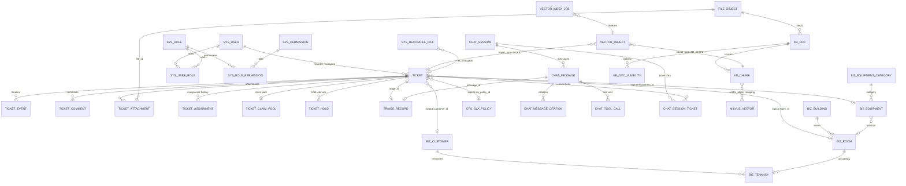

# 03-数据库设计文档

> 项目：**IT 运维工单智能 Agent**（agent-gongdan）
> 阶段：第三阶段 · 数据库设计
> 版本：v1.1
> 日期：2026-11-17
> 状态：待评审（评审结论：Pass with changes，已按清单修订）
> 说明：本文档只包含数据库设计，**不包含任何建表 SQL 文件、迁移脚本文件或业务代码**。

---

## 1. 文档信息与决策记录

### 1.1 修订记录

| 版本 | 日期 | 修订人 | 说明 |
|---|---|---|---|
| v1.0 | 2026-11-17 | Claude | 依据第一阶段需求、第二阶段架构与本阶段选型，输出完整数据库设计 |
| v1.1 | 2026-11-17 | Claude | 按评审清单修订：补齐相似工单向量映射、分诊落库、工单来源追溯；新增 `vector_object`、`vector_index_job`、`triage_record`、`chat_session_ticket`、`ticket_hold`；修正状态机/SLA、索引前缀、可见性、会话僵尸行与种子数据 |

### 1.2 关联文档

| 阶段 | 文档 | 状态 |
|---|---|---|
| 第一阶段 | `01-需求与功能模块清单.md` | 已认可 |
| 第二阶段 | `02-技术选型与架构设计.md` | 已认可 |
| 第三阶段 | `03-数据库设计文档.md` | 本文档 |
| 第四阶段 | `04-API接口设计清单.md` | 待产出 |
| 第五阶段 | `05-最终设计方案与开发规范.md` | 待产出 |

### 1.3 本阶段新增决策

| 编号 | 事项 | 决策 |
|---|---|---|
| D21 | 主键策略 | 雪花算法 `BIGINT`，Java 生成；API 全局 Long → String |
| D22 | 时间字段 | `DATETIME(3)` 存 UTC；应用层统一转换 |
| D23 | 附件与对象存储 | 中央 `file_object` 表 + 业务关联；object_key 规则固定 |
| D24 | 软删除 | `deleted_at` + `deleted_by` |
| D25 | 多租户预留 | 核心业务表**保留** `tenant_id` 列；唯一键保留 `tenant_id` 前缀；MVP 非唯一查询索引**不以 `tenant_id` 为前缀**，多租户落地时再补索引迁移 |
| D26 | 关联查询与删除 | **全部通过 MyBatis-Plus 代码层批量查询与内存组装；禁止多表 JOIN 级联删除；禁止数据库级外键约束** |
| D27 | 开发期 workerId | 默认 1，部署时通过环境变量注入并登记 |
| D28 | Flyway | SQL 版本化迁移，dev 自动、prod 发布流程执行 |
| D29 | 相似工单向量 | 泛化 `vector_object` + `vector_index_job`；知识/工单分 collection；阈值/topK/结果条数进 `sys_config` |
| D30 | 分诊结果落库 | 新增 `triage_record`；`ticket.triage_id` 回指，支撑准确率与转人工率统计 |
| D31 | 工单来源追溯 | `ticket.source_ref_type/source_ref_id` + `chat_session_ticket` 关系表 + `chat_tool_call.result_ticket_id` |
| D32 | P1/P2 表延后 | 9 张 P1/P2 表不进入 V1–V8；03 保留目标模型，后续独立版本创建 |
| D33 | 可复用唯一键 | 仅对可复用业务键（如 `username`）使用 `deleted_flag` 纳入唯一键；`ticket_no`/`doc_no` 全局不复用 |
| D34 | 会话僵尸行 | `message_count` 仅统计 `COMPLETED/FAILED`；`STREAMING` 超时由任务置 `FAILED`（`STREAM_TIMEOUT`） |
| D35 | 对账差异 | `sys_reconcile_diff` 为 P1 目标模型，不进 MVP 迁移；MVP 对账只报告不自动修复 |

### 1.4 数据库基本信息

| 项目 | 值 |
|---|---|
| 数据库类型 | MySQL 8.0.46（共享实例） |
| 逻辑库 | `agent_gongdan_db` |
| 业务账号 | `agent_gongdan_app`（仅本库权限，待创建） |
| 字符集 | `utf8mb4` |
| 排序规则 | `utf8mb4_0900_ai_ci` |
| 存储引擎 | InnoDB |
| 行格式 | DYNAMIC |
| 数据库时区 | `+00:00`（UTC） |
| 迁移工具 | Flyway 13.12.2 |
| 物理外键 | **全量禁止** |
| 多表 JOIN | **业务 Mapper 禁止；关联在 Service 层批量组装** |

### 1.5 v1.1 文档统计摘要

| 项目 | 数量 | 说明 |
|---|---:|---|
| 一级章节 | 14 | 与大纲一致 |
| 设计表总数 | 52 | 含 P1/P2 目标模型与废弃表 |
| MVP 物理表（V1–V8） | 41 | 实际进入迁移的物理表 |
| P1/P2 延后表 | 10 | 9 张原延后表 + `sys_reconcile_diff` |
| 废弃/视图 | 1 | `kb_index_job`，由 `vector_index_job` 取代 |
| 二级索引 | 137 | 另含 1 行主键说明，共 138 行索引记录 |
| 新增 MVP 表 | 5 | `vector_object`、`vector_index_job`、`triage_record`、`chat_session_ticket`、`ticket_hold` |

> 统计口径：设计表总数 = 原 46 + 新增 6（5 张 MVP + `sys_reconcile_diff`）；MVP 物理表 = 52 − 10 延后 − 1 废弃。

---

## 2. 设计目标与全局规范

### 2.1 设计目标

1. 支撑工单全生命周期、AI 会话、知识库、业户/设备等 P0/P1 业务。
2. 支撑高并发下的游标分页、幂等写入与乐观锁并发控制。
3. 保持与 Milvus Lite、MinIO 的清晰跨存储映射。
4. 为未来多物业（`tenant_id`）与分片保留结构基础。
5. 通过应用层一致性保障替代数据库级外键约束。

### 2.2 命名规范

| 对象 | 规范 | 示例 |
|---|---|---|
| 表名 | 小写下划线、单数、域前缀 | `ticket`、`chat_message`、`kb_chunk` |
| 域前缀 | `sys_` 平台 / `cfg_` 配置 / `ticket_` 工单 / `chat_` 会话 / `kb_` 知识 / `biz_` 业务 / `file_` 文件 | — |
| 字段名 | 小写下划线 | `ticket_no`、`created_at` |
| 主键 | 统一 `id` | — |
| 逻辑外键 | `<实体>_id` | `ticket_id`、`customer_id` |
| 编码字段 | `*_code` | `status_code`、`priority_code` |
| 时间字段 | `*_at`（时刻）/ `*_date`（日期） | `resolved_at`、`start_date` |
| 时长字段 | `*_minutes` | `response_minutes` |
| JSON 字段 | `*_json` | `payload_json` |
| 普通索引 | `idx_<table>_<cols>` | `idx_ticket_status_deleted_updated` |
| 唯一索引 | `uk_<table>_<cols>` | `uk_ticket_tenant_no` |

### 2.3 字段类型规范

| 类型 | 规范 |
|---|---|
| 主键/外键 | `BIGINT`（雪花 ID，应用生成，非自增） |
| 租户 | `BIGINT NOT NULL DEFAULT 0` |
| 短编码 | `VARCHAR(16)` / `VARCHAR(32)` / `VARCHAR(64)` |
| 名称/标题 | `VARCHAR(100)` / `VARCHAR(200)` |
| 描述/原因 | `VARCHAR(500)` / `VARCHAR(1000)` / `TEXT` |
| 长文本 | `TEXT`；消息与知识分块使用 `MEDIUMTEXT` |
| 时间 | `DATETIME(3)`，存 UTC |
| 日期 | `DATE` |
| 布尔 | `TINYINT(1) NOT NULL DEFAULT 0` |
| 计数 | `INT` / `BIGINT` |
| 金额 | `DECIMAL(12,2)` |
| 比例/得分 | `DECIMAL(6,4)` |
| 结构化扩展 | `JSON`（仅用于非核心查询字段） |
| 哈希 | `VARCHAR(64)`（SHA-256 十六进制） |
| 文件对象键 | `VARCHAR(512)` |
| IP | `VARCHAR(45)` |
| 手机号密文 | `VARBINARY(512)` |
| 手机号脱敏 | `VARCHAR(32)` |

**禁止使用 MySQL `ENUM`**：状态与类型统一使用 `VARCHAR` 编码 + 字典表，便于扩展与迁移。

### 2.4 时间规范（UTC）

1. 所有 `DATETIME(3)` 字段存储 **UTC** 时间，数据库会话时区固定 `+00:00`。
2. 应用层写入前转为 UTC，读取后按需转为 `Asia/Shanghai`。
3. API 传输使用 ISO-8601（带 `Z` 或 `+00:00`）；前端统一按本地时区展示。
4. 纯日期（租约、安装日期、维保到期）使用 `DATE`，不涉及时区。
5. 禁止使用 `TIMESTAMP` 类型，避免 2038 上限与会话时区隐式转换。
6. 时间比较、SLA 计算统一基于 UTC。

### 2.5 主键与 JS 精度

1. 主键由 Java 雪花算法生成，类型 `BIGINT`，不使用数据库自增。
2. 开发期 `workerId=1`；多实例部署时由环境变量注入并登记，禁止重复。
3. Java 全局配置 Long → String 序列化；所有 API 中的 ID 字段均为字符串。
4. 前端 TypeScript 类型统一为 `string`，禁止 `Number(id)`。
5. 业务单号（`ticket_no`、`doc_no` 等）独立生成，不依赖主键，便于人工识别。

### 2.6 软删除规范

1. 主数据与业务聚合根统一使用 `deleted_at DATETIME(3) NULL` + `deleted_by BIGINT NULL`。
2. 查询默认追加 `deleted_at IS NULL`；MyBatis-Plus 通过逻辑删除配置统一处理。
3. **可复用业务键**（如 `username`）使用 `deleted_flag BIGINT NOT NULL DEFAULT 0` 纳入唯一键 `(tenant_id, username, deleted_flag)`；删除时置为删除时刻或主键 ID，保留原始值供审计。该模式仅用于需要复用的字段。
4. **不可复用业务键**（`ticket_no`、`doc_no`、`customer_no`、`equipment_no` 等）**全局不复用**；唯一索引不因软删除释放。
5. 纯关联表与追加型日志表不参与软删除：
   - 关联表（`sys_user_role`、`sys_role_permission`、`chat_message_citation`、`chat_session_ticket` 等）物理删除，删除前写审计。
   - 日志表（`ticket_event`、`chat_tool_call`、`sys_audit_log`、`ai_call_log`、`triage_record`）只追加，不删除。
6. 文件对象采用“元数据软删除 + 对象异步删除”的两阶段策略；`file_object.checksum_sha256` 不再建唯一键，改由应用层查重。
7. 向量映射以 `vector_object` 为唯一权威源；`kb_chunk.vector_id` 为派生字段，仅用于兼容读取。

### 2.7 通用字段组

> 为避免重复，各表只列业务字段，并在末尾标注所引用的通用字段组。

**G-A：标准审计组（可变业务表）**

| 字段 | 类型 | 必填 | 默认值 | 说明 |
|---|---|---|---|---|
| `tenant_id` | BIGINT | 是 | 0 | 租户 ID，MVP 固定 0 |
| `created_at` | DATETIME(3) | 是 | `CURRENT_TIMESTAMP(3)` | 创建时间（UTC） |
| `created_by` | BIGINT | 否 | NULL | 创建人 ID |
| `updated_at` | DATETIME(3) | 是 | `CURRENT_TIMESTAMP(3)`，更新时自动刷新 | 更新时间（UTC） |
| `updated_by` | BIGINT | 否 | NULL | 更新人 ID |
| `deleted_at` | DATETIME(3) | 否 | NULL | 软删除时间（UTC） |
| `deleted_by` | BIGINT | 否 | NULL | 删除人 ID |

**G-B：追加型审计组（日志/明细/关联）**

| 字段 | 类型 | 必填 | 默认值 | 说明 |
|---|---|---|---|---|
| `tenant_id` | BIGINT | 是 | 0 | 租户 ID |
| `created_at` | DATETIME(3) | 是 | `CURRENT_TIMESTAMP(3)` | 创建时间（UTC） |
| `created_by` | BIGINT | 否 | NULL | 操作人 ID |

**G-V：乐观锁字段**

| 字段 | 类型 | 必填 | 默认值 | 说明 |
|---|---|---|---|---|
| `version` | INT | 是 | 0 | 乐观锁版本号，每次更新 +1 |

### 2.8 无物理外键与代码层组装（强制）

> **本项目全量禁止数据库级外键约束；所有表关系仅用逻辑外键字段 + 索引表达。**
> **所有跨表关联查询在 MyBatis-Plus 中通过代码层批量查询与内存组装完成；禁止在业务 Mapper 中编写多表 JOIN；禁止任何形式的数据库级联删除。**
> 删除由 Service 层显式编排：先校验引用、再软删除主记录、再按需清理关联与对象存储，全过程写审计。
> 说明：本文档中 `JOIN` 字样共 13 处，**全部为禁止性/规范性引用**，不存在任何多表 JOIN 设计。

**一致性保障手段**

1. 写入前存在性校验（引用对象必须存在且在数据权限内）。
2. 同一业务事务内写主表与明细/事件。
3. 幂等键 + 唯一索引防重复。
4. 定期对账检测孤儿数据。
5. 删除不依赖级联，由应用按业务顺序处理。

### 2.9 字符集与引擎

- `utf8mb4` / `utf8mb4_0900_ai_ci`，支持中文与 Emoji。
- InnoDB，支持事务与行锁。
- 行格式 `DYNAMIC`。
- 所有表与字段必须有中文注释（COMMENT）。
- 不在数据库层使用触发器、存储过程、事件调度器。

---

## 3. 概念模型总览

> 下图为逻辑关系，**不是数据库外键**。

**模块与表分组**

| 模块 | 表 |
|---|---|
| 平台与权限 | `sys_user`、`sys_role`、`sys_user_role`、`sys_permission`、`sys_role_permission`、`sys_dept` |
| 字典与配置 | `sys_dict_type`、`sys_dict_item`、`sys_config`、`cfg_sla_policy`、`cfg_business_calendar` |
| 工单 | `ticket`、`ticket_event`、`ticket_comment`、`ticket_attachment`、`ticket_assignment`、`ticket_claim_pool`、`ticket_hold`、`ticket_relation`（延后） |
| 会话与分诊 | `chat_session`、`chat_message`、`chat_message_citation`、`chat_tool_call`、`chat_event`、`triage_record`、`chat_session_ticket`、`chat_feedback`（延后） |
| 知识库与向量 | `kb_doc`、`kb_chunk`、`kb_doc_visibility`、`vector_object`、`vector_index_job`、`kb_doc_version`（延后）、`kb_candidate`（延后）、`kb_feedback`（延后）；`kb_index_job` 废弃/视图 |
| 业户与资源 | `biz_customer`、`biz_building`、`biz_room`、`biz_tenancy` |
| 设备与巡检 | `biz_equipment_category`、`biz_equipment`、`biz_inspection_plan`（延后）、`biz_inspection_task`（延后） |
| 文件 | `file_object` |
| 审计与日志 | `sys_audit_log`、`ai_call_log`、`sys_notification`、`sys_notification_pref`（延后）、`sys_reconcile_diff`（P1 目标，延后） |
| 幂等与序列 | `idempotency_record`、`biz_sequence` |

---

## 4. 表结构设计

> 每张表先列业务字段，再标注通用字段组。所有字段均需在实现时补充中文 COMMENT。

### 4.1 平台与权限

#### 4.1.1 `sys_user` 用户表

| 字段 | 类型 | 必填 | 默认值 | 说明 |
|---|---|---|---|---|
| `id` | BIGINT | 是 | 无（应用生成） | 主键，雪花 ID |
| `username` | VARCHAR(64) | 是 | 无 | 登录名，租户内唯一 |
| `password_hash` | VARCHAR(100) | 是 | 无 | BCrypt 密码哈希 |
| `display_name` | VARCHAR(100) | 是 | 无 | 显示名称 |
| `phone_enc` | VARBINARY(512) | 否 | NULL | 手机号密文 |
| `phone_hash` | CHAR(64) | 否 | NULL | 手机号 HMAC-SHA256，用于精确查询 |
| `phone_enc_key_version` | INT | 是 | 1 | 手机号加密密钥版本，支持轮换 |
| `phone_masked` | VARCHAR(32) | 否 | NULL | 手机号脱敏展示值，仅用于展示，不作查询键 |
| `email` | VARCHAR(128) | 否 | NULL | 邮箱 |
| `dept_id` | BIGINT | 否 | NULL | 所属部门 ID（逻辑外键） |
| `status` | VARCHAR(16) | 是 | `ACTIVE` | `ACTIVE` / `DISABLED` / `LOCKED` |
| `last_login_at` | DATETIME(3) | 否 | NULL | 最后登录时间 |
| `last_login_ip` | VARCHAR(45) | 否 | NULL | 最后登录 IP |
| `failed_login_count` | INT | 是 | 0 | 连续登录失败次数 |
| `locked_until` | DATETIME(3) | 否 | NULL | 锁定截止时间 |
| `deleted_flag` | BIGINT | 是 | 0 | 可复用唯一键标记：0=有效；删除时置为时间戳/主键 ID |

通用字段：G-A。  
索引：`uk_sys_user_tenant_username(tenant_id, username, deleted_flag)`；`idx_sys_user_dept_status(dept_id, status)`；`idx_sys_user_status_deleted(status, deleted_at)`；`idx_sys_user_phone_hash(phone_hash)`。

#### 4.1.2 `sys_role` 角色表

| 字段 | 类型 | 必填 | 默认值 | 说明 |
|---|---|---|---|---|
| `id` | BIGINT | 是 | 无 | 主键 |
| `role_code` | VARCHAR(64) | 是 | 无 | 角色编码，租户内唯一 |
| `role_name` | VARCHAR(100) | 是 | 无 | 角色名称 |
| `description` | VARCHAR(500) | 否 | NULL | 描述 |
| `is_builtin` | TINYINT(1) | 是 | 0 | 是否内置角色，内置不可删除 |
| `status` | VARCHAR(16) | 是 | `ACTIVE` | 状态 |

通用字段：G-A。  
索引：`uk_sys_role_tenant_code(tenant_id, role_code)`；`idx_sys_role_status_deleted(status, deleted_at)`。

#### 4.1.3 `sys_user_role` 用户角色关联

| 字段 | 类型 | 必填 | 默认值 | 说明 |
|---|---|---|---|---|
| `id` | BIGINT | 是 | 无 | 主键 |
| `user_id` | BIGINT | 是 | 无 | 用户 ID |
| `role_id` | BIGINT | 是 | 无 | 角色 ID |

通用字段：G-B（关联表物理删除，删除前写审计）。  
索引：`uk_sys_user_role(tenant_id, user_id, role_id)`；`idx_sys_user_role_role(role_id)`。

#### 4.1.4 `sys_permission` 权限点表

| 字段 | 类型 | 必填 | 默认值 | 说明 |
|---|---|---|---|---|
| `id` | BIGINT | 是 | 无 | 主键 |
| `permission_code` | VARCHAR(128) | 是 | 无 | 权限编码，如 `ticket:create` |
| `permission_name` | VARCHAR(100) | 是 | 无 | 权限名称 |
| `permission_type` | VARCHAR(16) | 是 | 无 | `MENU` / `BUTTON` / `API` |
| `parent_id` | BIGINT | 否 | NULL | 父权限 ID |
| `route_path` | VARCHAR(255) | 否 | NULL | 前端路由 |
| `http_method` | VARCHAR(16) | 否 | NULL | API 方法 |
| `api_pattern` | VARCHAR(255) | 否 | NULL | API 路径模式 |
| `sort_order` | INT | 是 | 0 | 排序 |
| `status` | VARCHAR(16) | 是 | `ACTIVE` | 状态 |

通用字段：G-A。  
索引：`uk_sys_permission_tenant_code(tenant_id, permission_code)`；`idx_sys_permission_parent(parent_id)`；`idx_sys_permission_type(permission_type)`。

#### 4.1.5 `sys_role_permission` 角色权限关联

| 字段 | 类型 | 必填 | 默认值 | 说明 |
|---|---|---|---|---|
| `id` | BIGINT | 是 | 无 | 主键 |
| `role_id` | BIGINT | 是 | 无 | 角色 ID |
| `permission_id` | BIGINT | 是 | 无 | 权限 ID |

通用字段：G-B。  
索引：`uk_sys_role_permission(tenant_id, role_id, permission_id)`；`idx_sys_role_permission_perm(permission_id)`。

#### 4.1.6 `sys_dept` 部门表

| 字段 | 类型 | 必填 | 默认值 | 说明 |
|---|---|---|---|---|
| `id` | BIGINT | 是 | 无 | 主键 |
| `parent_id` | BIGINT | 否 | NULL | 父部门 ID |
| `dept_code` | VARCHAR(64) | 是 | 无 | 部门编码 |
| `dept_name` | VARCHAR(100) | 是 | 无 | 部门名称 |
| `path` | VARCHAR(500) | 否 | NULL | 物化路径，便于子树查询 |
| `sort_order` | INT | 是 | 0 | 排序 |
| `status` | VARCHAR(16) | 是 | `ACTIVE` | 状态 |

通用字段：G-A。  
索引：`uk_sys_dept_tenant_code(tenant_id, dept_code)`；`idx_sys_dept_parent(parent_id)`；`idx_sys_dept_path(path(191))`（支持 `LIKE 'prefix%'` 数据范围查询）。

### 4.2 字典、配置与 SLA

#### 4.2.1 `sys_dict_type` 字典类型

| 字段 | 类型 | 必填 | 默认值 | 说明 |
|---|---|---|---|---|
| `id` | BIGINT | 是 | 无 | 主键 |
| `type_code` | VARCHAR(64) | 是 | 无 | 字典类型编码 |
| `type_name` | VARCHAR(100) | 是 | 无 | 字典类型名称 |
| `description` | VARCHAR(500) | 否 | NULL | 描述 |
| `status` | VARCHAR(16) | 是 | `ACTIVE` | 状态 |

通用字段：G-A。  
索引：`uk_sys_dict_type_tenant_code(tenant_id, type_code)`。

#### 4.2.2 `sys_dict_item` 字典项

| 字段 | 类型 | 必填 | 默认值 | 说明 |
|---|---|---|---|---|
| `id` | BIGINT | 是 | 无 | 主键 |
| `type_code` | VARCHAR(64) | 是 | 无 | 字典类型编码 |
| `item_code` | VARCHAR(64) | 是 | 无 | 字典项编码 |
| `item_name` | VARCHAR(100) | 是 | 无 | 字典项名称 |
| `sort_order` | INT | 是 | 0 | 排序 |
| `ext_json` | JSON | 否 | NULL | 展示扩展（颜色、图标等） |
| `status` | VARCHAR(16) | 是 | `ACTIVE` | 状态 |

通用字段：G-A。  
索引：`uk_sys_dict_item(tenant_id, type_code, item_code)`；`idx_sys_dict_item_query(type_code, status, sort_order)`。

#### 4.2.3 `sys_config` 业务配置

| 字段 | 类型 | 必填 | 默认值 | 说明 |
|---|---|---|---|---|
| `id` | BIGINT | 是 | 无 | 主键 |
| `config_key` | VARCHAR(128) | 是 | 无 | 配置键 |
| `config_value` | TEXT | 否 | NULL | 配置值 |
| `value_type` | VARCHAR(16) | 是 | `STRING` | `STRING` / `INT` / `BOOL` / `JSON` |
| `description` | VARCHAR(500) | 否 | NULL | 描述 |
| `is_sensitive` | TINYINT(1) | 是 | 0 | 是否敏感（敏感值加密存储） |

通用字段：G-A。  
索引：`uk_sys_config_tenant_key(tenant_id, config_key)`。  
说明：仅存业务可调参数；密钥、端点、超时等部署参数走 `.env`。  
建议配置键：`ai.triage.confidence_threshold`、`ai.rag.score_threshold`、`ai.similar.ticket_threshold`、`ai.similar.recall_top_k`、`ai.similar.result_limit`、`ai.visibility.recall_multiplier`。

#### 4.2.4 `cfg_sla_policy` SLA 策略

| 字段 | 类型 | 必填 | 默认值 | 说明 |
|---|---|---|---|---|
| `id` | BIGINT | 是 | 无 | 主键 |
| `policy_code` | VARCHAR(64) | 是 | 无 | 策略编码 |
| `policy_name` | VARCHAR(100) | 是 | 无 | 策略名称 |
| `priority_code` | VARCHAR(16) | 是 | 无 | 适用优先级 |
| `ticket_type_code` | VARCHAR(32) | 否 | NULL | 适用工单类型，空表示全部 |
| `response_minutes` | INT | 是 | 无 | 首次响应时限（分钟） |
| `resolve_minutes` | INT | 是 | 无 | 解决时限（分钟） |
| `calendar_type` | VARCHAR(16) | 是 | `24x7` | 日历类型 |
| `pause_on_hold` | TINYINT(1) | 是 | 1 | 挂起期间是否暂停 SLA 计时 |
| `enabled` | TINYINT(1) | 是 | 1 | 是否启用 |
| `effective_from` | DATETIME(3) | 否 | NULL | 生效开始 |
| `effective_to` | DATETIME(3) | 否 | NULL | 生效结束 |

通用字段：G-A。  
索引：`uk_cfg_sla_policy_tenant_code(tenant_id, policy_code)`；`idx_cfg_sla_policy_query(priority_code, ticket_type_code, enabled)`。  
Seed：紧急 240 分钟、普通 1440 分钟；低优先级 4320 分钟（可选）。  
**取值说明**：240/1440 为用户已拍板值，仍标注“待业务最终确认”。

#### 4.2.5 `cfg_business_calendar` 工作日历（P2）

| 字段 | 类型 | 必填 | 默认值 | 说明 |
|---|---|---|---|---|
| `id` | BIGINT | 是 | 无 | 主键 |
| `calendar_code` | VARCHAR(64) | 是 | 无 | 日历编码 |
| `calendar_name` | VARCHAR(100) | 是 | 无 | 名称 |
| `workdays_json` | JSON | 否 | NULL | 工作日规则 |
| `holidays_json` | JSON | 否 | NULL | 节假日 |
| `timezone` | VARCHAR(64) | 是 | `Asia/Shanghai` | 时区 |
| `status` | VARCHAR(16) | 是 | `ACTIVE` | 状态 |

通用字段：G-A。  
索引：`uk_cfg_calendar_tenant_code(tenant_id, calendar_code)`。

### 4.3 工单核心

#### 4.3.1 `ticket` 工单主表

| 字段 | 类型 | 必填 | 默认值 | 说明 |
|---|---|---|---|---|
| `id` | BIGINT | 是 | 无 | 主键 |
| `ticket_no` | VARCHAR(32) | 是 | 无 | 业务单号，租户内唯一 |
| `title` | VARCHAR(200) | 是 | 无 | 标题 |
| `description` | TEXT | 否 | NULL | 详细描述 |
| `ticket_type_code` | VARCHAR(32) | 是 | 无 | 工单类型编码 |
| `priority_code` | VARCHAR(16) | 是 | `NORMAL` | 优先级编码 |
| `status_code` | VARCHAR(32) | 是 | `PENDING` | 当前状态编码 |
| `source_code` | VARCHAR(16) | 是 | `FORM` | `FORM` / `CHAT` / `PHONE` / `INSPECTION` / `AGENT` |
| `source_ref_type` | VARCHAR(32) | 否 | NULL | 来源引用类型：`CHAT_SESSION` / `CHAT_MESSAGE` / `TOOL_CALL` / `INSPECTION` / `PHONE` / `MANUAL` |
| `source_ref_id` | BIGINT | 否 | NULL | 来源对象 ID（逻辑外键，按 `source_ref_type` 解释） |
| `triage_id` | BIGINT | 否 | NULL | 关联分诊记录 ID（`triage_record.id`，逻辑外键） |
| `reporter_id` | BIGINT | 是 | 无 | 报障人 ID |
| `reporter_dept_id` | BIGINT | 否 | NULL | 报障人部门 ID |
| `assignee_id` | BIGINT | 否 | NULL | 当前处理人 ID |
| `assignee_dept_id` | BIGINT | 否 | NULL | 当前处理部门 ID |
| `customer_id` | BIGINT | 否 | NULL | 关联业户 ID（逻辑外键） |
| `room_id` | BIGINT | 否 | NULL | 关联房号 ID（逻辑外键） |
| `equipment_id` | BIGINT | 否 | NULL | 关联设备 ID（逻辑外键） |
| `location_text` | VARCHAR(255) | 否 | NULL | 位置描述 |
| `sla_policy_id` | BIGINT | 否 | NULL | 建单时套用的 SLA 策略 ID |
| `sla_response_due_at` | DATETIME(3) | 否 | NULL | 首次响应到期时间（快照） |
| `sla_resolve_due_at` | DATETIME(3) | 否 | NULL | 解决到期时间（快照） |
| `sla_response_breached` | TINYINT(1) | 是 | 0 | 首次响应是否已超时（快照） |
| `sla_resolve_breached` | TINYINT(1) | 是 | 0 | 解决是否已超时（快照） |
| `hold_started_at` | DATETIME(3) | 否 | NULL | 当前挂起开始时间（NULL=未挂起） |
| `hold_reason` | VARCHAR(500) | 否 | NULL | 当前/最近挂起原因 |
| `hold_minutes` | INT | 是 | 0 | 累计挂起时长（分钟） |
| `first_response_at` | DATETIME(3) | 否 | NULL | 首次响应时间 |
| `accepted_at` | DATETIME(3) | 否 | NULL | 接单时间 |
| `resolved_at` | DATETIME(3) | 否 | NULL | 提交解决时间 |
| `closed_at` | DATETIME(3) | 否 | NULL | 关闭时间 |
| `close_reason_code` | VARCHAR(32) | 否 | NULL | 关闭原因编码 |
| `cancel_reason` | VARCHAR(500) | 否 | NULL | 取消原因 |
| `satisfaction_score` | TINYINT | 否 | NULL | 满意度 1–5（P1） |
| `satisfaction_comment` | VARCHAR(1000) | 否 | NULL | 满意度评价（P1） |
| `rated_by` | BIGINT | 否 | NULL | 评价人（P1） |
| `satisfaction_at` | DATETIME(3) | 否 | NULL | 评价时间（P1） |

通用字段：G-A + G-V。  
索引：  
`uk_ticket_tenant_no(tenant_id, ticket_no)`；  
`idx_ticket_status_deleted_updated(status_code, deleted_at, updated_at)`；  
`idx_ticket_assignee_status(assignee_id, status_code, deleted_at)`；  
`idx_ticket_reporter_created(reporter_id, created_at)`；  
`idx_ticket_customer(customer_id)`；  
`idx_ticket_room(room_id)`；  
`idx_ticket_equipment(equipment_id)`；  
`idx_ticket_created(created_at)`；  
`idx_ticket_sla_due(status_code, sla_resolve_due_at)`；  
`idx_ticket_source_ref(source_ref_type, source_ref_id)`；  
`idx_ticket_triage(triage_id)`。

#### 4.3.2 `ticket_event` 工单事件时间线（追加型）

| 字段 | 类型 | 必填 | 默认值 | 说明 |
|---|---|---|---|---|
| `id` | BIGINT | 是 | 无 | 主键 |
| `ticket_id` | BIGINT | 是 | 无 | 工单 ID |
| `event_type` | VARCHAR(32) | 是 | 无 | 事件类型，如 `CREATED` / `ASSIGNED` / `RESOLVED` |
| `from_status` | VARCHAR(32) | 否 | NULL | 变更前状态 |
| `to_status` | VARCHAR(32) | 否 | NULL | 变更后状态 |
| `operator_id` | BIGINT | 否 | NULL | 操作人 |
| `operator_role` | VARCHAR(32) | 否 | NULL | 操作人角色 |
| `reason` | VARCHAR(500) | 否 | NULL | 原因/备注 |
| `payload_json` | JSON | 否 | NULL | 扩展信息 |
| `trace_id` | VARCHAR(64) | 否 | NULL | 追踪 ID |

通用字段：G-B。  
索引：`idx_ticket_event_ticket(ticket_id, id)`；`idx_ticket_event_trace(trace_id)`；`idx_ticket_event_type(event_type, created_at)`。

#### 4.3.3 `ticket_comment` 工单评论

| 字段 | 类型 | 必填 | 默认值 | 说明 |
|---|---|---|---|---|
| `id` | BIGINT | 是 | 无 | 主键 |
| `ticket_id` | BIGINT | 是 | 无 | 工单 ID |
| `parent_id` | BIGINT | 否 | NULL | 父评论 ID |
| `author_id` | BIGINT | 是 | 无 | 作者 ID |
| `visibility` | VARCHAR(16) | 是 | `PUBLIC` | `PUBLIC` / `INTERNAL` |
| `content` | TEXT | 是 | 无 | 评论内容 |

通用字段：G-A。  
索引：`idx_ticket_comment_ticket(ticket_id, id)`；`idx_ticket_comment_parent(parent_id)`。

#### 4.3.4 `ticket_attachment` 工单附件

| 字段 | 类型 | 必填 | 默认值 | 说明 |
|---|---|---|---|---|
| `id` | BIGINT | 是 | 无 | 主键 |
| `ticket_id` | BIGINT | 是 | 无 | 工单 ID |
| `comment_id` | BIGINT | 否 | NULL | 关联评论 ID |
| `file_id` | BIGINT | 是 | 无 | 文件对象 ID（`file_object.id`） |
| `attachment_type` | VARCHAR(32) | 是 | `GENERAL` | 附件类型 |

通用字段：G-A。  
索引：`idx_ticket_attachment_ticket(ticket_id)`；`idx_ticket_attachment_file(file_id)`；`idx_ticket_attachment_comment(comment_id)`。

#### 4.3.5 `ticket_assignment` 派单/认领历史

| 字段 | 类型 | 必填 | 默认值 | 说明 |
|---|---|---|---|---|
| `id` | BIGINT | 是 | 无 | 主键 |
| `ticket_id` | BIGINT | 是 | 无 | 工单 ID |
| `action_type` | VARCHAR(32) | 是 | 无 | `ASSIGN` / `CLAIM` / `TRANSFER` / `TRANSFER_DEPT` / `RELEASE` / `REJECT` |
| `from_assignee_id` | BIGINT | 否 | NULL | 原处理人 |
| `to_assignee_id` | BIGINT | 否 | NULL | 新处理人 |
| `from_dept_id` | BIGINT | 否 | NULL | 原部门 |
| `to_dept_id` | BIGINT | 否 | NULL | 新部门 |
| `operated_by` | BIGINT | 是 | 无 | 操作人 |
| `reason` | VARCHAR(500) | 否 | NULL | 原因 |

通用字段：G-B。  
索引：`idx_ticket_assignment_ticket(ticket_id, id)`；`idx_ticket_assignment_assignee(to_assignee_id, created_at)`。

#### 4.3.6 `ticket_claim_pool` 抢单池

| 字段 | 类型 | 必填 | 默认值 | 说明 |
|---|---|---|---|---|
| `id` | BIGINT | 是 | 无 | 主键 |
| `ticket_id` | BIGINT | 是 | 无 | 工单 ID，唯一 |
| `status` | VARCHAR(16) | 是 | `OPEN` | `OPEN` / `CLAIMED` / `EXPIRED` / `CANCELLED` |
| `entered_at` | DATETIME(3) | 是 | 无 | 进入池时间 |
| `expires_at` | DATETIME(3) | 否 | NULL | 过期时间 |
| `claimed_by` | BIGINT | 否 | NULL | 认领人 |
| `claimed_at` | DATETIME(3) | 否 | NULL | 认领时间 |

通用字段：G-A + G-V。  
索引：`uk_ticket_claim_pool_ticket(tenant_id, ticket_id)`；`idx_ticket_claim_pool_status(status, expires_at)`。

#### 4.3.7 `ticket_relation` 工单通用关联（P2）

| 字段 | 类型 | 必填 | 默认值 | 说明 |
|---|---|---|---|---|
| `id` | BIGINT | 是 | 无 | 主键 |
| `ticket_id` | BIGINT | 是 | 无 | 工单 ID |
| `relation_type` | VARCHAR(32) | 是 | 无 | 关系类型，如 `RELATED_TICKET` / `EXTRA_EQUIPMENT` |
| `target_type` | VARCHAR(32) | 是 | 无 | 目标类型 |
| `target_id` | BIGINT | 是 | 无 | 目标 ID |

通用字段：G-B。  
索引：`uk_ticket_relation(tenant_id, ticket_id, relation_type, target_type, target_id)`；`idx_ticket_relation_target(target_type, target_id)`。

#### 4.3.8 `ticket_hold` 挂起区间表（P0）

| 字段 | 类型 | 必填 | 默认值 | 说明 |
|---|---|---|---|---|
| `id` | BIGINT | 是 | 无 | 主键 |
| `ticket_id` | BIGINT | 是 | 无 | 工单 ID |
| `started_at` | DATETIME(3) | 是 | 无 | 挂起开始时间（UTC） |
| `ended_at` | DATETIME(3) | 否 | NULL | 挂起结束时间；NULL 表示当前仍在挂起 |
| `reason` | VARCHAR(500) | 否 | NULL | 挂起原因 |
| `started_by` | BIGINT | 否 | NULL | 挂起操作人 |
| `ended_by` | BIGINT | 否 | NULL | 恢复操作人 |
| `updated_at` | DATETIME(3) | 是 | `CURRENT_TIMESTAMP(3)` | 更新时间 |

通用字段：G-B（`tenant_id`、`created_at`、`created_by`），另含 `updated_at`。  
索引：`idx_ticket_hold_ticket(ticket_id, started_at)`；`idx_ticket_hold_open(ended_at)`。  
规则：`cfg_sla_policy.pause_on_hold=1` 时，恢复时按挂起时长顺延 SLA 到期时间，并写 `ticket_event`。

### 4.4 AI 会话与消息

#### 4.4.1 `chat_session` 会话主表

| 字段 | 类型 | 必填 | 默认值 | 说明 |
|---|---|---|---|---|
| `id` | BIGINT | 是 | 无 | 主键 |
| `session_no` | VARCHAR(32) | 是 | 无 | 会话业务号，租户内唯一 |
| `user_id` | BIGINT | 是 | 无 | 归属用户 |
| `title` | VARCHAR(200) | 否 | NULL | 会话标题 |
| `status` | VARCHAR(16) | 是 | `ACTIVE` | `ACTIVE` / `HANDED_OFF` / `CLOSED` / `ARCHIVED` / `DEGRADED` |
| `ticket_id` | BIGINT | 否 | NULL | **最近主工单** ID（冗余，便于展示；全量追溯用 `chat_session_ticket`） |
| `message_count` | INT | 是 | 0 | 消息数量，**仅统计 `COMPLETED` / `FAILED`**；`PENDING` / `STREAMING` 占位行不计入 |
| `last_message_at` | DATETIME(3) | 否 | NULL | 最后一条消息时间 |
| `stream_expires_at` | DATETIME(3) | 否 | NULL | 当前活动流的会话级兜底截止时间；定时任务据此清理僵尸流 |
| `summary` | TEXT | 否 | NULL | 长会话摘要 |
| `summary_covered_message_id` | BIGINT | 否 | NULL | 摘要覆盖到的消息 ID |

通用字段：G-A + G-V。  
索引：`uk_chat_session_tenant_no(tenant_id, session_no)`；`idx_chat_session_user_updated(user_id, updated_at)`；`idx_chat_session_status_updated(status, updated_at)`；`idx_chat_session_ticket(ticket_id)`。

#### 4.4.2 `chat_message` 消息表

| 字段 | 类型 | 必填 | 默认值 | 说明 |
|---|---|---|---|---|
| `id` | BIGINT | 是 | 无 | 主键，雪花 ID，时间有序 |
| `session_id` | BIGINT | 是 | 无 | 会话 ID |
| `client_message_id` | VARCHAR(64) | 否 | NULL | 客户端消息 ID，用于幂等 |
| `role` | VARCHAR(16) | 是 | 无 | `USER` / `ASSISTANT` / `SYSTEM` / `TOOL` |
| `content` | MEDIUMTEXT | 否 | NULL | 消息内容 |
| `content_type` | VARCHAR(16) | 是 | `MARKDOWN` | `TEXT` / `MARKDOWN` |
| `status` | VARCHAR(16) | 是 | `COMPLETED` | `PENDING` / `STREAMING` / `COMPLETED` / `FAILED` |
| `trace_id` | VARCHAR(64) | 否 | NULL | 追踪 ID |
| `token_in` | INT | 是 | 0 | 输入 token 数 |
| `token_out` | INT | 是 | 0 | 输出 token 数 |
| `latency_ms` | INT | 否 | NULL | 生成耗时 |
| `error_code` | VARCHAR(64) | 否 | NULL | 失败错误码；超时清理固定为 `STREAM_TIMEOUT` |
| `stream_expires_at` | DATETIME(3) | 否 | NULL | 当前流截止时间；`STREAMING` 超期由任务置 `FAILED` |

通用字段：G-A。  
索引：`uk_chat_message_client(tenant_id, session_id, client_message_id)`（助手消息该字段为 NULL，唯一索引允许多个 NULL）；`idx_chat_message_session(session_id, id)`；`idx_chat_message_created(created_at)`。  
分页：按 `session_id + id < cursor` 倒序，不使用 OFFSET。  
僵尸行规则：`status=STREAMING` 且 `stream_expires_at < NOW()` 的行置 `FAILED`，补 `message_count`；客户端断连由 Java 先置 `FAILED`，任务兜底。

#### 4.4.3 `chat_message_citation` 消息引用

| 字段 | 类型 | 必填 | 默认值 | 说明 |
|---|---|---|---|---|
| `id` | BIGINT | 是 | 无 | 主键 |
| `message_id` | BIGINT | 是 | 无 | 消息 ID |
| `doc_id` | BIGINT | 是 | 无 | 知识文档 ID |
| `chunk_id` | BIGINT | 是 | 无 | 知识分块 ID |
| `score` | DECIMAL(6,4) | 否 | NULL | 检索相似度 |
| `rank_no` | INT | 是 | 0 | 引用排序 |

通用字段：G-B。  
索引：`idx_chat_citation_message(message_id, rank_no)`；`idx_chat_citation_doc(doc_id)`。

#### 4.4.4 `chat_tool_call` 工具调用轨迹

| 字段 | 类型 | 必填 | 默认值 | 说明 |
|---|---|---|---|---|
| `id` | BIGINT | 是 | 无 | 主键 |
| `session_id` | BIGINT | 是 | 无 | 会话 ID |
| `message_id` | BIGINT | 否 | NULL | 关联助手消息 ID |
| `tool_call_id` | VARCHAR(64) | 是 | 无 | 工具调用唯一标识 |
| `tool_name` | VARCHAR(64) | 是 | 无 | 工具名称 |
| `arguments_json` | JSON | 否 | NULL | 调用参数（敏感字段脱敏） |
| `result_json` | JSON | 否 | NULL | 返回结果；超过 **4096 字节**截断，完整内容转存 `file_object` |
| `result_ticket_id` | BIGINT | 否 | NULL | 工具产生的工单 ID（建单/关联），用于反查 |
| `result_truncated` | TINYINT(1) | 是 | 0 | `result_json` 是否被截断 |
| `result_size_bytes` | INT | 否 | NULL | 结果原始大小（字节） |
| `status` | VARCHAR(16) | 是 | 无 | `PENDING` / `SUCCESS` / `FAILED` / `CANCELLED`（被另一条确认路径取代） |
| `error_code` | VARCHAR(64) | 否 | NULL | 错误码 |
| `latency_ms` | INT | 否 | NULL | 耗时 |
| `trace_id` | VARCHAR(64) | 否 | NULL | 追踪 ID |

通用字段：G-B。  
索引：`uk_chat_tool_call(tenant_id, session_id, tool_call_id)`；`idx_chat_tool_call_message(message_id)`；`idx_chat_tool_call_name(tool_name, created_at)`；`idx_chat_tool_call_result_ticket(result_ticket_id)`。

#### 4.4.5 `chat_event` 会话事件

| 字段 | 类型 | 必填 | 默认值 | 说明 |
|---|---|---|---|---|
| `id` | BIGINT | 是 | 无 | 主键 |
| `session_id` | BIGINT | 是 | 无 | 会话 ID |
| `event_type` | VARCHAR(32) | 是 | 无 | `CREATED` / `HANDOFF` / `CLOSED` / `DEGRADED` 等 |
| `operator_id` | BIGINT | 否 | NULL | 操作人 |
| `payload_json` | JSON | 否 | NULL | 扩展信息 |

通用字段：G-B。  
索引：`idx_chat_event_session(session_id, id)`。

#### 4.4.6 `chat_feedback` 消息反馈（P2）

| 字段 | 类型 | 必填 | 默认值 | 说明 |
|---|---|---|---|---|
| `id` | BIGINT | 是 | 无 | 主键 |
| `message_id` | BIGINT | 是 | 无 | 消息 ID |
| `user_id` | BIGINT | 是 | 无 | 反馈用户 |
| `feedback_type` | VARCHAR(16) | 是 | 无 | `LIKE` / `DISLIKE` / `CORRECTION` |
| `comment` | VARCHAR(1000) | 否 | NULL | 反馈内容 |

通用字段：G-B。  
索引：`uk_chat_feedback(tenant_id, message_id, user_id)`。

#### 4.4.7 `triage_record` 分诊记录（P0）

| 字段 | 类型 | 必填 | 默认值 | 说明 |
|---|---|---|---|---|
| `id` | BIGINT | 是 | 无 | 主键 |
| `session_id` | BIGINT | 否 | NULL | 会话 ID（AI 对话分诊时必填） |
| `message_id` | BIGINT | 否 | NULL | 触发分诊的消息 ID |
| `trace_id` | VARCHAR(64) | 否 | NULL | 追踪 ID |
| `intent_code` | VARCHAR(32) | 是 | 无 | 意图编码，如 `FAULT_REPORT` / `QUERY` / `OPERATION` |
| `entities_json` | JSON | 否 | NULL | 抽取实体（系统、设备、位置、错误码等） |
| `confidence` | DECIMAL(6,4) | 否 | NULL | 置信度 0–1 |
| `threshold` | DECIMAL(6,4) | 否 | NULL | 当次使用的置信度阈值快照 |
| `action` | VARCHAR(16) | 是 | 无 | `ANSWER` / `CREATE_DRAFT` / `CLARIFY` / `HANDOFF` |
| `low_confidence` | TINYINT(1) | 是 | 0 | 是否低于阈值 |
| `clarify_round` | INT | 是 | 0 | 澄清轮次 |
| `draft_json` | JSON | 否 | NULL | 工单草稿快照 |
| `draft_status` | VARCHAR(16) | 否 | NULL | `DRAFT` / `CONFIRMED` / `CANCELLED` / `EXPIRED` |
| `confirmed_by` | BIGINT | 否 | NULL | 确认建单的用户 |
| `confirmed_at` | DATETIME(3) | 否 | NULL | 确认时间 |
| `model` | VARCHAR(100) | 否 | NULL | 分诊模型 |
| `prompt_version` | VARCHAR(32) | 否 | NULL | 提示词版本 |
| `latency_ms` | INT | 否 | NULL | 分诊耗时 |
| `corrected_intent_code` | VARCHAR(32) | 否 | NULL | 人工纠正后的意图（P1） |
| `corrected_by` | BIGINT | 否 | NULL | 纠正人（P1） |
| `corrected_at` | DATETIME(3) | 否 | NULL | 纠正时间（P1） |

通用字段：G-B（追加型，不更新、不软删除）。  
索引：`idx_triage_session_message(session_id, message_id)`；`idx_triage_intent(intent_code, created_at)`；`idx_triage_low_confidence(low_confidence, created_at)`。  
说明：`ticket.triage_id` 回指本表；支撑意图准确率、转人工率、人在回路确认审计。

#### 4.4.8 `chat_session_ticket` 会话-工单关系（P0）

| 字段 | 类型 | 必填 | 默认值 | 说明 |
|---|---|---|---|---|
| `id` | BIGINT | 是 | 无 | 主键 |
| `session_id` | BIGINT | 是 | 无 | 会话 ID |
| `ticket_id` | BIGINT | 是 | 无 | 工单 ID |
| `relation_type` | VARCHAR(16) | 是 | 无 | `CREATED` / `REOPENED` / `LINKED` |
| `created_tool_call_id` | VARCHAR(64) | 否 | NULL | 创建该关联的工具调用 ID |

通用字段：G-B（`tenant_id`、`created_at`、`created_by`）。  
索引：`uk_chat_session_ticket(tenant_id, session_id, ticket_id)`；`idx_chat_session_ticket_ticket(ticket_id)`。  
说明：支持一次会话创建/关联多张工单；`chat_session.ticket_id` 仅表示“最近主工单”。

### 4.5 知识库与向量映射

#### 4.5.1 `kb_doc` 知识文档

| 字段 | 类型 | 必填 | 默认值 | 说明 |
|---|---|---|---|---|
| `id` | BIGINT | 是 | 无 | 主键 |
| `doc_no` | VARCHAR(32) | 是 | 无 | 文档业务号，租户内唯一 |
| `title` | VARCHAR(200) | 是 | 无 | 标题 |
| `category_code` | VARCHAR(64) | 是 | 无 | 知识分类 |
| `source_type` | VARCHAR(16) | 是 | `UPLOAD` | `UPLOAD` / `MANUAL` / `TICKET` |
| `source_ref_id` | BIGINT | 否 | NULL | 来源对象 ID（如工单 ID） |
| `file_id` | BIGINT | 否 | NULL | 原始文件 ID（`file_object.id`） |
| `visibility_type` | VARCHAR(16) | 是 | `PUBLIC` | 粗分类快照：`PUBLIC` / `ROLE` / `DEPT` / `PRIVATE`；**权威源为 `kb_doc_visibility`** |
| `status` | VARCHAR(16) | 是 | `UPLOADED` | `UPLOADED` / `PARSING` / `INDEXING` / `ACTIVE` / `FAILED` / `DISABLED` |
| `current_version` | INT | 是 | 1 | 当前版本号 |
| `chunk_count` | INT | 是 | 0 | 分块数量 |
| `embedding_model` | VARCHAR(100) | 否 | NULL | Embedding 模型名称（默认 `BAAI/bge-m3`） |
| `embedding_dim` | INT | 否 | NULL | 向量维度（默认 1024，由 `sys_config` 驱动并启动校验） |
| `vector_collection` | VARCHAR(64) | 否 | NULL | Milvus collection，命名 `agent_gongdan_kb_{model}_{dim}_v{version}` |
| `index_version` | INT | 否 | NULL | 已生效的索引版本 |
| `checksum` | VARCHAR(64) | 否 | NULL | 文件 SHA-256 |
| `error_message` | VARCHAR(1000) | 否 | NULL | 失败原因 |

通用字段：G-A + G-V。  
索引：`uk_kb_doc_tenant_no(tenant_id, doc_no)`；`idx_kb_doc_category(category_code, status, deleted_at)`；`idx_kb_doc_source(source_type, source_ref_id)`；`idx_kb_doc_status(status, updated_at)`。

#### 4.5.2 `kb_doc_version` 文档版本（P1）

| 字段 | 类型 | 必填 | 默认值 | 说明 |
|---|---|---|---|---|
| `id` | BIGINT | 是 | 无 | 主键 |
| `doc_id` | BIGINT | 是 | 无 | 文档 ID |
| `version_no` | INT | 是 | 无 | 版本号 |
| `file_id` | BIGINT | 否 | NULL | 该版本文件 ID |
| `checksum` | VARCHAR(64) | 否 | NULL | 文件哈希 |
| `status` | VARCHAR(16) | 是 | `UPLOADED` | 版本状态 |
| `chunk_count` | INT | 是 | 0 | 分块数量 |

通用字段：G-B。  
索引：`uk_kb_doc_version(tenant_id, doc_id, version_no)`。

#### 4.5.3 `kb_chunk` 知识分块与向量映射

| 字段 | 类型 | 必填 | 默认值 | 说明 |
|---|---|---|---|---|
| `id` | BIGINT | 是 | 无 | 主键 |
| `doc_id` | BIGINT | 是 | 无 | 文档 ID |
| `doc_version` | INT | 是 | 无 | 文档版本号 |
| `chunk_no` | INT | 是 | 无 | 分块序号，从 0 开始 |
| `content` | MEDIUMTEXT | 是 | 无 | 分块文本 |
| `token_count` | INT | 否 | NULL | token 数 |
| `vector_id` | VARCHAR(128) | 是 | 无 | **派生字段**，权威源为 `vector_object.vector_id`；规则 `{doc_id}_{doc_version}_{chunk_no}` |
| `vector_collection` | VARCHAR(64) | 是 | 无 | **派生字段**，权威源为 `vector_object.vector_collection` |
| `metadata_json` | JSON | 否 | NULL | 额外过滤元数据 |
| `status` | VARCHAR(16) | 是 | `ACTIVE` | `PENDING` / `ACTIVE` / `FAILED` / `DELETED` |

通用字段：G-A。  
索引：`uk_kb_chunk_doc(tenant_id, doc_id, doc_version, chunk_no)`；`idx_kb_chunk_vector(vector_collection, vector_id)`；`idx_kb_chunk_doc_status(doc_id, status)`。  
`vector_id` 规则：`{doc_id}_{doc_version}_{chunk_no}`；唯一性由 `vector_object` 保证。

#### 4.5.4 `kb_doc_visibility` 知识可见范围

| 字段 | 类型 | 必填 | 默认值 | 说明 |
|---|---|---|---|---|
| `id` | BIGINT | 是 | 无 | 主键 |
| `doc_id` | BIGINT | 是 | 无 | 文档 ID |
| `subject_type` | VARCHAR(16) | 是 | 无 | `ROLE` / `DEPT` / `USER` |
| `subject_id` | BIGINT | 是 | 无 | 主体 ID |

通用字段：G-B。  
索引：`uk_kb_doc_visibility(tenant_id, doc_id, subject_type, subject_id)`；`idx_kb_doc_visibility_subject(subject_type, subject_id)`。  
说明：本表是**可见范围唯一权威源**；`kb_doc.visibility_type` 仅为粗分类快照。

#### 4.5.5 `kb_index_job` 索引/入库任务（废弃/视图）

| 字段 | 类型 | 必填 | 默认值 | 说明 |
|---|---|---|---|---|
| `id` | BIGINT | 是 | 无 | 主键 |
| `job_no` | VARCHAR(32) | 是 | 无 | 任务业务号 |
| `doc_id` | BIGINT | 是 | 无 | 文档 ID |
| `doc_version` | INT | 是 | 无 | 版本号 |
| `status` | VARCHAR(16) | 是 | `PENDING` | `PENDING` / `RUNNING` / `SUCCESS` / `FAILED` / `CANCELLED` |
| `progress` | INT | 是 | 0 | 进度 0–100 |
| `total_chunks` | INT | 是 | 0 | 总分块数 |
| `processed_chunks` | INT | 是 | 0 | 已处理数 |
| `error_message` | VARCHAR(1000) | 否 | NULL | 失败原因 |
| `trace_id` | VARCHAR(64) | 否 | NULL | 追踪 ID |
| `started_at` | DATETIME(3) | 否 | NULL | 开始时间 |
| `finished_at` | DATETIME(3) | 否 | NULL | 结束时间 |

通用字段：G-A + G-V。  
索引：`uk_kb_index_job_tenant_no(tenant_id, job_no)`；`idx_kb_index_job_doc(doc_id, status)`；`idx_kb_index_job_status(status, created_at)`。  
**状态：废弃（P0 不建物理表）**。由 `vector_index_job` 取代；如需兼容查询，可建立视图 `object_type='KB_CHUNK'`。

#### 4.5.6 `vector_object` 向量对象映射（P0）

| 字段 | 类型 | 必填 | 默认值 | 说明 |
|---|---|---|---|---|
| `id` | BIGINT | 是 | 无 | 主键 |
| `object_type` | VARCHAR(16) | 是 | 无 | `KB_CHUNK` / `TICKET` |
| `object_id` | BIGINT | 是 | 无 | 源对象 ID（`kb_chunk.id` / `ticket.id`） |
| `object_version` | INT | 是 | 无 | 源对象版本（文档版本 / 工单版本） |
| `seq_no` | INT | 是 | 0 | 对象内序号（知识分块号；工单为 0） |
| `vector_id` | VARCHAR(128) | 是 | 无 | Milvus 主键，确定性生成 |
| `vector_collection` | VARCHAR(64) | 是 | 无 | Milvus collection |
| `content_hash` | VARCHAR(64) | 否 | NULL | 被向量化内容的 SHA-256 |
| `status` | VARCHAR(16) | 是 | `PENDING` | `PENDING` / `ACTIVE` / `FAILED` / `DELETED` |

通用字段：G-A。  
索引：`uk_vector_object_vector(tenant_id, object_type, vector_collection, vector_id)`；`uk_vector_object_source(tenant_id, object_type, object_id, object_version, seq_no)`；`idx_vector_object_scan(object_type, status)`；`idx_vector_object_source_query(object_type, object_id, object_version)`。  
说明：知识、工单、未来设备手册共用一套幂等与版本切换机制；`kb_chunk.vector_id` 为派生字段。

#### 4.5.7 `vector_index_job` 向量索引任务（P0）

| 字段 | 类型 | 必填 | 默认值 | 说明 |
|---|---|---|---|---|
| `id` | BIGINT | 是 | 无 | 主键 |
| `job_no` | VARCHAR(32) | 是 | 无 | 任务业务号 |
| `object_type` | VARCHAR(16) | 是 | 无 | `KB_CHUNK` / `TICKET` |
| `object_id` | BIGINT | 是 | 无 | 源对象 ID |
| `object_version` | INT | 是 | 无 | 源对象版本 |
| `status` | VARCHAR(16) | 是 | `PENDING` | `PENDING` / `RUNNING` / `SUCCESS` / `FAILED` / `CANCELLED` |
| `progress` | INT | 是 | 0 | 进度 0–100 |
| `total_chunks` | INT | 是 | 0 | 总条目数 |
| `processed_chunks` | INT | 是 | 0 | 已处理数 |
| `error_message` | VARCHAR(1000) | 否 | NULL | 失败原因 |
| `trace_id` | VARCHAR(64) | 否 | NULL | 追踪 ID |
| `started_at` | DATETIME(3) | 否 | NULL | 开始时间 |
| `finished_at` | DATETIME(3) | 否 | NULL | 结束时间 |

通用字段：G-A + G-V。  
索引：`uk_vector_index_job_tenant_no(tenant_id, job_no)`；`idx_vector_index_job_object(object_type, object_id, status)`；`idx_vector_index_job_status(status, created_at)`。

#### 4.5.8 `kb_candidate` 知识候选（P1）

| 字段 | 类型 | 必填 | 默认值 | 说明 |
|---|---|---|---|---|
| `id` | BIGINT | 是 | 无 | 主键 |
| `ticket_id` | BIGINT | 是 | 无 | 完结工单 ID |
| `status` | VARCHAR(16) | 是 | `PENDING` | `PENDING` / `APPROVED` / `REJECTED` |
| `reviewed_by` | BIGINT | 否 | NULL | 审核人 |
| `reviewed_at` | DATETIME(3) | 否 | NULL | 审核时间 |

通用字段：G-A。  
索引：`uk_kb_candidate_ticket(tenant_id, ticket_id)`；`idx_kb_candidate_status(status, created_at)`。

#### 4.5.9 `kb_feedback` 知识反馈（P2）

| 字段 | 类型 | 必填 | 默认值 | 说明 |
|---|---|---|---|---|
| `id` | BIGINT | 是 | 无 | 主键 |
| `message_id` | BIGINT | 否 | NULL | 关联消息 |
| `doc_id` | BIGINT | 是 | 无 | 文档 ID |
| `chunk_id` | BIGINT | 否 | NULL | 分块 ID |
| `feedback_type` | VARCHAR(16) | 是 | 无 | `HELPFUL` / `NOT_HELPFUL` / `MISSING` |
| `comment` | VARCHAR(1000) | 否 | NULL | 反馈内容 |

通用字段：G-B。  
索引：`idx_kb_feedback_doc(doc_id, created_at)`。

### 4.6 业户与资源

#### 4.6.1 `biz_customer` 业户/客户

| 字段 | 类型 | 必填 | 默认值 | 说明 |
|---|---|---|---|---|
| `id` | BIGINT | 是 | 无 | 主键 |
| `customer_no` | VARCHAR(32) | 是 | 无 | 客户编号，租户内唯一 |
| `customer_name` | VARCHAR(100) | 是 | 无 | 姓名/企业名称 |
| `customer_type_code` | VARCHAR(16) | 是 | 无 | `OWNER` / `TENANT` / `COMPANY` |
| `contact_name` | VARCHAR(100) | 否 | NULL | 联系人（企业客户） |
| `phone_enc` | VARBINARY(512) | 否 | NULL | 手机号密文 |
| `phone_masked` | VARCHAR(32) | 否 | NULL | 脱敏手机号 |
| `email` | VARCHAR(128) | 否 | NULL | 邮箱 |
| `status` | VARCHAR(16) | 是 | `ACTIVE` | `ACTIVE` / `INACTIVE` |
| `remark` | VARCHAR(500) | 否 | NULL | 备注 |

通用字段：G-A。  
索引：`uk_biz_customer_tenant_no(tenant_id, customer_no)`；`idx_biz_customer_name(customer_name)`；`idx_biz_customer_phone(phone_masked)`。

#### 4.6.2 `biz_building` 楼栋

| 字段 | 类型 | 必填 | 默认值 | 说明 |
|---|---|---|---|---|
| `id` | BIGINT | 是 | 无 | 主键 |
| `building_no` | VARCHAR(32) | 是 | 无 | 楼栋编号 |
| `building_name` | VARCHAR(100) | 是 | 无 | 楼栋名称 |
| `address` | VARCHAR(255) | 否 | NULL | 地址 |
| `floor_count` | INT | 否 | NULL | 楼层数 |
| `status` | VARCHAR(16) | 是 | `ACTIVE` | 状态 |
| `remark` | VARCHAR(500) | 否 | NULL | 备注 |

通用字段：G-A。  
索引：`uk_biz_building_tenant_no(tenant_id, building_no)`；`idx_biz_building_status(status)`。

#### 4.6.3 `biz_room` 房号/资源

| 字段 | 类型 | 必填 | 默认值 | 说明 |
|---|---|---|---|---|
| `id` | BIGINT | 是 | 无 | 主键 |
| `building_id` | BIGINT | 是 | 无 | 楼栋 ID |
| `unit_no` | VARCHAR(32) | 是 | 无 | 单元号 |
| `floor_no` | INT | 是 | 无 | 楼层 |
| `room_no` | VARCHAR(32) | 是 | 无 | 房号 |
| `area` | DECIMAL(10,2) | 否 | NULL | 面积（㎡） |
| `status_code` | VARCHAR(16) | 是 | `VACANT` | `VACANT` / `OCCUPIED` / `MAINTENANCE` |
| `remark` | VARCHAR(500) | 否 | NULL | 备注 |

通用字段：G-A。  
索引：`uk_biz_room_tenant_unique(tenant_id, building_id, unit_no, room_no)`；`idx_biz_room_building_status(building_id, status_code)`；`idx_biz_room_building_floor(building_id, floor_no, status_code)`。

#### 4.6.4 `biz_tenancy` 租住关系

| 字段 | 类型 | 必填 | 默认值 | 说明 |
|---|---|---|---|---|
| `id` | BIGINT | 是 | 无 | 主键 |
| `customer_id` | BIGINT | 是 | 无 | 业户 ID |
| `room_id` | BIGINT | 是 | 无 | 房号 ID |
| `tenancy_type` | VARCHAR(16) | 是 | 无 | `OWNER` / `TENANT` |
| `start_date` | DATE | 是 | 无 | 开始日期 |
| `end_date` | DATE | 否 | NULL | 结束日期 |
| `status_code` | VARCHAR(16) | 是 | `ACTIVE` | `ACTIVE` / `ENDED` / `UPCOMING` |
| `is_primary` | TINYINT(1) | 是 | 0 | 是否主联系人 |
| `remark` | VARCHAR(500) | 否 | NULL | 备注 |

通用字段：G-A。  
索引：`idx_biz_tenancy_customer(customer_id, status_code)`；`idx_biz_tenancy_room(room_id, status_code)`；`idx_biz_tenancy_end(end_date)`。  
说明：同一房号在租期重叠约束由应用层校验，数据库不加唯一约束。

### 4.7 设备台账与巡检

#### 4.7.1 `biz_equipment_category` 设备分类

| 字段 | 类型 | 必填 | 默认值 | 说明 |
|---|---|---|---|---|
| `id` | BIGINT | 是 | 无 | 主键 |
| `category_code` | VARCHAR(64) | 是 | 无 | 分类编码 |
| `category_name` | VARCHAR(100) | 是 | 无 | 分类名称 |
| `parent_id` | BIGINT | 否 | NULL | 父分类 ID |
| `sort_order` | INT | 是 | 0 | 排序 |
| `status` | VARCHAR(16) | 是 | `ACTIVE` | 状态 |

通用字段：G-A。  
索引：`uk_biz_equipment_category_tenant_code(tenant_id, category_code)`；`idx_biz_equipment_category_parent(parent_id)`。

#### 4.7.2 `biz_equipment` 设备台账

| 字段 | 类型 | 必填 | 默认值 | 说明 |
|---|---|---|---|---|
| `id` | BIGINT | 是 | 无 | 主键 |
| `equipment_no` | VARCHAR(32) | 是 | 无 | 设备编号 |
| `category_id` | BIGINT | 是 | 无 | 设备分类 ID |
| `equipment_name` | VARCHAR(100) | 是 | 无 | 设备名称 |
| `brand` | VARCHAR(64) | 否 | NULL | 品牌 |
| `model` | VARCHAR(64) | 否 | NULL | 型号 |
| `building_id` | BIGINT | 否 | NULL | 所在楼栋 |
| `room_id` | BIGINT | 否 | NULL | 所在房号 |
| `location_text` | VARCHAR(255) | 否 | NULL | 位置描述 |
| `status_code` | VARCHAR(16) | 是 | `RUNNING` | `RUNNING` / `FAULT` / `MAINTENANCE` / `RETIRED` |
| `install_date` | DATE | 否 | NULL | 安装日期 |
| `warranty_end_date` | DATE | 否 | NULL | 维保到期日期 |
| `maintainer_id` | BIGINT | 否 | NULL | 维保负责人 |
| `remark` | VARCHAR(500) | 否 | NULL | 备注 |

通用字段：G-A。  
索引：`uk_biz_equipment_tenant_no(tenant_id, equipment_no)`；`idx_biz_equipment_category_status(category_id, status_code)`；`idx_biz_equipment_building(building_id)`；`idx_biz_equipment_room(room_id)`；`idx_biz_equipment_maintainer(maintainer_id)`。

#### 4.7.3 `biz_inspection_plan` 巡检计划（P2）

| 字段 | 类型 | 必填 | 默认值 | 说明 |
|---|---|---|---|---|
| `id` | BIGINT | 是 | 无 | 主键 |
| `plan_no` | VARCHAR(32) | 是 | 无 | 计划编号 |
| `plan_name` | VARCHAR(100) | 是 | 无 | 计划名称 |
| `category_id` | BIGINT | 否 | NULL | 设备分类 ID |
| `cycle_type` | VARCHAR(16) | 是 | 无 | `DAILY` / `WEEKLY` / `MONTHLY` |
| `cycle_value` | INT | 是 | 1 | 周期值 |
| `route_json` | JSON | 否 | NULL | 巡检路线/检查项 |
| `status` | VARCHAR(16) | 是 | `ACTIVE` | 状态 |

通用字段：G-A。  
索引：`uk_biz_inspection_plan_tenant_no(tenant_id, plan_no)`；`idx_biz_inspection_plan_category(category_id, status)`。

#### 4.7.4 `biz_inspection_task` 巡检任务（P2）

| 字段 | 类型 | 必填 | 默认值 | 说明 |
|---|---|---|---|---|
| `id` | BIGINT | 是 | 无 | 主键 |
| `task_no` | VARCHAR(32) | 是 | 无 | 任务编号 |
| `plan_id` | BIGINT | 否 | NULL | 巡检计划 ID |
| `equipment_id` | BIGINT | 是 | 无 | 设备 ID |
| `scheduled_at` | DATETIME(3) | 是 | 无 | 计划执行时间 |
| `executed_by` | BIGINT | 否 | NULL | 执行人 |
| `executed_at` | DATETIME(3) | 否 | NULL | 实际执行时间 |
| `result_code` | VARCHAR(16) | 否 | NULL | `NORMAL` / `ABNORMAL` |
| `result_json` | JSON | 否 | NULL | 巡检结果 |
| `ticket_id` | BIGINT | 否 | NULL | 异常转工单 ID |
| `status` | VARCHAR(16) | 是 | `PENDING` | `PENDING` / `DONE` / `MISSED` |

通用字段：G-A。  
索引：`uk_biz_inspection_task_tenant_no(tenant_id, task_no)`；`idx_biz_inspection_task_plan(plan_id, scheduled_at)`；`idx_biz_inspection_task_equipment(equipment_id)`；`idx_biz_inspection_task_status(status, scheduled_at)`。

### 4.8 文件对象

#### 4.8.1 `file_object` 文件对象元数据

| 字段 | 类型 | 必填 | 默认值 | 说明 |
|---|---|---|---|---|
| `id` | BIGINT | 是 | 无 | 主键 |
| `object_key` | VARCHAR(512) | 是 | 无 | MinIO 对象键，全局唯一 |
| `bucket` | VARCHAR(64) | 是 | `agent-gongdan` | 桶名 |
| `original_name` | VARCHAR(255) | 是 | 无 | 原始文件名 |
| `content_type` | VARCHAR(128) | 否 | NULL | MIME 类型 |
| `size_bytes` | BIGINT | 是 | 无 | 文件大小 |
| `checksum_sha256` | VARCHAR(64) | 否 | NULL | SHA-256 |
| `storage_provider` | VARCHAR(16) | 是 | `MINIO` | 存储提供方 |
| `biz_type` | VARCHAR(32) | 否 | NULL | 业务类型，如 `TICKET_ATTACHMENT` / `KB_DOC` |
| `biz_id` | BIGINT | 否 | NULL | 业务对象 ID |
| `status` | VARCHAR(16) | 是 | `ACTIVE` | 值域：`ACTIVE` / `PENDING_DELETE` / `DELETED` |
| `uploaded_by` | BIGINT | 否 | NULL | 上传人 |

通用字段：G-A。  
索引：`uk_file_object_key(tenant_id, object_key)`；`idx_file_object_checksum(bucket, checksum_sha256)`；`idx_file_object_biz(biz_type, biz_id)`；`idx_file_object_status(status, created_at)`。  
说明：`checksum_sha256` **不建唯一键**，由应用层查重；避免软删除后重传或跨业务复用同一文件时撞唯一键。

**object_key 规则**：`agent-gongdan/{env}/{biz_type}/{yyyy/MM}/{uuid}.{ext}`。  
读取：Java 生成短时效预签名 URL，不暴露 bucket 凭据。  
删除：先软删除元数据，再由异步任务删除对象；失败重试并告警。

### 4.9 通知、审计与 AI 日志

#### 4.9.1 `sys_notification` 站内通知

| 字段 | 类型 | 必填 | 默认值 | 说明 |
|---|---|---|---|---|
| `id` | BIGINT | 是 | 无 | 主键 |
| `recipient_id` | BIGINT | 是 | 无 | 接收人 |
| `type_code` | VARCHAR(32) | 是 | 无 | 通知类型 |
| `title` | VARCHAR(200) | 是 | 无 | 标题 |
| `content` | VARCHAR(1000) | 否 | NULL | 内容 |
| `biz_type` | VARCHAR(32) | 否 | NULL | 业务类型 |
| `biz_id` | BIGINT | 否 | NULL | 业务 ID |
| `channel` | VARCHAR(16) | 是 | `IN_APP` | `IN_APP` / `EMAIL` / `IM` |
| `read_at` | DATETIME(3) | 否 | NULL | 已读时间 |

通用字段：G-A。  
索引：`idx_sys_notification_recipient(recipient_id, read_at, created_at)`；`idx_sys_notification_biz(biz_type, biz_id)`。

#### 4.9.2 `sys_notification_pref` 通知偏好（P2）

| 字段 | 类型 | 必填 | 默认值 | 说明 |
|---|---|---|---|---|
| `id` | BIGINT | 是 | 无 | 主键 |
| `user_id` | BIGINT | 是 | 无 | 用户 ID |
| `channel` | VARCHAR(16) | 是 | 无 | 渠道 |
| `enabled` | TINYINT(1) | 是 | 1 | 是否启用 |

通用字段：G-A。  
索引：`uk_sys_notification_pref(tenant_id, user_id, channel)`。

#### 4.9.3 `sys_audit_log` 操作审计（追加型）

| 字段 | 类型 | 必填 | 默认值 | 说明 |
|---|---|---|---|---|
| `id` | BIGINT | 是 | 无 | 主键 |
| `trace_id` | VARCHAR(64) | 否 | NULL | 追踪 ID |
| `actor_id` | BIGINT | 否 | NULL | 操作人 ID |
| `actor_name` | VARCHAR(100) | 否 | NULL | 操作人名称快照 |
| `action` | VARCHAR(64) | 是 | 无 | 动作编码 |
| `resource_type` | VARCHAR(64) | 否 | NULL | 资源类型 |
| `resource_id` | VARCHAR(64) | 否 | NULL | 资源 ID（字符串） |
| `before_json` | JSON | 否 | NULL | 变更前（脱敏） |
| `after_json` | JSON | 否 | NULL | 变更后（脱敏） |
| `ip` | VARCHAR(45) | 否 | NULL | 来源 IP |
| `user_agent` | VARCHAR(512) | 否 | NULL | User-Agent |
| `result` | VARCHAR(16) | 是 | `SUCCESS` | `SUCCESS` / `FAILED` |
| `error_code` | VARCHAR(64) | 否 | NULL | 错误码 |

通用字段：G-B。  
索引：`idx_sys_audit_actor(actor_id, created_at)`；`idx_sys_audit_trace(trace_id)`；`idx_sys_audit_resource(resource_type, resource_id, created_at)`；`idx_sys_audit_action(action, created_at)`。

#### 4.9.4 `ai_call_log` AI 调用日志（追加型）

| 字段 | 类型 | 必填 | 默认值 | 说明 |
|---|---|---|---|---|
| `id` | BIGINT | 是 | 无 | 主键 |
| `trace_id` | VARCHAR(64) | 否 | NULL | 追踪 ID |
| `scene` | VARCHAR(32) | 是 | 无 | `CHAT` / `TRIAGE` / `EMBEDDING` / `INGEST` |
| `model` | VARCHAR(100) | 否 | NULL | 模型名称 |
| `prompt_tokens` | INT | 是 | 0 | 输入 token |
| `completion_tokens` | INT | 是 | 0 | 输出 token |
| `total_tokens` | INT | 是 | 0 | 总 token |
| `latency_ms` | INT | 否 | NULL | 耗时 |
| `status` | VARCHAR(16) | 是 | 无 | `SUCCESS` / `FAILED` |
| `error_code` | VARCHAR(64) | 否 | NULL | 错误码 |
| `actor_id` | BIGINT | 否 | NULL | 用户 ID |
| `session_id` | BIGINT | 否 | NULL | 会话 ID，用于成本归因 |
| `message_id` | BIGINT | 否 | NULL | 消息 ID，用于细粒度归因 |

通用字段：G-B。  
索引：`idx_ai_call_scene(scene, created_at)`；`idx_ai_call_trace(trace_id)`；`idx_ai_call_status(status, created_at)`；`idx_ai_call_session(session_id)`。

#### 4.9.5 `sys_reconcile_diff` 对账差异（P1 目标，不进 MVP 迁移）

| 字段 | 类型 | 必填 | 默认值 | 说明 |
|---|---|---|---|---|
| `id` | BIGINT | 是 | 无 | 主键 |
| `run_id` | VARCHAR(64) | 是 | 无 | 对账批次 ID |
| `check_type` | VARCHAR(64) | 是 | 无 | 检查类型，如 `TICKET_CUSTOMER_ORPHAN` |
| `ref_type` | VARCHAR(32) | 否 | NULL | 引用类型 |
| `ref_id` | BIGINT | 否 | NULL | 引用 ID |
| `detail_json` | JSON | 否 | NULL | 差异详情 |
| `status` | VARCHAR(16) | 是 | `PENDING` | `PENDING` / `RESOLVED` / `IGNORED` |
| `resolved_at` | DATETIME(3) | 否 | NULL | 处理时间 |

通用字段：G-B。  
索引：`idx_reconcile_run(run_id, check_type)`；`idx_reconcile_status(status, created_at)`。  
说明：MVP 对账只报告不自动修复；本表不进入 V1–V8。

### 4.10 幂等与业务序列

#### 4.10.1 `idempotency_record` 幂等记录

| 字段 | 类型 | 必填 | 默认值 | 说明 |
|---|---|---|---|---|
| `id` | BIGINT | 是 | 无 | 主键 |
| `idem_key` | VARCHAR(128) | 是 | 无 | 幂等键 |
| `scope` | VARCHAR(64) | 是 | 无 | 作用域，如 `TICKET_CREATE` |
| `request_hash` | VARCHAR(64) | 否 | NULL | 请求体哈希 |
| `status` | VARCHAR(16) | 是 | `PROCESSING` | `PROCESSING` / `SUCCESS` / `FAILED` |
| `response_code` | INT | 否 | NULL | 业务码 |
| `response_json` | JSON | 否 | NULL | 成功响应快照 |
| `expires_at` | DATETIME(3) | 否 | NULL | 过期时间 |

通用字段：G-B 的 `tenant_id` + `created_at` + `updated_at`。  
索引：`uk_idempotency_record(tenant_id, scope, idem_key)`；`idx_idempotency_expires(expires_at)`。  
说明：Redis 作为热路径，DB 作为持久化兜底；键值均带 `agent_gongdan:` 前缀。

#### 4.10.2 `biz_sequence` 业务序列

| 字段 | 类型 | 必填 | 默认值 | 说明 |
|---|---|---|---|---|
| `id` | BIGINT | 是 | 无 | 主键 |
| `seq_name` | VARCHAR(64) | 是 | 无 | 序列名称，如 `TICKET_NO` |
| `current_value` | BIGINT | 是 | 0 | 当前值 |
| `step` | INT | 是 | 100 | 号段步长 |
| `updated_at` | DATETIME(3) | 是 | `CURRENT_TIMESTAMP(3)` | 更新时间 |

索引：`uk_biz_sequence_tenant_name(tenant_id, seq_name)`。  
说明：用于生成 `ticket_no`、`doc_no`、`session_no` 等业务单号；号段在应用内缓存，定时持久化，避免每单一次数据库写入。

---

## 5. 关键设计专题

### 5.1 工单流转与状态机

**表组合**：`ticket`（当前状态与当前处理人）+ `ticket_event`（追加事件）+ `ticket_assignment`（派单历史）+ `ticket_claim_pool`（抢单池）。

**状态编码与 MVP 取舍**

| 状态 | 含义 | MVP 使用 | 说明 |
|---|---|---|---|
| `PENDING` | 待受理（未派单） | 是 | 建单后的初始状态 |
| `PENDING_ASSIGN` | 待派单 | 否（P1） | 派单看板启用后的中间态；MVP 直接派单走 `PENDING → PENDING_ACCEPT` |
| `PENDING_ACCEPT` | 待接单（已指派/池中） | 是 | 指定处理人或进入抢单池 |
| `PROCESSING` | 处理中 | 是 | 已接单 |
| `SUSPENDED` | 挂起 | 是 | 等待外部资源/备件；挂起区间写 `ticket_hold` |
| `PENDING_VERIFY` | 待验证 | 是 | 工程师提交解决 |
| `RESOLVED` | 已解决 | 是 | 验证通过 |
| `CLOSED` | 已关闭 | 是 | 评价/归档后关闭 |
| `CANCELLED` | 已取消 | 是 | 必填原因 |

**转物业部映射**：`ticket_assignment.action_type=TRANSFER_DEPT`，目标状态 `PENDING_ACCEPT`，记录 `from_dept_id` / `to_dept_id`；通知双方并写 `ticket_event`。

**状态变更流程**

1. 应用层状态机校验当前状态与目标状态是否合法。
2. 以 `id + status_code + version` 为条件更新 `ticket`；影响行数为 0 视为并发冲突。
3. 同一事务写入 `ticket_event`；涉及处理人变化时同时写 `ticket_assignment`。
4. 触发通知与审计；通知失败不回滚主事务，进入重试。
5. 非法流转、重复流转均返回明确错误码并写审计。

**SLA 快照与挂起**

- 建单时读取 `cfg_sla_policy`，写入 `sla_policy_id`、`sla_response_due_at`、`sla_resolve_due_at`；策略后续调整不影响已建工单。
- 挂起：写 `ticket_hold` 区间，更新 `ticket.hold_started_at` / `hold_reason`；恢复时累计 `hold_minutes`。
- `cfg_sla_policy.pause_on_hold=1` 时，恢复时按挂起时长顺延 `sla_*_due_at`，并写 `ticket_event`（记录原/新到期时间）。
- 最小 SLA 扫描（MVP/P1）：`sla_resolve_due_at < NOW()` 且未终结 → 写 `SLA_BREACHED` 事件，置 `sla_resolve_breached=1`；`SLA_WARNING` 字典项标注 P1。

**时间线查询**：按 `ticket_event.id` 游标分页，避免 OFFSET。

### 5.2 多态与复杂关联

**方案：显式关联列 + 通用关系表。**

| 关联 | 存储方式 | 说明 |
|---|---|---|
| 工单 → 业户 | `ticket.customer_id` | 单值，最常用，索引 |
| 工单 → 房号 | `ticket.room_id` | 单值，索引 |
| 工单 → 设备 | `ticket.equipment_id` | 单值，索引 |
| 工单 → 多设备/相关工单/知识 | `ticket_relation`（P2） | 多值、可扩展，唯一键防重复 |
| 工单 → 来源 | `ticket.source_ref_type` + `source_ref_id` | 会话/消息/工具调用/巡检/电话/手工来源 |
| 会话 ↔ 工单 | `chat_session_ticket` | 多对多；支持一次会话多单、重开、关联 |
| 业户 ↔ 房号 | `biz_tenancy` | 多对多历史关系，应用层校验租期不重叠 |
| 房号 → 楼栋 | `biz_room.building_id` | 层级关系 |
| 设备 → 房号/楼栋 | `biz_equipment.room_id` / `building_id` | 位置关联 |

**为什么不全用多态字段**：`target_type + target_id` 虽然灵活，但查询与索引效率低、约束弱、可读性差。核心三类关联稳定且高频，使用显式列；只有未来不确定的关联才进入 `ticket_relation`。

**一致性**：无数据库级外键；Service 层校验被引用对象存在、未删除、属于当前租户与数据权限；对账任务检测孤儿引用。

### 5.3 AI 会话高并发与分页

**写入模型**

1. 用户消息：先落库 `chat_message`（`role=USER`，状态 `COMPLETED`），并更新 `chat_session.message_count` 与 `last_message_at`。
2. 调用 Python：Java 传入会话历史、摘要、Actor 与业务上下文引用。
3. 分诊：Python 返回 `triage_record` 所需字段；Java 落库并回填 `ticket.triage_id`（如建单）。
4. 助手消息：先插入占位行（`status=PENDING`，`stream_expires_at = NOW() + 5 分钟`），流结束后一次性更新内容、token、耗时与状态；**禁止逐 token 写库**。
5. 工具调用与引用：在助手消息完成后批量写入 `chat_tool_call`、`chat_message_citation`；建单工具写入 `result_ticket_id`，并在 `chat_session_ticket` 建立关联。
6. 失败：助手消息标记 `FAILED` 并记录 `error_code`，保留已生成的部分内容。

**message_count 规则**

- 仅统计 `status IN (COMPLETED, FAILED)` 的消息；`PENDING` / `STREAMING` 占位行不计入。
- 用户消息写入即计数；助手消息在最终化为 `COMPLETED/FAILED` 时计数一次。
- 定时任务：`status=STREAMING` 且 `stream_expires_at < NOW()` → 置 `FAILED`，错误码 `STREAM_TIMEOUT`，补计数；客户端断连由 Java 先置 `FAILED`，任务兜底。

**分页模型**：`session_id + id < cursor` 倒序，索引 `(session_id, id)`；不使用 `OFFSET`。

**并发与会话-工单关联**

- 同一会话写入通过 Redis 锁（前缀 `agent_gongdan:lock:chat:{session_id}`）或 `chat_session.version` 串行化。
- 客户端消息幂等：`(session_id, client_message_id)` 唯一；重试返回已存在消息。
- 会话摘要由异步任务生成，`summary_covered_message_id` 标记覆盖范围，避免重复摘要。
- `chat_session.ticket_id` 仅表示最近主工单；全量追溯查询 `chat_session_ticket`，支持一次会话多单、重开与关联。

### 5.4 MySQL 元数据与 Milvus 向量映射

**统一映射：`vector_object` 是向量映射的唯一权威源。**

| 源对象 | `object_type` | `object_id` | `object_version` | `seq_no` | `vector_id` 规则 |
|---|---|---|---|---|---|
| 知识分块 | `KB_CHUNK` | `kb_chunk.id` | `doc_version` | `chunk_no` | `{doc_id}_{doc_version}_{chunk_no}` |
| 工单 | `TICKET` | `ticket.id` | `ticket.version` | 0 | `TICKET_{ticket_id}_{version}` |

- `vector_object.status`：`PENDING` / `ACTIVE` / `FAILED` / `DELETED`。
- 唯一键：`(tenant_id, object_type, vector_collection, vector_id)` 与 `(tenant_id, object_type, object_id, object_version, seq_no)`。
- `kb_chunk.vector_id` / `vector_collection` 为派生字段，便于旧查询兼容，**写入以 `vector_object` 为准**。

**Collection 命名与配置**

| 用途 | Collection 示例 |
|---|---|
| 知识库 | `agent_gongdan_kb_bge_m3_1024_v1` |
| 相似工单 | `agent_gongdan_ticket_bge_m3_1024_v1` |

命名规范：`agent_gongdan_{type}_{model}_{dim}_v{version}`。模型、维度、collection 名由 `sys_config` 驱动；启动时校验 Embedding 维度与 collection 定义一致（Q2 已确认 bge-m3 / 1024）。

**Milvus 字段设计**

知识 collection：

| 字段 | 类型 | 说明 |
|---|---|---|
| `vector_id` | VARCHAR（主键） | 确定性 ID |
| `embedding` | FLOAT_VECTOR(1024) | bge-m3 向量 |
| `tenant_id` | INT64 | 租户过滤 |
| `doc_id` | INT64 | 文档 ID |
| `doc_version` | INT32 | 版本 |
| `chunk_id` | INT64 | 分块 ID |
| `chunk_no` | INT32 | 分块序号 |
| `category_code` | VARCHAR | 分类过滤 |
| `visibility_type` | VARCHAR | 粗过滤 |
| `visible_role_ids` | ARRAY<INT64> | 角色可见范围（若 Milvus Lite 支持） |
| `visible_dept_ids` | ARRAY<INT64> | 部门可见范围（若支持） |
| `content_hash` | VARCHAR | 内容变更检测 |
| `updated_at` | INT64 | 更新时间戳（毫秒） |

工单 collection：

| 字段 | 类型 | 说明 |
|---|---|---|
| `vector_id` | VARCHAR（主键） | `TICKET_{ticket_id}_{version}` |
| `embedding` | FLOAT_VECTOR(1024) | 工单内容向量 |
| `tenant_id` | INT64 | 租户过滤 |
| `ticket_id` | INT64 | 工单 ID |
| `ticket_status` | VARCHAR | 状态过滤 |
| `priority_code` | VARCHAR | 优先级过滤 |
| `category_code` | VARCHAR | 分类过滤 |
| `created_at` | INT64 | 建单时间戳（毫秒） |
| `updated_at` | INT64 | 更新时间戳（毫秒） |

**可见性策略**

1. `kb_doc_visibility` 是唯一权威源；`kb_doc.visibility_type` 仅为粗分类快照。
2. Milvus 尽量使用 `visible_role_ids` / `visible_dept_ids` 前置过滤；若 Milvus Lite 不支持数组过滤，采用“召回 topK × 3–5 + 应用层二次过滤 + 不足则补召”，放大系数写入 `sys_config.ai.visibility.recall_multiplier`。
3. 最终权限由 Java/Python 按 Actor 与 MySQL 可见性二次校验，Milvus 过滤只用于性能优化。

**写入/更新流程**

1. Java 创建 `vector_index_job`（PENDING），按 `object_type` 调用 Python 入库接口。
2. Python 解析/分块/Embedding，按 `vector_id` 幂等写入对应 collection。
3. Python 返回结果；Java 轮询任务状态，写入 `vector_object` 与源元数据（`kb_chunk` / 工单）。
4. 新版本全部成功 → 源对象状态 `ACTIVE` / `index_version=current_version`，`vector_object.status=ACTIVE`。
5. 异步删除旧版本向量（按 `object_type + object_id + object_version` 过滤）；失败重试并记录。
6. 工单向量触发：建单/修改标题描述时写入；完结时补充解决方案内容；版本变化产生新 `vector_id`。
7. 相似工单检索：查询向量 → ticket collection 检索 → 取 `ticket_id` 批量查询工单 → Service 层组装；阈值/`topK`/结果条数由 `sys_config` 驱动。
8. 向量与 MySQL 最终一致；以 MySQL 为准，Milvus 可重建。

### 5.5 SLA 与字典驱动

- 字典类型建议：`ticket_status`、`ticket_priority`、`ticket_type`、`ticket_source`、`equipment_category`、`knowledge_category`、`knowledge_visibility`、`notification_type`。
- 字典项 `ext_json` 可存颜色、排序、图标、是否终态等展示信息。
- **状态迁移规则不放入字典**，由应用层显式状态机维护，避免配置错误导致非法流转。
- SLA 策略按“优先级 + 工单类型”匹配；建单时快照到期时间；`pause_on_hold` 控制挂起是否暂停计时。
- MVP 保留最小 SLA 扫描：`sla_resolve_due_at` 到期且未终结 → 写 `SLA_BREACHED` 事件并置 `sla_resolve_breached=1`；`SLA_WARNING` / `SLA_BREACHED` 字典项标注 P1。
- 字典与 SLA 配置变更需写审计；影响面大的变更（如状态语义）走发布流程。

### 5.6 软删除与唯一索引

1. 不可复用业务键全局不复用：`ticket_no`、`doc_no`、`customer_no`、`equipment_no`、`session_no` 等。
2. 不可复用键的唯一索引不包含 `deleted_at`，删除后仍占用唯一值，避免“删除后重建冲突”的不确定行为。
3. **可复用键**（如 `username`）使用 `deleted_flag` 纳入唯一键：`(tenant_id, username, deleted_flag)`；有效值为 0，删除时置为删除时刻或主键 ID，保留原始值供审计，不改写业务数据。
4. 关联表物理删除；业务主表软删除；日志表只追加。
5. 所有查询默认过滤 `deleted_at IS NULL`，由 MyBatis-Plus 逻辑删除统一处理。
6. 文件 checksum 不建唯一键，应用层查重；避免删除后重传或跨业务复用撞键。

### 5.7 并发控制与幂等

| 场景 | 机制 |
|---|---|
| 工单状态流转 | `ticket.version` 乐观锁 + 状态条件更新 |
| 抢单 | `ticket_claim_pool` 唯一键 + `version` 乐观锁 |
| 会话写入 | Redis 会话锁 + `chat_session.version` |
| 建单幂等 | `idempotency_record` 唯一键 + Redis 热缓存 |
| 客户端消息重试 | `(session_id, client_message_id)` 唯一键 |
| 分诊落库 | `triage_record` + `ticket.triage_id`；人在回路确认写 `confirmed_by/at` |
| 相似工单 | `vector_object` 确定性 `vector_id` + `vector_index_job` 状态机 |
| 知识入库 | `vector_object` 确定性 `vector_id` + `vector_index_job` 状态机 |
| 文件上传 | `object_key` 唯一 + 应用层 checksum 查重 |

---

## 6. 索引设计

### 6.1 索引原则

1. 所有逻辑外键字段按查询频率建立普通索引。
2. 列表页按“状态 + 删除标记 + 时间”设计复合索引；**MVP 非唯一索引不以恒定 `tenant_id` 为前缀**。
3. 追加型大表按“父 ID + 主键”支持游标分页。
4. 唯一索引覆盖业务唯一键与幂等键；**唯一键保留 `tenant_id` 前缀**。
5. 避免冗余索引；写多表控制索引数量。
6. 索引列顺序遵循“等值在前、范围在后”原则；例如 `(status_code, sla_resolve_due_at)`。
7. 不使用数据库级外键，因此外键校验完全由应用层承担，索引仅用于查询性能。
8. 可复用唯一键（如 `username`）使用 `deleted_flag` 纳入唯一索引。
9. 本文档中 `JOIN` 字样共 13 处，全部为禁止性/规范性引用，不存在多表 JOIN 设计。

### 6.2 完整索引清单

| 表 | 索引名 | 类型 | 列 | 用途 |
|---|---|---|---|---|
| `sys_user` | `PRIMARY` | 主键 | `id` | 主键 |
| `sys_user` | `uk_sys_user_tenant_username` | 唯一 | `tenant_id, username, deleted_flag` | 登录名唯一（可复用键） |
| `sys_user` | `idx_sys_user_dept_status` | 普通 | `dept_id, status` | 部门用户列表 |
| `sys_user` | `idx_sys_user_status_deleted` | 普通 | `status, deleted_at` | 状态过滤 |
| `sys_user` | `idx_sys_user_phone_hash` | 普通 | `phone_hash` | 手机号精确检索 |
| `sys_role` | `uk_sys_role_tenant_code` | 唯一 | `tenant_id, role_code` | 角色编码唯一 |
| `sys_role` | `idx_sys_role_status_deleted` | 普通 | `status, deleted_at` | 状态过滤 |
| `sys_user_role` | `uk_sys_user_role` | 唯一 | `tenant_id, user_id, role_id` | 防重复授权 |
| `sys_user_role` | `idx_sys_user_role_role` | 普通 | `role_id` | 按角色查用户 |
| `sys_permission` | `uk_sys_permission_tenant_code` | 唯一 | `tenant_id, permission_code` | 权限编码唯一 |
| `sys_permission` | `idx_sys_permission_parent` | 普通 | `parent_id` | 权限树 |
| `sys_permission` | `idx_sys_permission_type` | 普通 | `permission_type` | 类型过滤 |
| `sys_role_permission` | `uk_sys_role_permission` | 唯一 | `tenant_id, role_id, permission_id` | 防重复授权 |
| `sys_role_permission` | `idx_sys_role_permission_perm` | 普通 | `permission_id` | 按权限查角色 |
| `sys_dept` | `uk_sys_dept_tenant_code` | 唯一 | `tenant_id, dept_code` | 部门编码唯一 |
| `sys_dept` | `idx_sys_dept_parent` | 普通 | `parent_id` | 部门树 |
| `sys_dept` | `idx_sys_dept_path` | 普通 | `path(191)` | 数据范围前缀查询 |
| `sys_dict_type` | `uk_sys_dict_type_tenant_code` | 唯一 | `tenant_id, type_code` | 类型编码唯一 |
| `sys_dict_item` | `uk_sys_dict_item` | 唯一 | `tenant_id, type_code, item_code` | 字典项唯一 |
| `sys_dict_item` | `idx_sys_dict_item_query` | 普通 | `type_code, status, sort_order` | 字典查询 |
| `sys_config` | `uk_sys_config_tenant_key` | 唯一 | `tenant_id, config_key` | 配置键唯一 |
| `cfg_sla_policy` | `uk_cfg_sla_policy_tenant_code` | 唯一 | `tenant_id, policy_code` | 策略编码唯一 |
| `cfg_sla_policy` | `idx_cfg_sla_policy_query` | 普通 | `priority_code, ticket_type_code, enabled` | SLA 匹配 |
| `cfg_business_calendar` | `uk_cfg_calendar_tenant_code` | 唯一 | `tenant_id, calendar_code` | 日历编码唯一 |
| `ticket` | `uk_ticket_tenant_no` | 唯一 | `tenant_id, ticket_no` | 工单号唯一 |
| `ticket` | `idx_ticket_status_deleted_updated` | 普通 | `status_code, deleted_at, updated_at` | 工单列表 |
| `ticket` | `idx_ticket_assignee_status` | 普通 | `assignee_id, status_code, deleted_at` | 我的待办 |
| `ticket` | `idx_ticket_reporter_created` | 普通 | `reporter_id, created_at` | 我报的工单 |
| `ticket` | `idx_ticket_customer` | 普通 | `customer_id` | 业户工单 |
| `ticket` | `idx_ticket_room` | 普通 | `room_id` | 房号工单 |
| `ticket` | `idx_ticket_equipment` | 普通 | `equipment_id` | 设备工单 |
| `ticket` | `idx_ticket_created` | 普通 | `created_at` | 时间范围 |
| `ticket` | `idx_ticket_sla_due` | 普通 | `status_code, sla_resolve_due_at` | SLA 扫描 |
| `ticket` | `idx_ticket_source_ref` | 普通 | `source_ref_type, source_ref_id` | 来源追溯 |
| `ticket` | `idx_ticket_triage` | 普通 | `triage_id` | 分诊回查 |
| `ticket_event` | `idx_ticket_event_ticket` | 普通 | `ticket_id, id` | 时间线游标 |
| `ticket_event` | `idx_ticket_event_trace` | 普通 | `trace_id` | 链路追踪 |
| `ticket_event` | `idx_ticket_event_type` | 普通 | `event_type, created_at` | 事件统计 |
| `ticket_comment` | `idx_ticket_comment_ticket` | 普通 | `ticket_id, id` | 评论分页 |
| `ticket_comment` | `idx_ticket_comment_parent` | 普通 | `parent_id` | 回复树 |
| `ticket_attachment` | `idx_ticket_attachment_ticket` | 普通 | `ticket_id` | 附件列表 |
| `ticket_attachment` | `idx_ticket_attachment_file` | 普通 | `file_id` | 文件反查 |
| `ticket_attachment` | `idx_ticket_attachment_comment` | 普通 | `comment_id` | 评论附件 |
| `ticket_assignment` | `idx_ticket_assignment_ticket` | 普通 | `ticket_id, id` | 派单历史 |
| `ticket_assignment` | `idx_ticket_assignment_assignee` | 普通 | `to_assignee_id, created_at` | 人员派单统计 |
| `ticket_claim_pool` | `uk_ticket_claim_pool_ticket` | 唯一 | `tenant_id, ticket_id` | 一单一条 |
| `ticket_claim_pool` | `idx_ticket_claim_pool_status` | 普通 | `status, expires_at` | 池中扫描 |
| `ticket_hold` | `idx_ticket_hold_ticket` | 普通 | `ticket_id, started_at` | 挂起区间 |
| `ticket_hold` | `idx_ticket_hold_open` | 普通 | `ended_at` | 当前挂起扫描 |
| `ticket_relation` | `uk_ticket_relation` | 唯一 | `tenant_id, ticket_id, relation_type, target_type, target_id` | 防重复关联 |
| `ticket_relation` | `idx_ticket_relation_target` | 普通 | `target_type, target_id` | 反向查询 |
| `chat_session` | `uk_chat_session_tenant_no` | 唯一 | `tenant_id, session_no` | 会话号唯一 |
| `chat_session` | `idx_chat_session_user_updated` | 普通 | `user_id, updated_at` | 用户会话列表 |
| `chat_session` | `idx_chat_session_status_updated` | 普通 | `status, updated_at` | 状态筛选 |
| `chat_session` | `idx_chat_session_ticket` | 普通 | `ticket_id` | 工单会话 |
| `chat_message` | `uk_chat_message_client` | 唯一 | `tenant_id, session_id, client_message_id` | 客户端幂等 |
| `chat_message` | `idx_chat_message_session` | 普通 | `session_id, id` | 游标分页 |
| `chat_message` | `idx_chat_message_created` | 普通 | `created_at` | 归档/清理 |
| `chat_message_citation` | `idx_chat_citation_message` | 普通 | `message_id, rank_no` | 消息引用 |
| `chat_message_citation` | `idx_chat_citation_doc` | 普通 | `doc_id` | 文档引用统计 |
| `chat_tool_call` | `uk_chat_tool_call` | 唯一 | `tenant_id, session_id, tool_call_id` | 工具调用唯一 |
| `chat_tool_call` | `idx_chat_tool_call_message` | 普通 | `message_id` | 消息工具轨迹 |
| `chat_tool_call` | `idx_chat_tool_call_name` | 普通 | `tool_name, created_at` | 工具统计 |
| `chat_tool_call` | `idx_chat_tool_call_result_ticket` | 普通 | `result_ticket_id` | 工具反查工单 |
| `chat_event` | `idx_chat_event_session` | 普通 | `session_id, id` | 会话事件 |
| `triage_record` | `idx_triage_session_message` | 普通 | `session_id, message_id` | 分诊消息回查 |
| `triage_record` | `idx_triage_intent` | 普通 | `intent_code, created_at` | 意图统计 |
| `triage_record` | `idx_triage_low_confidence` | 普通 | `low_confidence, created_at` | 低置信统计 |
| `chat_session_ticket` | `uk_chat_session_ticket` | 唯一 | `tenant_id, session_id, ticket_id` | 会话工单唯一 |
| `chat_session_ticket` | `idx_chat_session_ticket_ticket` | 普通 | `ticket_id` | 工单反查会话 |
| `chat_feedback` | `uk_chat_feedback` | 唯一 | `tenant_id, message_id, user_id` | 防重复反馈 |
| `kb_doc` | `uk_kb_doc_tenant_no` | 唯一 | `tenant_id, doc_no` | 文档号唯一 |
| `kb_doc` | `idx_kb_doc_category` | 普通 | `category_code, status, deleted_at` | 分类列表 |
| `kb_doc` | `idx_kb_doc_source` | 普通 | `source_type, source_ref_id` | 来源反查 |
| `kb_doc` | `idx_kb_doc_status` | 普通 | `status, updated_at` | 状态筛选 |
| `kb_doc_version` | `uk_kb_doc_version` | 唯一 | `tenant_id, doc_id, version_no` | 版本唯一 |
| `kb_chunk` | `uk_kb_chunk_doc` | 唯一 | `tenant_id, doc_id, doc_version, chunk_no` | 分块唯一 |
| `kb_chunk` | `idx_kb_chunk_vector` | 普通 | `vector_collection, vector_id` | 派生向量字段查询 |
| `kb_chunk` | `idx_kb_chunk_doc_status` | 普通 | `doc_id, status` | 文档分块 |
| `kb_doc_visibility` | `uk_kb_doc_visibility` | 唯一 | `tenant_id, doc_id, subject_type, subject_id` | 防重复授权 |
| `kb_doc_visibility` | `idx_kb_doc_visibility_subject` | 普通 | `subject_type, subject_id` | 按主体查文档 |
| `kb_index_job` | `uk_kb_index_job_tenant_no` | 唯一 | `tenant_id, job_no` | 任务号唯一（废弃，视图兼容） |
| `kb_index_job` | `idx_kb_index_job_doc` | 普通 | `doc_id, status` | 文档任务（废弃） |
| `kb_index_job` | `idx_kb_index_job_status` | 普通 | `status, created_at` | 任务队列（废弃） |
| `vector_object` | `uk_vector_object_vector` | 唯一 | `tenant_id, object_type, vector_collection, vector_id` | 向量映射唯一 |
| `vector_object` | `uk_vector_object_source` | 唯一 | `tenant_id, object_type, object_id, object_version, seq_no` | 源对象唯一 |
| `vector_object` | `idx_vector_object_scan` | 普通 | `object_type, status` | 按类型扫描 |
| `vector_object` | `idx_vector_object_source_query` | 普通 | `object_type, object_id, object_version` | 源对象查询 |
| `vector_index_job` | `uk_vector_index_job_tenant_no` | 唯一 | `tenant_id, job_no` | 任务号唯一 |
| `vector_index_job` | `idx_vector_index_job_object` | 普通 | `object_type, object_id, status` | 对象任务 |
| `vector_index_job` | `idx_vector_index_job_status` | 普通 | `status, created_at` | 任务队列 |
| `kb_candidate` | `uk_kb_candidate_ticket` | 唯一 | `tenant_id, ticket_id` | 一单一候选 |
| `kb_candidate` | `idx_kb_candidate_status` | 普通 | `status, created_at` | 审核列表 |
| `kb_feedback` | `idx_kb_feedback_doc` | 普通 | `doc_id, created_at` | 知识反馈 |
| `biz_customer` | `uk_biz_customer_tenant_no` | 唯一 | `tenant_id, customer_no` | 客户号唯一 |
| `biz_customer` | `idx_biz_customer_name` | 普通 | `customer_name` | 名称检索 |
| `biz_customer` | `idx_biz_customer_phone` | 普通 | `phone_masked` | 手机号检索 |
| `biz_building` | `uk_biz_building_tenant_no` | 唯一 | `tenant_id, building_no` | 楼栋号唯一 |
| `biz_building` | `idx_biz_building_status` | 普通 | `status` | 状态筛选 |
| `biz_room` | `uk_biz_room_tenant_unique` | 唯一 | `tenant_id, building_id, unit_no, room_no` | 房号唯一 |
| `biz_room` | `idx_biz_room_building_status` | 普通 | `building_id, status_code` | 资源图 |
| `biz_room` | `idx_biz_room_building_floor` | 普通 | `building_id, floor_no, status_code` | 楼层筛选 |
| `biz_tenancy` | `idx_biz_tenancy_customer` | 普通 | `customer_id, status_code` | 业户租约 |
| `biz_tenancy` | `idx_biz_tenancy_room` | 普通 | `room_id, status_code` | 房号租约 |
| `biz_tenancy` | `idx_biz_tenancy_end` | 普通 | `end_date` | 到期扫描 |
| `biz_equipment_category` | `uk_biz_equipment_category_tenant_code` | 唯一 | `tenant_id, category_code` | 分类编码唯一 |
| `biz_equipment_category` | `idx_biz_equipment_category_parent` | 普通 | `parent_id` | 分类树 |
| `biz_equipment` | `uk_biz_equipment_tenant_no` | 唯一 | `tenant_id, equipment_no` | 设备号唯一 |
| `biz_equipment` | `idx_biz_equipment_category_status` | 普通 | `category_id, status_code` | 分类设备 |
| `biz_equipment` | `idx_biz_equipment_building` | 普通 | `building_id` | 楼栋设备 |
| `biz_equipment` | `idx_biz_equipment_room` | 普通 | `room_id` | 房号设备 |
| `biz_equipment` | `idx_biz_equipment_maintainer` | 普通 | `maintainer_id` | 维保人 |
| `biz_inspection_plan` | `uk_biz_inspection_plan_tenant_no` | 唯一 | `tenant_id, plan_no` | 计划号唯一 |
| `biz_inspection_plan` | `idx_biz_inspection_plan_category` | 普通 | `category_id, status` | 分类计划 |
| `biz_inspection_task` | `uk_biz_inspection_task_tenant_no` | 唯一 | `tenant_id, task_no` | 任务号唯一 |
| `biz_inspection_task` | `idx_biz_inspection_task_plan` | 普通 | `plan_id, scheduled_at` | 计划任务 |
| `biz_inspection_task` | `idx_biz_inspection_task_equipment` | 普通 | `equipment_id` | 设备巡检 |
| `biz_inspection_task` | `idx_biz_inspection_task_status` | 普通 | `status, scheduled_at` | 待办扫描 |
| `file_object` | `uk_file_object_key` | 唯一 | `tenant_id, object_key` | 对象键唯一 |
| `file_object` | `idx_file_object_checksum` | 普通 | `bucket, checksum_sha256` | 应用层查重 |
| `file_object` | `idx_file_object_biz` | 普通 | `biz_type, biz_id` | 业务反查 |
| `file_object` | `idx_file_object_status` | 普通 | `status, created_at` | 清理扫描 |
| `sys_notification` | `idx_sys_notification_recipient` | 普通 | `recipient_id, read_at, created_at` | 通知列表 |
| `sys_notification` | `idx_sys_notification_biz` | 普通 | `biz_type, biz_id` | 业务通知 |
| `sys_notification_pref` | `uk_sys_notification_pref` | 唯一 | `tenant_id, user_id, channel` | 偏好唯一 |
| `sys_audit_log` | `idx_sys_audit_actor` | 普通 | `actor_id, created_at` | 用户审计 |
| `sys_audit_log` | `idx_sys_audit_trace` | 普通 | `trace_id` | 链路审计 |
| `sys_audit_log` | `idx_sys_audit_resource` | 普通 | `resource_type, resource_id, created_at` | 资源审计 |
| `sys_audit_log` | `idx_sys_audit_action` | 普通 | `action, created_at` | 动作审计 |
| `ai_call_log` | `idx_ai_call_scene` | 普通 | `scene, created_at` | AI 成本 |
| `ai_call_log` | `idx_ai_call_trace` | 普通 | `trace_id` | 链路追踪 |
| `ai_call_log` | `idx_ai_call_status` | 普通 | `status, created_at` | 失败率 |
| `ai_call_log` | `idx_ai_call_session` | 普通 | `session_id` | 会话成本归因 |
| `sys_reconcile_diff` | `idx_reconcile_run` | 普通 | `run_id, check_type` | 对账批次（P1 目标） |
| `sys_reconcile_diff` | `idx_reconcile_status` | 普通 | `status, created_at` | 差异处理（P1 目标） |
| `idempotency_record` | `uk_idempotency_record` | 唯一 | `tenant_id, scope, idem_key` | 幂等唯一 |
| `idempotency_record` | `idx_idempotency_expires` | 普通 | `expires_at` | 过期清理 |
| `biz_sequence` | `uk_biz_sequence_tenant_name` | 唯一 | `tenant_id, seq_name` | 序列唯一 |

### 6.3 核心查询与索引对照

| 查询场景 | 主要条件 | 命中索引 |
|---|---|---|
| 工单列表（我的待办） | `tenant_id`, `assignee_id`, `status_code`, `deleted_at IS NULL` | `idx_ticket_assignee_status` |
| 工单列表（状态筛选） | `tenant_id`, `status_code`, `deleted_at IS NULL` | `idx_ticket_status_deleted_updated` |
| 我报的工单 | `tenant_id`, `reporter_id` | `idx_ticket_reporter_created` |
| 业户/房号/设备工单 | `tenant_id` + 对应 ID | `idx_ticket_customer/room/equipment` |
| 工单时间线 | `tenant_id`, `ticket_id`, `id < cursor` | `idx_ticket_event_ticket` |
| 工单来源追溯 | `tenant_id`, `source_ref_type`, `source_ref_id` | `idx_ticket_source_ref` |
| 工单分诊回查 | `tenant_id`, `triage_id` | `idx_ticket_triage` |
| 会话消息分页 | `tenant_id`, `session_id`, `id < cursor` | `idx_chat_message_session` |
| 用户会话列表 | `tenant_id`, `user_id` | `idx_chat_session_user_updated` |
| 会话-工单关联 | `tenant_id`, `session_id` / `ticket_id` | `uk_chat_session_ticket` / `idx_chat_session_ticket_ticket` |
| 分诊统计 | `intent_code`, `created_at` / `low_confidence` | `idx_triage_intent` / `idx_triage_low_confidence` |
| 知识分类列表 | `tenant_id`, `category_code`, `status` | `idx_kb_doc_category` |
| 文档分块 | `tenant_id`, `doc_id`, `doc_version` | `uk_kb_chunk_doc` |
| 向量映射查询 | `object_type`, `object_id`, `object_version` | `idx_vector_object_source_query` |
| 向量任务扫描 | `object_type`, `status` / `status`, `created_at` | `idx_vector_object_scan` / `idx_vector_index_job_status` |
| 相似工单检索 | Milvus ticket collection → `ticket_id` 批量查询 | `uk_ticket_tenant_no`（批量） |
| 资源图（楼栋楼层状态） | `tenant_id`, `building_id`, `floor_no`, `status_code` | `idx_biz_room_building_floor` |
| 设备分类列表 | `tenant_id`, `category_id`, `status_code` | `idx_biz_equipment_category_status` |
| 通知未读 | `tenant_id`, `recipient_id`, `read_at` | `idx_sys_notification_recipient` |
| 对账：孤儿检查 | 按逻辑外键列批量查询 | 对应单列/复合索引 |

> 说明：查询条件仍包含 `tenant_id`（MVP 恒为 0），但非唯一索引不再以其为前缀；唯一索引保留 `tenant_id` 前缀。

### 6.4 分区与归档（P1）

| 表 | 增长特征 | 演进方案 |
|---|---|---|
| `chat_message` | 随会话量增长最快 | 按 `created_at` 月分区或冷热归档；分区时主键需包含分区键 |
| `ticket_event` | 随工单流转增长 | 按 `created_at` 月分区；历史事件归档 |
| `sys_audit_log` | 持续增长 | 按 `created_at` 月分区；保留 6–12 个月 |
| `ai_call_log` | 持续增长 | 按 `created_at` 月分区；聚合后归档 |
| `chat_tool_call` | 随 AI 使用增长 | 与消息同步归档 |

MVP 先通过索引与保留策略控制；分区需在数据量与运维需求明确后实施。

---

## 7. 无物理外键下的一致性保障

### 7.1 强制约定

> **数据库层不创建任何外键约束，不使用级联删除/更新。**
> **业务 Mapper 不编写多表 JOIN；所有关联查询由 Service 层先查主表、再按逻辑外键批量查询（`IN` / `selectBatchIds`），在内存中组装。**
> 删除由 Service 显式编排，禁止依赖数据库级联。

### 7.2 写入校验

| 场景 | 校验 |
|---|---|
| 建单 | `customer_id` / `room_id` / `equipment_id` 必须存在、未删除、属于当前租户与权限范围 |
| 建单来源 | `source_ref_type` 与 `source_ref_id` 必须指向存在且可访问的对象；`triage_id` 必须存在 |
| 派单 | 处理人必须存在、状态可用、具备对应角色 |
| 会话关联工单 | `chat_session_ticket` 的会话与工单必须都存在且可访问 |
| 分诊记录 | `session_id` / `message_id` 必须存在；`ticket.triage_id` 回指一致 |
| 知识分块 | `doc_id`、`doc_version` 必须存在且状态允许 |
| 向量映射 | `vector_object` 的 `object_id` / `object_version` 必须指向存在的源对象 |
| 文件关联 | `file_id` 必须存在、状态 ACTIVE、属于当前租户 |
| 租住关系 | 业户、房号必须存在；租期重叠由应用层校验 |

校验与写入在同一业务事务内完成；校验失败立即返回明确错误码。

### 7.3 事务边界

| 业务 | 同一事务内 |
|---|---|
| 工单创建 | `ticket` + `ticket_event(CREATED)` + `ticket_hold`（如初始挂起）+ 审计 + 通知记录 |
| 状态流转 | `ticket` 乐观锁更新 + `ticket_event` + `ticket_hold`（挂起/恢复）+ `ticket_assignment`（如涉及）+ 审计 |
| 分诊建单 | `triage_record`（确认状态）+ `ticket` + `ticket_event` + `chat_session_ticket` + 审计 |
| 评论/附件 | `ticket_comment` / `ticket_attachment` + 审计 |
| 会话用户消息 | `chat_message` + `chat_session.message_count/last_message_at` |
| 助手消息完成 | `chat_message` 更新 + `chat_message_citation` 批量写 + `chat_tool_call` 批量写 + `chat_session_ticket`（建单时） |
| 向量任务状态 | `vector_index_job` 状态 + `vector_object` 批量写 + 源元数据（`kb_chunk` / 工单） |
| 派单/抢单 | `ticket` + `ticket_assignment` + `ticket_claim_pool` + 通知 |

跨服务（Java ↔ Python）操作不使用分布式事务：通过**幂等键 + 状态机 + 补偿**保证最终一致。

### 7.4 幂等与补偿

1. 建单：`Idempotency-Key` + `idempotency_record` 唯一键；重复请求返回首次成功结果。
2. 客户端消息重试：`(session_id, client_message_id)` 唯一键。
3. 工具调用：`tool_call_id` 唯一；失败返回明确状态，由 Agent 决定是否重试。
4. 分诊：`triage_record` 追加写；重复确认以 `draft_status` 与 `confirmed_at` 幂等。
5. 知识/工单向量：`vector_id` 确定性 + `vector_index_job` 状态机；失败可从 `PENDING/FAILED` 重试。
6. 文件上传：`object_key` 唯一；重复上传按应用层 checksum 查重。
7. 补偿任务：通知失败重试、文件删除重试、向量删除重试、消息状态修复、会话计数对账。

### 7.5 孤儿数据与对账

**每日对账任务（P1）检查：**

| 检查 | 处理 |
|---|---|
| `ticket.customer_id` 指向不存在/已删除业户 | 写入 `sys_reconcile_diff`，报告并标记待修复 |
| `ticket.room_id` / `equipment_id` 孤儿 | 写入差异表，报告并标记待修复 |
| `ticket.source_ref_id` / `triage_id` 孤儿 | 写入差异表，报告并标记待修复 |
| `ticket_attachment.file_id` 孤儿 | 写入差异表，报告并清理无效关联 |
| `chat_session.ticket_id` / `chat_session_ticket.ticket_id` 孤儿 | 写入差异表，报告并解除关联 |
| `triage_record` 无对应消息/会话 | 写入差异表，报告并标记 |
| `kb_chunk.doc_id` 孤儿 | 写入差异表，报告并删除分块/向量 |
| `vector_object` 源对象不存在 | 写入差异表，标记并删除向量 |
| `biz_tenancy.customer_id` / `room_id` 孤儿 | 写入差异表，报告并修正 |
| `file_object` 状态与 MinIO 对象不一致 | 写入差异表，报告并校正 |

`sys_reconcile_diff` 为 P1 目标表，MVP 不建；MVP 对账先写日志并只报告，不自动跨业务删除；修复动作需审计。

### 7.6 删除编排

| 删除对象 | 步骤 |
|---|---|
| 工单 | 软删除工单 → `ticket_hold` 关闭未结束区间 → 评论/附件保留引用 → 附件对象异步清理（按策略）→ 审计 |
| 会话 | 软删除会话 → `chat_session_ticket` 与 `triage_record` 保留审计 → 消息按保留策略处理 → 审计 |
| 知识文档 | 软删除文档/分块 → 标记 `vector_object` 为 `DELETED` → 异步删除 Milvus 向量 → 异步删除文件对象 → 审计 |
| 业户/设备 | 先校验是否被工单引用；有关联则禁止或要求先解绑 → 软删除 → 审计 |
| 文件对象 | 软删除元数据 → 标记 `PENDING_DELETE` → 异步删除 MinIO 对象 → 成功后置 `DELETED` |

### 7.7 查询组装规范

1. 列表查询：主表分页 → 收集关联 ID → 批量查询关联表 → Map 组装 DTO。
2. 详情查询：主表 → 按需批量查询评论、附件、事件、关联对象。
3. 禁止 N+1：所有循环内查询改为一次 `IN` 批量查询。
4. 禁止在 Mapper XML/注解中写多表 JOIN；统计报表如后续需要，使用独立读模型或离线聚合，不进入 OLTP 主链路。
5. 批量查询需控制 `IN` 列表大小（建议 ≤ 500），超出分批。

---

## 8. Seed Data 规划

### 8.1 数据集清单

| 类别 | 数量 | 说明 |
|---|---:|---|
| 用户 | 9 | 管理员、调度员、3 工程师、2 报障人、知识库管理员、巡检员 |
| 角色 | 6 | ADMIN、DISPATCHER、ENGINEER、REPORTER、KB_ADMIN、INSPECTOR |
| 业户 | 8 | 5 个人 + 3 企业，覆盖业主/租户 |
| 楼栋 | 2 | A 栋 18 层、B 栋 12 层 |
| 房号 | 10 | 8 在租、2 空置 |
| 租住关系 | 10 | 8 有效、1 已结束、1 待生效 |
| 设备分类 | 5 | 电梯、空调、水泵、消防、门禁 |
| 设备台账 | 12 | 3 电梯、3 空调、2 水泵、2 消防、2 门禁 |
| 工单 | 10 | 覆盖各状态 |
| 工单事件 | 约 30 | 建单、派单、接单、解决、关闭等 |
| 评论 | 约 15 | 公开与内部备注 |
| 工单附件 | 5 | 关联演示文件元数据 |
| 知识文档 | 6 | 电梯、空调、水泵、门禁、消防、网络 |
| 知识分块 | 约 36 | 每篇 5–7 块，文本入库；向量由演示引导任务生成 |
| AI 会话（P0） | 2 | 纯 RAG、对话建单 |
| AI 会话（P1 演示） | 1 | 查单 + 转人工，不进 P0 种子 |
| 会话消息（P0） | 约 14 | SESS0001（6）+ SESS0002（8） |
| 工具调用（P0） | 2 | 检索知识、建单 |
| 分诊记录（P0） | 2 | 一条 `ANSWER`、一条 `CREATE_DRAFT` |
| 会话-工单关系（P0） | 1 | SESS0002 建单关联 |
| 向量对象映射 | 约 46 | 36 个知识分块 + 10 张工单；由 dev 引导任务生成，不硬编码 |
| 工单挂起区间 | 1 | 演示挂起与 SLA 顺延 |
| 通知 | 5 | 派单、状态变更、超时提醒 |

### 8.2 业户样例（8 条）

| 编号 | 名称 | 类型 | 联系人 | 脱敏手机号 | 状态 |
|---|---|---|---|---|---|
| CUS0001 | 王建国 | OWNER | 王建国 | 138****0001 | ACTIVE |
| CUS0002 | 李秀兰 | OWNER | 李秀兰 | 138****0002 | ACTIVE |
| CUS0003 | 陈志远 | TENANT | 陈志远 | 138****0003 | ACTIVE |
| CUS0004 | 张敏 | TENANT | 张敏 | 138****0004 | ACTIVE |
| CUS0005 | 刘洋 | TENANT | 刘洋 | 138****0005 | ACTIVE |
| CUS0006 | 杭州云启科技有限公司 | COMPANY | 周宁 | 138****0006 | ACTIVE |
| CUS0007 | 杭州恒信咨询有限公司 | COMPANY | 孙悦 | 138****0007 | ACTIVE |
| CUS0008 | 赵磊 | OWNER | 赵磊 | 138****0008 | ACTIVE |

### 8.3 房号与租住样例（10 条房号）

| 楼栋 | 单元 | 楼层 | 房号 | 面积 | 状态 | 说明 |
|---|---|---:|---|---:|---|---|
| A | 1 | 1 | 101 | 89.5 | OCCUPIED | 王建国（业主） |
| A | 1 | 1 | 102 | 92.0 | OCCUPIED | 李秀兰（业主） |
| A | 2 | 2 | 201 | 88.0 | OCCUPIED | 陈志远（租户） |
| A | 2 | 2 | 202 | 90.5 | OCCUPIED | 张敏（租户） |
| A | 3 | 3 | 301 | 95.0 | VACANT | 空置，用于资源图演示 |
| B | 1 | 1 | 101 | 120.0 | OCCUPIED | 云启科技（企业租户） |
| B | 1 | 1 | 102 | 118.0 | OCCUPIED | 恒信咨询（企业租户） |
| B | 2 | 2 | 201 | 86.0 | OCCUPIED | 刘洋（租户） |
| B | 2 | 2 | 202 | 87.5 | OCCUPIED | 赵磊（业主） |
| B | 3 | 3 | 301 | 96.0 | VACANT | 空置，用于资源图演示 |

租住关系：8 条 ACTIVE、1 条 ENDED（历史租户）、1 条 UPCOMING（下月生效）。

### 8.4 设备样例（12 条）

| 编号 | 分类 | 名称 | 品牌/型号 | 位置 | 状态 | 维保到期 |
|---|---|---|---|---|---|---|
| EQ0001 | 电梯 | A 栋 1 号客梯 | KONE 3000 | A 栋 1 单元 | RUNNING | 2027-03-15 |
| EQ0002 | 电梯 | A 栋 2 号客梯 | KONE 3000 | A 栋 2 单元 | FAULT | 2027-03-15 |
| EQ0003 | 电梯 | B 栋 1 号客梯 | OTIS Gen2 | B 栋 1 单元 | RUNNING | 2026-12-20 |
| EQ0004 | 空调 | A 栋屋顶中央空调 1 号 | York YCAE | A 栋屋顶 | RUNNING | 2027-06-30 |
| EQ0005 | 空调 | A 栋屋顶中央空调 2 号 | York YCAE | A 栋屋顶 | RUNNING | 2027-06-30 |
| EQ0006 | 空调 | B 栋中央空调 | Carrier 30XW | B 栋屋顶 | MAINTENANCE | 2026-11-30 |
| EQ0007 | 水泵 | 生活水泵 1 号 | Grundfos CR | 地下泵房 | RUNNING | 2027-01-10 |
| EQ0008 | 水泵 | 消防水泵 1 号 | Wilo | 地下泵房 | RUNNING | 2027-01-10 |
| EQ0009 | 消防 | A 栋消防主机 | 海湾 JB-QB | A 栋 1 层 | RUNNING | 2027-05-01 |
| EQ0010 | 消防 | B 栋消防主机 | 海湾 JB-QB | B 栋 1 层 | RUNNING | 2027-05-01 |
| EQ0011 | 门禁 | A 栋门禁控制器 | Hikvision | A 栋大堂 | RUNNING | 2026-12-31 |
| EQ0012 | 门禁 | B 栋门禁控制器 | Dahua | B 栋大堂 | FAULT | 2026-12-31 |

### 8.5 工单样例（10 条）

| 单号 | 标题 | 类型 | 优先级 | 状态 | 关联 |
|---|---|---|---|---|---|
| GD202611170001 | A 栋电梯困人 | 电梯故障 | URGENT | CLOSED | EQ0001 / A-1-101 |
| GD202611170002 | A 栋 2 号梯运行异响 | 电梯故障 | NORMAL | PROCESSING | EQ0002 |
| GD202611170003 | A-301 空调不制冷 | 空调故障 | NORMAL | PENDING_ASSIGN | A-3-301 / EQ0004 |
| GD202611170004 | 地下泵房水泵异响 | 水泵故障 | URGENT | RESOLVED | EQ0007 |
| GD202611170005 | B 栋门禁刷卡失灵 | 门禁故障 | NORMAL | PENDING_VERIFY | EQ0012 |
| GD202611170006 | A 栋消防主机误报 | 消防故障 | URGENT | CLOSED | EQ0009 |
| GD202611170007 | A 栋走廊照明不亮 | 公共设施 | LOW | PROCESSING | A 栋 2 层 |
| GD202611170008 | 租户网络中断 | 网络故障 | NORMAL | PENDING | B-1-101 |
| GD202611170009 | 空置房阳台渗水 | 房屋渗漏 | URGENT | RESOLVED | A-3-301 |
| GD202611170010 | 保洁服务投诉 | 投诉 | LOW | CLOSED | B-1-102 |

### 8.6 知识文档样例（6 篇）

| 文档号 | 标题 | 分类 | 分块数 | 说明 |
|---|---|---|---:|---|
| KB0001 | 电梯困人应急处置手册 | 电梯 | 7 | 含报警、安抚、维保联系、记录 |
| KB0002 | 中央空调不制冷排查指南 | 空调 | 6 | 含电源、滤网、冷媒、控制面板 |
| KB0003 | 生活水泵异响与漏水处理 | 水泵 | 6 | 含停泵、阀件、压力、报修 |
| KB0004 | 门禁系统常见故障 | 门禁 | 5 | 含读卡器、控制器、网络、权限 |
| KB0005 | 消防主机告警处置流程 | 消防 | 6 | 含确认、误报处理、疏散 |
| KB0006 | 租户网络故障排查 | 网络 | 6 | 含光猫、交换机、DHCP、运营商 |

> 演示分块文本写入 MySQL；Milvus 向量由 dev 引导任务在首次启动时生成，不在种子数据中硬编码向量。

### 8.7 AI 会话样例（P0 两个 + P1 一个）

| 会话号 | 用户 | 场景 | 消息数 | 引用 | 工具调用 | 结束状态 | 种子范围 |
|---|---|---|---:|---|---|---|---|
| SESS0001 | reporter01 | 电梯困人知识问答 | 6 | KB0001 × 2 | 无 | CLOSED | P0 |
| SESS0002 | reporter01 | 电梯异响 → 对话建单 | 8 | KB0001 × 1 | `search_knowledge`、`create_ticket` | ACTIVE | P0 |
| SESS0003 | reporter02 | 查询工单进度 → 转人工 | 7 | KB0002 × 1、KB0003 × 1 | `list_my_tickets`、`query_ticket` | HANDED_OFF | **P1 演示** |

**分诊记录与来源关联（P0）**

| 会话 | 消息 | `action` | `confidence` | `threshold` | `low_confidence` | `draft_status` | 关联工单 |
|---|---|---|---:|---:|---|---|---|
| SESS0001 | MSG0003 | `ANSWER` | 0.91 | 0.75 | 0 | NULL | 无 |
| SESS0002 | MSG0009 | `CREATE_DRAFT` | 0.88 | 0.75 | 0 | `CONFIRMED` | GD202611170002 |

- `chat_session_ticket`：SESS0002 ↔ GD202611170002，`relation_type=CREATED`，`created_tool_call_id=TC0002`。
- `ticket.source_ref_type=CHAT_SESSION`、`source_ref_id=SESS0002`、`triage_id=TRG0002`。
- P1 演示：SESS0003 以 `HANDED_OFF` 结束，依赖 FR-CHAT-08 转人工能力；放入 P1 演示种子，不进入 P0 种子。

**会话 1（SESS0001，6 条消息）**

1. 用户：A 栋电梯困人了怎么办？
2. 助手：立即安抚、按警铃、联系维保，引用《电梯困人应急处置手册》第 2、3 块。
3. 用户：需要通知哪些人？
4. 助手：值班工程师、物业负责人、电梯维保单位，附联系人角色说明与引用。
5. 用户：处理后要记录什么？
6. 助手：困人时间、救援时长、故障原因、维保反馈，并建议归档。

**会话 2（SESS0002，8 条消息，2 次工具调用）**

1. 用户：A 栋 2 号梯有异响，麻烦报修。
2. 助手：调用 `search_knowledge`，引用《电梯困人应急处置手册》相关段落，判断为电梯故障、优先级 NORMAL。
3. 助手：生成工单草稿（标题、类型、设备、描述），请求确认。
4. 用户：确认。
5. 助手：调用 `create_ticket`，返回工单 `GD202611170002`，展示工单卡片。
6. 用户：多久能处理？
7. 助手：按 SLA 普通 24 小时，建议今日内响应。
8. 助手：提示可继续补充现场情况。

**会话 3（SESS0003，7 条消息，2 次工具调用，转人工）**

1. 用户：我上周报的空调不制冷处理到哪了？
2. 助手：调用 `list_my_tickets`，命中 `GD202611170003`。
3. 助手：说明当前状态为待派单，引用空调排查知识。
4. 用户：能催一下吗？
5. 助手：调用 `query_ticket` 获取最新状态，说明已提醒调度员。
6. 用户：直接转人工吧。
7. 助手：创建转人工事件，会话状态改为 `HANDED_OFF`，引用水泵/空调相关知识供人工参考。

### 8.8 Seed 执行规则

1. 系统种子（角色、权限、字典、SLA）放入版本化脚本，所有环境可执行。
2. 演示数据放入 `R__dev_seed_demo_data.sql`，仅 dev 环境加载，重复执行幂等。
3. 演示实体使用保留 ID 区间 `1–99999`；运行时雪花 ID 远大于该区间。
4. 手机号使用假数据并脱敏；不包含真实个人信息。
5. 向量不硬编码；dev 引导任务读取 `kb_chunk.content` 与工单内容，生成向量并写入 `vector_object` / Milvus。
6. 工单事件、评论、工具调用、引用、分诊记录均使用确定性 ID，保证多次执行结果一致。
7. `R__dev_seed_demo_data.sql` 仅包含 P0 范围（SESS0001、SESS0002）；SESS0003 放入 `R__dev_seed_demo_p1.sql`。
8. 生产环境禁止加载演示业户、设备、工单与会话。

---

## 9. Flyway 迁移规划

### 9.1 脚本命名

命名格式：`V<版本号>__<动作>_<对象>.sql`；演示种子使用 `R__` 前缀。

| 脚本 | 内容 |
|---|---|
| `V1__create_platform_and_auth_tables.sql` | `sys_user`（含 `phone_hash` / `deleted_flag`）、`sys_role`、`sys_user_role`、`sys_permission`、`sys_role_permission`、`sys_dept`、`idempotency_record`、`biz_sequence` |
| `V2__create_dict_config_and_sla_tables.sql` | `sys_dict_type`、`sys_dict_item`、`sys_config`、`cfg_sla_policy`（含 `pause_on_hold`） |
| `V3__create_ticket_tables.sql` | `ticket`（含来源/分诊/挂起/SLA 违约字段）、`ticket_event`、`ticket_comment`、`ticket_attachment`、`ticket_assignment`、`ticket_claim_pool`、`ticket_hold` |
| `V4__create_chat_tables.sql` | `chat_session`、`chat_message`、`chat_message_citation`、`chat_tool_call`、`chat_event`、`triage_record`、`chat_session_ticket` |
| `V5__create_knowledge_and_vector_tables.sql` | `kb_doc`、`kb_chunk`、`kb_doc_visibility`、`vector_object`、`vector_index_job` |
| `V6__create_business_tables.sql` | `biz_customer`、`biz_building`、`biz_room`、`biz_tenancy`、`biz_equipment_category`、`biz_equipment` |
| `V7__create_file_notification_and_log_tables.sql` | `file_object`、`sys_notification`、`sys_audit_log`、`ai_call_log` |
| `V8__seed_system_config.sql` | 角色、权限、字典、SLA 等系统种子 |
| `R__dev_seed_demo_data.sql` | 仅 dev 的 P0 演示数据，幂等 |
| `R__dev_seed_demo_p1.sql` | 仅 dev 的 P1 演示数据（SESS0003 等），后续阶段启用 |

**延后表（不进入 V1–V8）**：`kb_doc_version`、`kb_candidate`、`kb_feedback`、`chat_feedback`、`ticket_relation`、`cfg_business_calendar`、`biz_inspection_plan`、`biz_inspection_task`、`sys_notification_pref`、`sys_reconcile_diff`。后续按 `V9__...` 起的独立版本创建。

**废弃表**：`kb_index_job` 不建物理表，由 `vector_index_job` 取代；如需兼容，建 `object_type='KB_CHUNK'` 视图。

### 9.2 执行策略

| 环境 | 策略 |
|---|---|
| dev | 应用启动或脚本自动执行迁移；允许清库重建 |
| test | 发布流水线执行；每次部署前校验 |
| prod | 发布流程中单独执行；应用默认关闭自动迁移 |

### 9.3 迁移规则

1. 已执行的版本脚本严禁修改；修复使用新版本向前迁移。
2. 一个迁移只做一类逻辑变更；索引可与建表同脚本，或独立版本。
3. 不使用数据库级外键、触发器、存储过程。
4. 大表变更采用在线 DDL 策略；必要时分步执行。
5. 种子脚本必须幂等；`R__` 脚本校验和变化会重新执行，需保证重复执行安全。
6. 生产不加载演示数据；系统种子与演示种子严格分离。
7. 每次迁移在评审清单中确认“无数据库级外键约束”。

---

## 10. 容量、性能与扩展

### 10.1 数据量预估（首年）

| 表 | 预估行数 | 增长特征 |
|---|---:|---|
| `ticket` | 1 万 | 稳定增长 |
| `ticket_event` | 10 万 | 每单约 10 条 |
| `ticket_comment` | 5 万 | 每单约 5 条 |
| `chat_session` | 5 千 | 稳定增长 |
| `chat_message` | 20 万 | 每会话约 40 条 |
| `chat_tool_call` | 5 万 | 每会话约 10 条 |
| `triage_record` | 10 万 | 每次分诊一条 |
| `chat_session_ticket` | 1 万 | 会话与工单关联 |
| `ticket_hold` | 1 万 | 挂起区间 |
| `kb_doc` | 1 千 | 稳定增长 |
| `kb_chunk` | 10 万 | 每文档约 100 块 |
| `vector_object` | 20 万 | 知识分块 + 工单向量 |
| `vector_index_job` | 5 千 | 入库/重建任务 |
| `sys_audit_log` | 50 万 | 持续增长 |
| `ai_call_log` | 50 万 | 持续增长 |
| `biz_customer` | 5 千 | 稳定增长 |
| `biz_equipment` | 5 千 | 稳定增长 |

### 10.2 性能策略

1. 列表页全部走复合索引，禁止全表扫描。
2. 消息/事件/审计使用游标分页，禁止深分页 OFFSET。
3. 批量查询 `IN` 列表控制在 500 以内；超出分批。
4. 大字段（描述、消息、分块）与列表查询分离，列表不查 `TEXT/MEDIUMTEXT`。
5. 写操作短事务；异步任务（知识入库、通知、文件清理）与主事务解耦。
6. 热点统计（工单量、SLA）使用缓存或离线聚合，避免实时大范围扫描。

### 10.3 分区与归档

- `chat_message`、`ticket_event`、`sys_audit_log`、`ai_call_log` 为优先分区候选。
- 分区键统一 `created_at`；分区后主键/唯一键需包含分区键。
- 归档数据迁移到冷存储或历史库，保留查询入口。
- 分区实施前评估 MySQL 分区限制与迁移成本。

### 10.4 分库分表预留

- 核心表已预留 `tenant_id`；未来可按 `tenant_id` 分库或分表。
- 雪花 ID 全局唯一，便于跨库迁移。
- 禁止业务代码假设单库自增；所有 ID 由应用生成。
- 分片键候选：`tenant_id`、`user_id`、`ticket_id`；需在第五阶段明确。

### 10.5 统计快照（P2 backlog）

- `metric_snapshot` 列入 P2 backlog，**MVP 不建表**。
- MVP 报表直接使用 `ticket.sla_response_breached` / `sla_resolve_breached` 快照列做聚合查询。
- AI 效果指标可从 `triage_record`、`ai_call_log`、`chat_feedback` 聚合；待数据量增大后再引入预聚合表。

---

## 11. 安全与隐私

### 11.1 敏感字段

| 字段 | 处理方式 |
|---|---|
| `phone_enc` | 应用层加密后写入 `VARBINARY`；密钥从 `.env` 读取 |
| `phone_hash` | HMAC-SHA256 精确查询；与加密密钥分离 |
| `phone_enc_key_version` | 支持密钥轮换；旧版本密钥保留解密窗口 |
| `phone_masked` | 脱敏展示，列表与日志优先使用；仅展示，不作查询键 |
| 用户密码 | BCrypt 哈希，不可逆 |
| `sys_config.is_sensitive` | 敏感配置加密存储，读取时脱敏 |
| 文件内容 | 仅通过预签名 URL 短时访问 |
| 日志 | 手机号、地址、Token、密钥、Cookie 一律脱敏 |

### 11.2 数据权限

1. 所有业务查询强制带 `tenant_id` 条件。
2. 工单、会话、知识、业户、设备按角色与部门范围过滤。
3. Python 只能使用 Java 传入的已授权上下文，不得自行扩大查询。
4. 内部接口仍执行权限校验，不因“内部调用”跳过。

### 11.3 审计

- 登录、工单流转、派单、知识变更、AI 工具调用、权限变更均写 `sys_audit_log`。
- 审计记录包含 `trace_id`、操作人、前后值（脱敏）、结果。
- 审计表只追加，不允许业务代码修改或删除。

---

## 12. 与 Milvus / MinIO 的跨存储映射

| 存储 | 内容 | 事实源 | 一致性策略 |
|---|---|---|---|
| MySQL | 业务数据、会话消息、分诊记录、知识元数据与分块文本、文件元数据、`vector_object` 映射 | 是 | 事务 + 幂等 + 对账 |
| Milvus Lite | 知识向量 + 相似工单向量（两个 collection） | 否（可重建） | `vector_index_job` 状态机 + 重试 + 版本切换 |
| MinIO | 附件与知识原文 | 否（对象内容） | `file_object` 元数据 + 预签名 + 异步清理 |

**关键规则**

1. MySQL 是唯一事实源；Milvus 与 MinIO 均可重建。
2. 向量写入以 `vector_id` 幂等；`vector_object` 为映射权威源；版本切换成功后才删除旧向量。
3. 相似工单使用独立 ticket collection；阈值/topK/结果条数由 `sys_config` 驱动。
4. 可见性以 `kb_doc_visibility` 为权威源；Milvus 数组过滤不可用时使用“召回放大 + 应用层二次过滤”。
5. 文件删除采用两阶段；元数据先软删除，对象异步删除。
6. 跨存储操作失败进入补偿任务，记录 trace_id 与错误码。
7. 不允许 Python 直接写 MySQL；知识分块、向量映射与分诊记录由 Java 落库。

---

## 13. 风险与待确认事项

### 13.1 风险

| 风险 | 影响 | 应对 |
|---|---|---|
| 雪花 workerId 冲突 | 主键重复 | 部署登记；多实例唯一分配；监控 |
| 时钟回拨 | ID 重复/乱序 | 使用带时钟回拨保护的生成器；告警 |
| UTC 规范执行不严 | 时间偏移 | 数据库会话固定 UTC；代码评审检查 |
| 无外键产生孤儿数据 | 数据不一致 | 应用校验 + 每日对账 + 修复审计 |
| 无 JOIN 导致 N+1 | 性能下降 | 批量 `IN` 查询 + Map 组装 + 压测 |
| Milvus 与 MySQL 不一致 | 检索缺失/脏向量 | 索引任务状态机 + 重建机制 |
| 大表增长 | 查询变慢 | 游标分页 + 分区/归档 |
| JSON 字段滥用 | 查询困难 | 核心字段结构化，JSON 仅存扩展 |
| 中文全文检索 | 关键词体验不足 | P1 评估 ngram 全文索引或独立检索 |
| 共享 Redis noeviction | 缓存写满影响他项目 | 强制 TTL、容量上限、监控 |
| 工单向量化增加写入与成本 | 建单延迟/费用上升 | 异步任务、批量、版本合并、按需开启 |
| Milvus Lite 不支持数组过滤 | 可见性召回不稳 | 召回放大 + 应用层过滤 + 补召；配置放大系数 |
| 分诊记录增长快 | 查询变慢 | 索引 + 归档；只保留必要字段 |
| 会话僵尸行 | 计数不准/资源泄漏 | `stream_expires_at` + 定时清理 + 断连先置失败 |
| 可复用键删除标记 | 唯一索引膨胀 | 仅用于 username 等少数字段；定期归档 |

### 13.2 待确认事项与跨文档决策矩阵

| 编号 | 事项 | 决策/归属 | 状态 |
|---|---|---|---|
| Q3 | JWT 存储策略 | 第四阶段 | 待拍板（倾向纯无状态 + 可选 Redis 黑名单） |
| Q4 | Java↔Python 内部令牌 | 第四阶段 | 待拍板（静态 `X-Internal-Token` 为基线） |
| Q6 | 附件大小/类型 | 第四阶段 API 契约 | 预设 10 MB、pdf/docx/md/png/jpg |
| Q8 | 业户/设备数据来源 | 第五阶段种子数据 | 本期手工 Seed 10–20 条 |
| Q9 | SLA 取值 | 本阶段已定 | 紧急 240 / 普通 1440；用户已拍板，待业务最终确认 |
| Q11 | MinIO 使用现有凭据还是独立凭据 | 实施前 | 待确认；不得修改共享认证 |
| Q12 | Java 包名（暂定 `com.agentgongdan`） | 第四阶段 | 待确认 |
| Q15 | 数据库最小权限账号命名（暂定 `agent_gongdan_app`） | 实施前 | 待确认 |
| Q16 | 分区/归档具体时间点 | 第五阶段 | 待评估 |
| Q17 | 中文全文检索方案 | P1 评估 | 待评估 |
| Q18 | 演示知识文档的原始文件来源 | 实施前 | 待确认 |
| D07 | SiliconFlow + bge-m3 + 1024 维 | 第二阶段已确认 | 已确认；collection 命名与配置驱动与此一致 |

---

## 14. 附录

### 附录 A：状态码与字典项建议

| 字典类型 | 字典项 |
|---|---|
| `ticket_status` | `PENDING`、`PENDING_ASSIGN`（P1 保留）、`PENDING_ACCEPT`、`PROCESSING`、`SUSPENDED`、`PENDING_VERIFY`、`RESOLVED`、`CLOSED`、`CANCELLED` |
| `ticket_priority` | `URGENT`、`NORMAL`、`LOW` |
| `ticket_type` | `ELEVATOR`、`HVAC`、`PUMP`、`FIRE`、`ACCESS`、`NETWORK`、`CLEANING`、`SECURITY`、`COMPLAINT`、`OTHER` |
| `ticket_source` | `FORM`、`CHAT`、`PHONE`、`INSPECTION`、`AGENT` |
| `equipment_status` | `RUNNING`、`FAULT`、`MAINTENANCE`、`RETIRED` |
| `room_status` | `VACANT`、`OCCUPIED`、`MAINTENANCE` |
| `knowledge_visibility` | `PUBLIC`、`ROLE`、`DEPT`、`PRIVATE` |
| `knowledge_status` | `UPLOADED`、`PARSING`、`INDEXING`、`ACTIVE`、`FAILED`、`DISABLED` |
| `chat_status` | `ACTIVE`、`HANDED_OFF`、`CLOSED`、`ARCHIVED`、`DEGRADED` |
| `notification_type` | `TICKET_ASSIGNED`、`TICKET_STATUS_CHANGED`、`COMMENT_ADDED`；`SLA_WARNING` / `SLA_BREACHED` 标注 P1 |

### 附录 B：无数据库级外键 / 无 JOIN 级联检查清单

- [ ] 建表脚本中不出现任何数据库级外键约束关键字
- [ ] 不使用级联删除/更新
- [ ] 业务 Mapper 中不出现多表 JOIN
- [ ] 文档中 JOIN 字样均为禁止性/规范性引用（v1.1 共 13 处）
- [ ] 关联查询使用主表分页 + 批量 `IN` + 内存组装
- [ ] 删除由 Service 显式编排并写审计
- [ ] 每个逻辑外键字段有对应索引
- [ ] 对账任务覆盖核心逻辑外键
- [ ] 迁移评审逐条确认

### 附录 C：Flyway 命名速查

| 前缀 | 用途 |
|---|---|
| `V{n}__` | 版本化结构/配置变更，只增不改 |
| `R__` | 可重复执行脚本（仅 dev 演示数据） |
| `U{n}__` | 不使用（Flyway 社区版不支持回滚脚本） |

### 附录 D：关键字段速查

| 场景 | 字段 |
|---|---|
| 工单当前状态 | `ticket.status_code` |
| 工单来源追溯 | `ticket.source_ref_type` + `source_ref_id` |
| 工单分诊回指 | `ticket.triage_id` |
| 工单时间线 | `ticket_event.ticket_id + id` |
| 工单挂起区间 | `ticket_hold.ticket_id + started_at` |
| 工单 SLA 快照 | `ticket.sla_response_due_at` / `sla_resolve_due_at` |
| SLA 违约快照 | `ticket.sla_response_breached` / `sla_resolve_breached` |
| 会话消息游标 | `chat_message.session_id + id` |
| 会话-工单关联 | `chat_session_ticket.session_id + ticket_id` |
| 分诊记录 | `triage_record.session_id` + `message_id` |
| 知识/工单向量映射 | `vector_object.object_type + object_id + object_version` |
| 向量索引任务 | `vector_index_job.object_type + object_id` |
| 知识索引版本 | `kb_doc.index_version` / `current_version` |
| 文件对象键 | `file_object.object_key` |
| 幂等键 | `idempotency_record.scope + idem_key` |
| 手机号精确查询 | `sys_user.phone_hash` |
| 可复用唯一键 | `sys_user.username + deleted_flag` |
| 对账差异 | `sys_reconcile_diff.run_id` |
| 租户隔离 | 所有业务表 `tenant_id`（唯一键前缀；非唯一索引不前缀） |

### 附录 E：v1.1 表分类与统计

| 分类 | 数量 | 表 |
|---|---:|---|
| 设计表总数 | 52 | 见第 3 节模块分组与第 4 节明细 |
| MVP 物理表（V1–V8） | 41 | 含新增 `vector_object`、`vector_index_job`、`triage_record`、`chat_session_ticket`、`ticket_hold` |
| P1/P2 延后表 | 10 | `kb_doc_version`、`kb_candidate`、`kb_feedback`、`chat_feedback`、`ticket_relation`、`cfg_business_calendar`、`biz_inspection_plan`、`biz_inspection_task`、`sys_notification_pref`、`sys_reconcile_diff` |
| 废弃/视图 | 1 | `kb_index_job`（由 `vector_index_job` 取代） |
| 新增 MVP 表 | 5 | `vector_object`、`vector_index_job`、`triage_record`、`chat_session_ticket`、`ticket_hold` |

> 统计口径：52 = 原 46 + 新增 6；41 = 52 − 10 延后 − 1 废弃。索引清单 138 行 = 137 条二级索引 + 1 行主键说明，无重复索引名。

---

> **文档结束**。本文档不包含任何建表 SQL、迁移脚本或业务代码；下一阶段将输出《04-API接口设计清单.md》。
